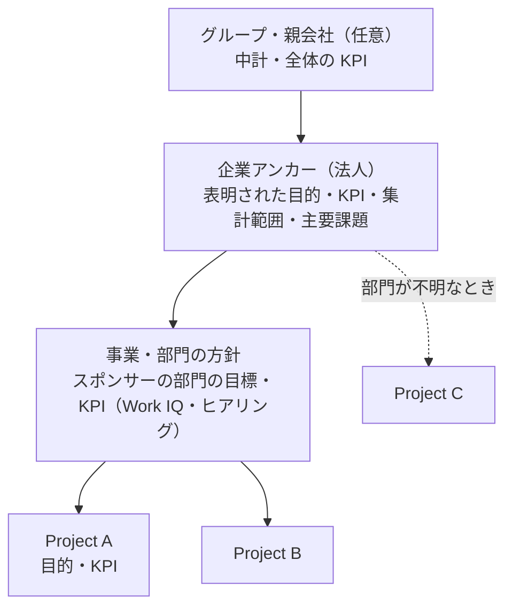
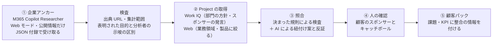

# 企業アンカーと Project の整合：仮説の監査・分析・妥当性評価

監査日: 2026-11-12。対象: 利用者の仮説（下記）、Microsoft 365 Copilot 用の企業分析プロンプト（`work/company-analytics-prompt.md`）とその実行結果（`work/company-analytics-result.md`。どちらも git 管理外）、BAS の企業・Project・顧客パック生成の現行実装。

顧客の個人情報や社内情報は扱っていない。結果ファイルは公開情報に基づく分析だが、どの顧客と取引しているかが分かるため、本書では対象を「サンプル企業A」（自動車部品メーカー、親会社の完全子会社で非上場）と表記する。結果に書かれた企業の事実（売上・沿革など）が正しいかは、本監査では確認していない。

## 0. 監査の前提（深掘りの 4 点と書き直した依頼）

1. **専門家が追加で行うこと:** 仮説を、検証できる小さな主張（H1〜H4）に分ける。それぞれ、支持する根拠と反証を集める。「企業目的に沿っている」と判定する仕組みには、何でも沿っていると判定してしまう危険がある。そこで「沿わない」と正しく判定できるか（判別力）を確かめる。あわせて、整合を測る単位（法人・グループ・事業・部門）と、金額を比べるときの分母がずれていないかを点検する。
2. **最も生の素材:** 添付のプロンプト原文と結果原文。BAS の [企業・Project の状態](../src/state/projects.ts)、[パック生成](../src/modules/project/packGenerate.ts)、[Work IQ の検索内容](../server/workiq.ts)、[パックのスキーマ](../src/data/schema.ts)、[既存の取得範囲監査](customer-pack-coverage-audit.md)、[決定ガイド §0.3](decision-guide.md)。
3. **手法とツール:** 仮説の分解と反証の探索、実装コードとの突き合わせ、結果ファイルの欠落の計測（文字数・章の有無）、戦略展開の既存手法との比較（方針管理〈Hoshin Kanri〉の X マトリクスとキャッチボール、OKR の cascading と alignment の違い、Mintzberg の創発的戦略）、LLM の迎合（sycophancy）に関する研究。
4. **第三者による検証:** 判定が正しいかは、最終的に顧客側のスポンサーが確認する。整合判定の仕組みは、過去案件（結果が分かっているもの）と、わざと無関係にした Project（負の対照）で評価する（§8）。本監査では顧客への問い合わせ、M365 Copilot や Work IQ の実行、外部への送信は行っていない。

**書き直した依頼:** 「顧客パック作成を 2 段階に分ける仮説を監査する。第 1 段で企業単位の戦略分析（公開情報。M365 Copilot で実行）を一度だけ取得する。第 2 段で Project ごとに Web と Work IQ で取得し、Project の目的を企業の目的に照らして紐付け、妥当性を確認する。H1 企業分析の有用性、H2 取得経路の分担、H3 『必ず沿わせる』という規則、H4 妥当性チェックとしての効果、の 4 つに分け、それぞれを根拠と反証で評価せよ。BAS の現行実装との差、添付結果の品質、リスク、修正した設計案、第三者が検証できる評価計画を示し、未確定事項を明記せよ。」

## 1. 結論

仮説の方向性は妥当で、BAS の現状の弱点を正しく突いている。ただし「必ず沿わせる」という規則と「Copilot の結果文をそのまま使う」という取得方法は、そのままでは逆効果になりうる。次の 3 点を修正すれば採用を勧める。

| 仮説 | 判定 | 要点 |
|---|---|---|
| H1 企業単位の大きな分析があると、顧客分析に役立つ | **支持** | 現在の BAS の企業情報は「業種・公式サイト・メモ」だけで、企業の目的・KPI・課題を持っていない。Project の課題・KPI を位置付ける基準がない |
| H2 企業は M365 Copilot の分析結果、Project は Web と Work IQ で別々に取る | **条件付き支持** | 企業分析を 1 回だけ取って全 Project で使い回すのは、費用と一貫性の両面で合理的。ただし、①添付の貼り付け文は、主要示唆・中計・課題・To-Be・KPI の本文がなく、完全性を検査できる形での受け取りが必要。②会社が表明した目標と、AI による提案を分けて保存する必要がある。③企業単位でも Work IQ（顧客の経営層が自社に話した優先事項）が強い根拠になりうる |
| H3 Project の目的を企業の目的に「必ず」沿わせる | **修正して支持** | 「必ず沿わせる」と、LLM はどんな Project にも理由を作ってしまう（迎合）。法令対応・保守・現場発の取り組みは、企業目的に無理に結び付けられる。正しくは「**必ず照合し、整合の強さと根拠を記録する。紐付かないものは『未整合』として人が判断する**」 |
| H4 企業と Project の妥当性チェックに効果的 | **支持（問いを出す道具として。合否の判定器としては不可）** | 「それは会社の何の役に立つのか」を顧客に問う材料としては非常に有効。ただし大企業の中計は抽象度が高く（例:「DX」「製造革新」）、ほぼ全 Project が「整合」と判定されて判別力を失う。事業・部門の層を挟む必要がある |

**最重要の修正 3 点**

1. **顧客が表明した目的と、AI の推定を分ける。** Project の整合を確かめる基準は、顧客自身が表明した目的・KPI に限る。表明には、公表資料（中計・IR）と、顧客のスポンサーや経営層が自社に述べたことの記録（会議メモなど。出典あり）の両方を含める。AI が作った To-Be や戦略提言を基準にすると、AI の仮説で AI の仮説を正当化することになる。
2. **3 層にする（企業 → 事業・部門 → Project）。** 企業全体の方針だけでは判別力が足りない。Project のスポンサーがいる部門の方針（Work IQ、顧客ヒアリング）を中間に置く。
3. **整合は「強制」ではなく「判定と根拠の記録」にする。** 「直接寄与／間接寄与／基盤／守り・義務／未整合」に分類する。必須にする根拠は分類によって変える（直接寄与なら KPI のつながり、守り・義務なら規制やリスクの出典、未整合なら紐付かない理由）。「未整合」は異常ではなく、顧客との対話（キャッチボール）を始める合図として扱う。

**利用者決定（2026-11-12）:** §9 に記録した U-1〜U-7 の推奨を採用する。整合判定の主な合格目安は、負の対照 Project の 90% 以上を「未整合」と判定すること。C-03 については、企業アンカーの利用と AI による整合案という本レポート記載の用途を許可し、実装に反映する方針が承認された。これは本用途を C-03 に追加する承認であり、未列挙のデータ・提供者・目的への包括的な送信許可ではない。C-03 の行、送信内容、接続先、費用条件、実行前確認を運用でも確認してから接続する。報告書の更新自体は外部送信を行わない。実装状況は §9 を参照。

## 2. 仮説の分解

| ID | 主張 | 反証になる観察 |
|---|---|---|
| H1 | 企業単位の分析（事業構造・戦略・KPI・課題）があると、Project の分析の質が上がる | 企業分析を加えても、Project の課題・KPI・施策の選び方が変わらない |
| H2a | 企業分析は企業に 1 つ。全 Project で再利用できる | Project ごとに必要な企業情報がほとんど異なる |
| H2b | 企業分析は M365 Copilot（公開情報）で取得するのが適している | 結果が欠落する、出典を確かめられない、古くなる |
| H2c | Project は Web と Work IQ で別に取得する | Project 単位の Web 調査が企業分析と重複するだけになる |
| H3 | Project の目的を企業の目的に必ず沿わせる | 価値のある Project が企業目的に紐付かない。紐付けが恣意的になる |
| H4 | 企業と Project の整合の確認は、妥当性チェックとして効果がある | 判定がほぼ全部「整合」になる。人の判断と一致しない |

## 3. BAS の実装前の状態との突き合わせ

以下は機能を実装する前の調査時点の状態である。実装後の状態は §9 を参照。

| 観点 | 現状（根拠） | 仮説との差 |
|---|---|---|
| 企業の情報 | `CompanyProfile` は `officialUrl`・`industry`・`notes` だけ（[projects.ts](../src/state/projects.ts)） | 目的・KPI・事業構造・集計範囲・出典を持たない |
| パックの企業 | `company: { name, industry }` だけ（[schema.ts](../src/data/schema.ts)） | 企業の戦略を表す項目がない |
| パック生成の入力 | 企業名・Project 名・目的・基準日が必須。プロンプトの「対象」は企業・Project・目的・基準日・業種・公式サイト・重点（[packGenerate.ts](../src/modules/project/packGenerate.ts) の `scope`） | 企業の目的が入力に含まれない。Project の目的は自由記述で、照合されない |
| 企業の基盤の作り方 | Project ごとに、公式サイト・ニュース・Work IQ を取り直す。段階 A で拠点・製品・顧客・仕入先・人物を毎回作る | 同じ企業の Project 間で基盤の値がずれうる。取得と生成の費用が Project の数だけかかる |
| Work IQ の検索 | 8 区分（組織・KPI・業務・データ・拠点・人物・案件・課題）に加え、現在の変更中の実装は不足項目ごとの複数検索を計画・統合する（[workiq.ts](../server/workiq.ts)、[workiqCli.ts](../server/workiqCli.ts)）。企業名と Project 名を手掛かりにするが、会社の経営方針・中計を独立して取得する設計ではない | 企業・部門の目標を体系的に集める検索項目がない。顧客が自社に表明した目標は人が出典付きで入力するか、専用の取得項目を追加する |
| 整合の確認 | Project どうしの「同じ課題・依存・相関」と、同じ業務課題の警告・統合だけ（PARAM-150〜154。[03-projects.md](../users-guide/03-projects.md)） | **横（Project 間）の確認はあるが、縦（企業 → Project）の確認はない** |
| 外部送信の扱い（手作業の経路） | M365 Copilot にプロンプトを貼って作る経路では、公開 Web 調査は社内データのない Web モード、社内資料を使う作成は Web 検索オフ、の 2 段階（FR-308） | 企業分析は公開情報だけなので、1 段目にそのまま合う |
| 外部送信の扱い（アプリ内の経路） | アプリ内の生成は、中継プロセスが公式サイトとニュースを取得し、Work IQ の回答（Microsoft Foundry のときだけ）・添付資料と合わせて、段階 A・B の両方に渡す。送ってよいデータは C-03 の `packBuild` の行に列挙され、「それ以外はアプリから送らない」と定められている（[policy.ts](../src/ai/policy.ts)） | 調査時点では企業アンカーと整合案は許可範囲に含まれていなかった。利用者の承認後、送信項目・提供者・実行条件・費用条件を C-03 とコードに反映した |

補足: 横の確認（同じ業務課題の警告）は、決まった計算で、生成 AI を使わず、同じ入力なら同じ結果になる設計である。縦の確認もこの方針に合わせると、説明しやすく、テストもしやすい（§7.4）。

## 4. 添付プロンプトと結果の監査

### 4.1 プロンプトの強み

- 情報源の優先順位（IR・有価証券報告書 → 中計 → 公的統計 → 調査会社 → 報道）と、事実・分析・示唆・仮説の区別を求めている。
- 章ごとに「根拠の十分性・不足データ・次の論点」を書かせており、BAS の取得報告（`extensions.collection` の不足項目と次の取得方法）と考え方が同じ。
- 「特定事業の深掘りはしない」として、企業全体の初期診断に範囲を絞っている。企業アンカーの目的に合っている。

### 4.2 結果の監査

| 発見 | 内容 | BAS で使う場合の影響 |
|---|---|---|
| **本文の大部分が欠落** | 結果ファイルは 4,259 字で、プロンプト（5,211 字）より短い。章見出しと「出典」の注記は残っているが、主要示唆（1.2）、経営理念・中計（2.3）、課題（3.6）、To-Be（4）、KPI（6.3）などの本文がない。「実行用に補強したプロンプト」も見出しだけ | 整合の確認に最も必要な中計・KPI・課題が、このファイルには残っていない。原因（コピー時に表や折りたたみが落ちた、応答自体が省略された、など）は、元の応答がないため特定できない。**完全性の検査（必須の章・項目がそろっているか）を通らない受け取り方は使わない** |
| 集計範囲の区別は優れている | 単体決算、ハーネス事業全体、親会社の自動車関連セグメントを分けている。「異なる範囲の数値を割って比べない」と明記 | Project の効果の大きさを評価するときの分母（単体の利益か、事業全体の売上か）を誤らないための重要な情報。企業アンカーの必須項目にすべき |
| 出典に URL がない | 「第165期決算公告」「中期経営計画説明資料」のように資料名だけで、URL・確認日・ページがない | BAS は出典に URL・確認日・位置を残し、数値が資料本文にあるかを照合する。資料名だけではこの照合ができない |
| 「企業」の単位が曖昧 | 非上場の完全子会社で、時価総額がなく、戦略の一部は親会社の中計にある | 「企業の目的」が子会社のものか親会社のものかを決めないと、照合の基準がぶれる。法人とグループの関係を持つ必要がある |
| 会社の目標と分析者の提案が混在 | To-Be・戦略提言・ロードマップは「本レポートの独自提案」と注記されているが、同じ文書に並んでいる | 取り込み時に区別しないと、AI の提案が「会社の目的」として Project の照合基準になる |
| 30 年の沿革に分量を割いている | 1990 年代以降の沿革と PEST・5 Forces・SWOT など、多くの章を求めている | 応答の長さには限りがあり、中計・KPI など照合に使う部分が圧縮されうる。沿革は整合の確認にはほとんど効かない |
| 自己申告の扱いは適切 | 市場シェアや従業員数の自己申告値・差異を「要照合」としている | そのまま取得報告の「partial」と不足項目に使える |
| 既存施策の出典が特定ベンダーの事例 | クラウド導入の効果は公開導入事例の試算 | 試算と実績の区別は守られている。提案する側の製品に有利な事例に偏らないよう、出典の種類を記録するとよい |

### 4.3 判定

プロンプトの設計は、企業アンカーの素材として質が高い。ただし、添付された形の結果は、照合に必要な部分が欠けていて素材として使えない。§7.5 の「機械で読める付録」を追加し、BAS は付録を検査（必須項目・出典 URL・集計範囲）してから取り込む。本文は人が読むレポートとして別に保存する。

## 5. 仮説ごとの妥当性分析

### H1 企業単位の分析は有用か — 支持

- **根拠（内部）:** 現在の BAS は、Project の目的を企業の文脈なしで扱っている（§3）。課題（issue）の `impact` は 1〜5 の評価で、企業の規模や重点と結び付いていない。
- **根拠（外部）:** 方針管理（Hoshin Kanri）は、3〜5 年の目的 → 年度目的 → 改善の優先事項 → 指標を 1 枚の X マトリクスでつなぐ。「どのチームも、何を改善し、それが会社にとってなぜ重要かを答えられる」ことを目指す手法である。PMI の 2014 年の調査では、戦略と強く整合していないプロジェクトが 58%、失敗した戦略施策が 44% と報告されている。
- **反証の観点:** 企業分析を加えても、Project のパックの中身（課題・KPI）が変わらなければ、効果は表示だけにとどまる。§8 の評価で、企業アンカーの有無によって課題の優先度や KPI の選び方が変わるかを測る。

### H2 取得経路の分担 — 条件付き支持

- **H2a（企業に 1 つ）は支持:** 1 社あたり最大 50 Project（PARAM-031）。今は Project ごとに企業の基盤を作り直しているため、企業アンカーを 1 回取得して共有すれば、費用が減り、Project 間で値が一貫する。
- **H2b（M365 Copilot・公開情報）は条件付き:** 公開情報だけを扱うので、FR-308 の 1 段目（社内データを使わない Web モード）に合う。Microsoft の説明によると、Researcher エージェントは複数段階の調査を行い、出典付きの構造化された報告を作るので、長い企業分析に向いている。一方で、①§4.2 の欠落、②URL がない、③鮮度（中計や決算で変わる）、の 3 点が条件になる。利用者は企業アンカーを顧客パック生成で使う C-03 の変更を承認した。実装では、`packBuild` の送信データに要約を明記し、整合案作成は別の用途として記録する（§9）。鮮度は日数（PARAM-004 の 30 日）だけでなく、「決算・中計・トップ交代の発表」をきっかけに更新するのがよい。
- **H2c（Project は Web と Work IQ）は支持。ただし役割を分ける:** Project 単位の Web 調査が企業分析と重複しないように、Project 側の Web は「その業務領域・部門・製品」に絞る。Work IQ は自社のテナント（メール・会議・ファイル）を検索する。Microsoft は Work IQ を「利用者が普段扱っているメール・ファイル・チャット・会議・人・案件など」と説明している。そのため Work IQ で分かるのは、顧客社内の資料ではなく、**自社が顧客について持っている情報**（顧客との会議メモ、提案、アカウントプラン）である。その中で、顧客の経営層・スポンサーが自社に話した優先事項は、公開の中計よりも Project の整合を強く裏付けうる。企業単位の Work IQ は第 1 段階では人が出典付きで入力し、自動検索を加える場合は今回承認された C-03 の範囲に検索対象・質問・渡す回答・提供者を明記する。既存の Work IQ 経路は Microsoft Foundry に限られるため、別の接続先に自動で拡張しない。

### H3「必ず沿わせる」 — 修正して支持

- **反証 1（迎合と後付けの理屈）:** LLM は利用者の意見に合わせた回答をしやすいと報告されている（Sharma ほか 2023）。「必ず沿わせよ」と指示すれば、無関係な Project にも説得力のある紐付けを作る。これは H4 の判別力を壊す。
- **反証 2（cascading の失敗）:** OKR の実務では、上位目標を下位に機械的に分解する cascading は、上位が変わると全体の作り直しが必要になる。支援・管理系のチームは、営業目標などに無理に結び付けられる。そのため、上位の少数の目的に各チームが自分で貢献を書く alignment が勧められている。「業務が運用中心のチームに OKR を強制するのは cascading の症状」という指摘もある。
- **反証 3（創発的戦略）:** Mintzberg は、意図した戦略と、現場の判断から生まれる創発的戦略を区別した。顧客が持ち込む Project が、まだ中計に書かれていない新しい方向を示していることもある。必ず沿わせる規則は、この情報を捨ててしまう。
- **反証 4（守り・義務）:** 法令対応、セキュリティ、老朽化した設備やシステムの更新は、中計の成長テーマに直接は結び付かないが、必要な Project である。
- **修正した規則:** すべての Project を企業の目的と**照合**する。結果を 5 つに分類する（§7.4）。「未整合」になったら、Project を却下するのではなく、顧客に「何の役に立つか」を確かめる質問を出す。

### H4 妥当性チェックとして効果的か — 支持（問いを出す道具として）

- **効く場面:** 「目的が書かれていない」「目的が企業のどの目標にも、部門の方針にも結び付かない」「KPI が企業の KPI につながらない」「効果が集計範囲に対して小さすぎる、または大きすぎる」は、決まった規則で検出できる。顧客との会話の材料として価値が高い。
- **判別力の問題:** 大企業の中計は「成長領域」「製造革新」「資本効率」のように抽象的で、ほとんどの Project が何かに結び付けられる。判別力がなければチェックとして意味がない。§8 で「負の対照（明らかに無関係な Project）を『未整合』と判定できるか」を必ず確かめる。
- **分母の問題:** サンプル企業Aでは、単体の営業利益率は約 0.5% と薄く、ハーネス事業全体（単体の約 2.2 倍の売上）とは集計範囲が違う。同じ効果額でも、どの分母で比べるかで重要度の印象が大きく変わる。比べるときは、企業アンカーに記録した集計範囲を必ず使う。
- **合否の判定器にしない:** 判定の最終責任は顧客側のスポンサーにある。方針管理のキャッチボールと同じく、上位の方針と現場の提案を往復させるための道具として位置付ける。

## 6. リスクと落とし穴

| リスク | 内容 | 対策 |
|---|---|---|
| 迎合・後付け | AI がどんな Project にも紐付けを作る | 紐付けには、顧客が表明した目的の ID と出典を必須にする。反証（沿わない理由）も同時に書かせる。負の対照で評価する |
| 抽象度 | 企業の方針が抽象的で、判別できない | 事業・部門の層を挟む。目的ごとに KPI の目標値を持たせる |
| 基準の混入 | AI の To-Be・提言が「会社の目的」として使われる | 目的に表明の種類（`published` 公表資料／`customerStated` 顧客が自社に述べた記録）を付け、`analystHypotheses`（分析者の示唆）と分けて保存する。照合には表明された目的だけを使う |
| 単位・分母のずれ | 子会社か親会社か、単体か連結か | 企業アンカーに法人の範囲と集計範囲を持たせる。効果の比較では同じ範囲の数値だけを使う |
| 鮮度 | 中計の改定・トップ交代で基準が変わる | 基準日を記録し、決算・中計の発表をきっかけに更新する。古い基準での判定には警告を出す |
| 指標の歪み | 「整合度」が目標になり、目的の書き方を整えるだけになる | 整合度を数値の点数にして順位付けしない。分類と根拠だけを表示する |
| 送信の境界 | 企業分析のチャットに社内情報が混ざる。アプリ内で、許可されていないデータを生成 AI に送る | 企業分析は公開情報だけで、Web モードの別チャットで行う（FR-308）。許可された用途の C-03 行に送信データ・提供者・有効条件・費用を記し、実行前に内容を示して確認を取る。実装状況は §9 を参照 |
| 費用と容量 | 企業分析をすべてプロンプトに入れると長くなる | Project の生成に渡すのは、表明された目的・KPI・集計範囲・主要な課題の要約だけにする（レポート全文は渡さない）。生成プロンプトの上限は 200,000 字（`PACK_BUILD_MAX_PROMPT_CHARS`） |

## 7. 推奨する設計（修正した仮説）

### 7.1 3 層のモデル



### 7.2 データ項目の案

**企業アンカー（企業に 1 つ。独立した文書に保存し、`CompanyProfile` に参照を持たせる）**

| 項目 | 内容 |
|---|---|
| `asOf`・`refreshTriggers` | 基準日と、更新のきっかけ（決算・中計・トップ交代） |
| `entityScope` | 法人名、親会社・グループとの関係、数値の集計範囲（単体／事業全体／連結） |
| `statedObjectives[]` | 顧客が表明した目的。`id`・本文・期間（中計の年度）・表明の種類（`published`／`customerStated`）・出典 ID |
| `companyKpis[]` | 表明された KPI。名前・目標値・期間・単位・集計範囲・出典 ID |
| `segments[]` | 事業セグメント・製品群（分かる範囲で売上・利益の寄与） |
| `structuralIssues[]` | 構造的な課題。`basis` で「会社が開示」と「分析者の推定」を区別 |
| `analystHypotheses[]` | AI・分析者の To-Be・提言。**照合の基準には使わない** |
| `sources[]` | URL・確認日・資料内の位置・出典の種類（一次・二次） |

**Project の整合（Project ごと）**

| 項目 | 内容 |
|---|---|
| `alignment[]` | 分類（§7.4）、`objectiveId`（企業または部門の目的。未整合では空）、寄与の道筋（直接・間接寄与のとき。Project の KPI → 企業の KPI）、根拠の出典 ID、紐付かない理由（未整合のとき） |
| `counterArguments[]` | 沿わない理由・前提が崩れる条件 |
| `confirmedBy`・`confirmedAt` | 顧客側で確認した人の役割と日付（氏名は必須にしない） |

### 7.3 取得の順序



- ① は企業に 1 回。取得したら、全 Project で共有する。
- ② の Work IQ の検索に企業アンカーの目的（`statedObjectives` の本文）を含めるか、回答のどの部分を後続の生成に渡すかは、新しい C-03 の行に明記する。利用者は本用途を許可したが、現行 Work IQ の利用条件（Microsoft Foundry 接続時のみ）や、現在実装中の複数検索・回答統合の範囲を自動的に拡張したものとは扱わない。
- ③ の決まった規則による検査は端末内で行い、外部に送らない。AI による紐付け案・寄与の道筋・反証は、利用者が C-03 への追加を許可済みである。用途専用の行と確認画面に、提供者・入力データ・費用・実行前確認を明示する。
- 段階 A（拠点・製品など）の企業の基盤も、企業アンカーを共有の入力として使い、毎回ゼロから作らないことを検討する。各 Project のパックは、その時点の写しとして今までどおり 1 つずつ保存すればよく、「顧客パックは Project に 1 つ」の設計は変えなくてよい。

### 7.4 整合の判定規則

| 分類 | 条件 | 必須の根拠 | 表示 |
|---|---|---|---|
| 直接寄与 | 企業または部門の表明された目的に紐付き、Project の KPI が企業・部門の KPI に数式または明確な因果でつながる | 目的 ID、両方の KPI、出典 | 緑。寄与の道筋を表示 |
| 間接寄与 | 目的に紐付くが、KPI のつながりが中間の指標を経由する、または定性的 | 目的 ID、出典 | 黄。中間の指標の確認を促す |
| 基盤（イネーブラー） | データ基盤・人材など、複数の目的の前提になる | 前提となる目的 ID（1 つ以上） | 青。どの目的の前提かを表示 |
| 守り・義務 | 法令・安全・セキュリティ・老朽化への対応 | 規制・リスクの出典（目的 ID・KPI は不要） | 灰。根拠となる規制・リスクを表示 |
| 未整合（要確認） | 上のどれにも当てはまらない、または根拠がない | 紐付かない理由 | 橙。顧客への質問を生成。却下ではない |

**決まった規則で行う検査（生成 AI を使わず、端末内で行う）:**

1. 目的が空でない。紐付けた `objectiveId` があれば、企業アンカーまたは部門の方針に存在する。
2. 分類ごとの必須の根拠（上の表）がそろっている。出典は、アプリが持っている資料の ID だけ。
3. 効果額と比べる分母が、同じ集計範囲・期間・単位の数値である。
4. 企業アンカーの基準日が古い、または更新のきっかけが発生している場合は警告する。

**AI に任せる部分（C-03 の用途専用行に基づく）:** 紐付けの案、寄与の道筋の文章、反証。利用者は用途の追加を承認済みで、送信機能と確認画面を実装している。AI の出力は案として表示し、分類を確定するのは人である。

### 7.5 企業分析プロンプトへの追加案

既存のプロンプトの「出力形式」の最後に、次を加える（本文のレポートはそのまま残す）。

```text
# 機械で読める付録（必須）
レポートの最後に、次の JSON を 1 つだけ出力してください。レポート本文に書いた事実のうち、
出典を確認できたものだけを入れます。推測は入れないでください。
{
  "asOf": "YYYY-MM-DD",
  "entityScope": { "legalEntity": "", "parent": "", "figuresScope": ["単体", "事業全体", "連結"] },
  "statedObjectives": [ { "id": "OBJ-1", "text": "", "horizon": "", "basis": "published", "scope": "legalEntity", "sourceIds": ["S1"] } ],
  "companyKpis": [ { "id": "KPI-1", "name": "", "target": "", "unit": "", "period": "", "scope": "", "objectiveIds": ["OBJ-1"], "sourceIds": ["S1"] } ],
  "segments": [ { "name": "", "revenue": "", "profit": "", "scope": "", "sourceIds": [] } ],
  "structuralIssues": [ { "text": "", "basis": "disclosed | inferred", "sourceIds": [] } ],
  "analystHypotheses": [ { "text": "", "type": "toBe | strategy | promisingArea" } ],
  "sources": [ { "id": "S1", "title": "", "type": "public", "provenance": "primary", "url": "https://...", "publishedDate": "", "accessedDate": "", "locator": "p.12", "excerpt": "" } ]
}
- statedObjectives と companyKpis には、会社が公表したものだけを書く。本レポートの提案は analystHypotheses に書く。
- 数値には必ず集計範囲（scope）を書く。範囲が違う数値を同じ項目に混ぜない。
- 出典には URL、確認日、一次・二次の区別と、数値を照合できる短い抜粋を書く。URL が分からない公開資料は使わない。
```

あわせて次も勧める。

- 実際の取込形式に合わせたプロンプトは、アプリの企業枠から取得する。上の空欄は見本であり、そのまま入力できる事実ではない。
- 30 年の沿革は「戦略の転換点だけ 5 件以内」に縮め、中計・KPI・課題に分量を回す。
- Researcher エージェントで実行し、受け取った後に必須の章と付録がそろっているかを確かめる。欠けていれば、欠けた章だけを追加で依頼する。
- この付録は公開情報だけなので `basis` は `published` になる。顧客が自社に述べた目的（`customerStated`）は、Work IQ やヒアリングの記録から BAS 側で追加する。

## 8. 検証計画（第三者による検証）

| 評価 | 方法 | 合格の目安 |
|---|---|---|
| 判別力（負の対照） | 実在の Project の中に、明らかに無関係な Project（例: 別業界のテーマ）を混ぜて照合する | **利用者決定（2026-11-12）:** 負の対照の 90% 以上を「未整合」と判定する。あわせて、負の対照を「直接寄与」と誤判定しないことを重大な失敗として個別に記録する |
| 人の判断との一致 | 結果が分かっている過去案件 10〜20 件について、仕組みの分類と、顧客側スポンサー・担当営業の分類（互いに見ずに付ける）を比べる | 一致率と Cohen の κ を記録する。κ ≥ 0.6 を参考目標とする。少数例なので信頼区間と件数も併記し、単独で合否を決めない |
| 判定の分布 | 1 社の全 Project の分類の分布 | 「直接寄与」が 80% を超える場合は、基準が抽象的すぎる疑いとして再点検する |
| 有用性 | 企業アンカーの有無で、パックの課題の優先度・KPI の選び方・顧客に出す質問がどう変わるかを比べる | 顧客との打ち合わせで、質問が採用された数を記録する |
| 取得品質 | JSON 付録の出典 URL が開けるか。KPI・セグメントの値が、出典の本文に同じ指標・期間・単位・集計範囲で書かれているか | 根拠のない値 0 件。既存の `ungroundedNumbers` はパックのエンティティの数値項目だけを対象にし、指標の意味までは照合しないため、企業アンカー用の照合（文字列の値から数値と単位を取り出し、指標名・期間・範囲も比べる）を新しく作る |
| 費用 | 企業アンカーを共有した場合と、今の Project ごとの生成とで、呼び出し回数と文字数を比べる | 2 件目以降の Project で減っていること |

決まった規則の部分（§7.4 の 1〜4）は単体テストで確認できる。AI の紐付け案は、上の負の対照と一致の評価で確認する。90% は負の対照を未整合と判定する割合の目標であり、Project 全体の 90% を企業目的に結び付ける目標ではない。

## 9. 決定事項と実施条件

利用者は 2026-11-12 に直前の推奨案を採用し、C-03 への本用途の追加を許可した。以下を本レポートの決定として扱う。

| 番号 | 決定 | 理由・実施条件 |
|---|---|---|
| U-1 | 企業アンカーは企業専用の別文書・専用スキーマに保存する。既存の `CompanyProfile` には参照先と版・基準日を持たせる | 出典、スナップショット、版ごとの検証状態を管理できる。業種・URL・メモ中心の企業プロフィールに大きな分析結果を詰めず、BAS の Project 顧客パック形式とも分離する |
| U-2 | 企業アンカーの基盤情報は共有の入力として使い、各 Project の顧客パックには生成時点の写しを保存する | Project ごとのデータ分離と「顧客パックは Project に 1 つ」を維持し、過去の生成結果を再現できる。実装はまず目的・KPI の照合を評価した後に行う。拠点・製品などの共有はその効果が確認できてから段階導入する |
| U-3 | 企業・部門の Work IQ 情報は初期段階では人が出典付きで入力する。自動取得は後続段階にする | 3 層モデルには顧客が表明した部門方針が必要だが、手入力なら追加の外部取得なしに開始できる。自動取得を追加する場合は、今回の C-03 承認を踏まえても質問・対象データ・回答の利用範囲・接続先を専用行と実装に明記する。Work IQ は現行決定どおり Foundry 接続時だけとする |
| U-4 | 親会社の中計もグループ層として含める。まず当該法人の目的と照合し、必要なとき親会社の目的を使ったことを明示する | 完全子会社では親会社方針が重要な場合がある一方、法人・連結・事業の集計範囲を同一視しないため。使用した階層と数値範囲を各判定に残す |
| U-5 | 「未整合」でもパック生成を止めず、警告と顧客への確認質問を提示する | 誤って有効な Project を止める損失を避ける。義務・保守や現場起点の新しい戦略を排除せず、最終判断は顧客側スポンサーに残す |
| U-6 | 負の対照の 90% 以上を「未整合」と判定することを主な評価目安とする | 利用者が 90% を決定。誤った「直接寄与」は重大な失敗として別に記録する。人との一致 κ ≥ 0.6 は参考目標、「直接寄与」80% 超は基準の抽象度を再点検する警告とし、少数データで機械的なリリース合否を決めない |
| U-7 | 企業アンカーの要約を `packBuild` の許可データに追加し、AI の Project 整合案は別の用途専用 C-03 行として実装する。決まった規則による検査と最終分類は端末内・人の確認で行う | 利用者が C-03 への本用途の追加を許可。`packBuild` は生成入力として渡す企業情報を明示し、整合案は目的・接続先・送信データ・費用・実行条件を独立して制御できるよう別行にする。実装済みの各行と画面の実行前確認を使い、許可範囲を確認する |

### 実施順序

1. **U-5・U-1:** まず判定を拒否ゲートにしないことを確定し、企業アンカーの版管理の土台を設計する。
2. **U-4:** グループ・法人・事業/部門・Project の階層と、数値の集計範囲を定める。
3. **U-7 の手動運用:** 公開情報の企業アンカーを人が検査して、Project の資料として添付する。これは本レポート記録時点の `packBuild` の既存入力範囲で試行し、追加の自動送信は行わない。
4. **U-6:** 負の対照とスポンサーの判断で評価し、90% の目標を測る。基準の曖昧さや欠落データがあれば、結果と分けて記録する。
5. **U-3・U-7 の自動化と U-2:** 評価後、許可された範囲の C-03 行・コード・実行前確認をそろえてから Work IQ、AI 整合案、基盤情報の共有を段階導入する。

### 実装状況と未検証事項

「全ての機能を実装」という追加依頼を受け、上の段階導入を待たずに、企業分析の取込・版管理、Project ごとの整合記録、AI 案、生成時の要約と版の写し、公開検索語の確認、および独立評価の集計を実装した。C-03 に `alignmentProposal` を追加し、`packBuild` の入力に企業分析を明記した。送信は接続設定と用途ごとの確認が必要で、実顧客データを使った外部接続や精度評価は実施していない。

- 企業・部門の Work IQ 情報は人が出典付きで企業分析に入力する。企業・部門を対象とした Work IQ の自動取得は実装していない。Project の Work IQ は既存の Foundry 専用経路で別に取得する。
- 入力された出典抜粋と項目名・値・期間・単位・範囲の文字照合を行うが、URL の到達性・原文の意味・真偽・因果関係は検証しない。数値の信頼性は原資料を読んだ人が判断する。
- 正解ラベルを独立評価者が付けた匿名ケースを画面に入力し、負の対照の未整合率、直接寄与への誤判定、通常案件の一致率・κ・直接寄与割合を計算する。負の対照は通常案件の分母に混ぜない。割合には 95% Wilson 区間、κ には独立した案件を仮定した 95% 漸近正規近似区間を表示する。完全一致など変動がない場合は κ の区間を算出せず、少数例・偏った標本では区間も不安定である。評価者の独立性は自己申告だけでは証明できず、標本の代表性も別途検討する。
- 負の対照 90% は事前に決めた**目安**であり、実案件の達成率ではない。少数例の点推定だけで合否を決めず、直接寄与への誤判定を別途確認する。
- 内部出典を含む企業分析から生成されたパックは、出典の紐付かない派生テキストを自動で安全に分類できないため、社外表示を停止する。生 JSON は全量バックアップとして扱う。表示切替はアクセス制御ではない。
- 企業分析の過去版は画面で表示・検査でき、編集して保存すると新しい最新版になる。整合と生成は常に最新版を使う。Project のバックアップには企業分析の全版と整合記録を含める。復元先に企業分析がある場合や同名の別企業へ統合する場合は既存の企業分析を優先し、持ち込んだ整合記録を未確定に戻す。独立評価ケースは別に出力する。
- 有用性・企業分析を共有した場合の費用削減・独立した顧客評価は、実データと第三者による検証がまだ必要である。

## 10. 出典

- Microsoft Support「What information does Copilot use to answer my prompt?」（Work IQ が扱う業務データ、Web、添付）: https://support.microsoft.com/en-us/microsoft-365-copilot/what-information-does-copilot-use-to-answer-my-prompt （確認日 2026-11-12）
- Microsoft Learn「What is Researcher Agent in Microsoft Copilot?」: https://learn.microsoft.com/en-us/microsoft-365/copilot/researcher-agent （確認日 2026-11-12）
- PMI「Bridging the chasm」（2014 Pulse of the Profession: 戦略と強く整合しないプロジェクト 58%、失敗した戦略施策 44%）: https://www.pmi.org/learning/library/2019/04/07/15/10/organization-change-in-profession-3832 （確認日 2026-11-12）
- Tability「Cascading OKRs vs. aligning OKRs」: https://www.tability.io/okrs/cascading-vs-aligning-okrs （確認日 2026-11-12）
- OKR Institute「OKR Cascading vs Alignment」: https://okrinstitute.org/it/blog-okr-cascading-vs-alignment/ （確認日 2026-11-12）
- Hoshin Kanri の X マトリクスとキャッチボール: https://symplprocess.com/learn/lm-hoshin-kanri （確認日 2026-11-12）
- Mintzberg の意図した戦略と創発的戦略: https://pressbooks.cuny.edu/principlesofmanagement/chapter/5-4-how-do-strategies-emerge/ 、https://online.hbs.edu/blog/post/emergent-vs-deliberate-strategy （確認日 2026-11-12）
- Sharma ほか「Towards Understanding Sycophancy in Language Models」arXiv:2310.13548: https://arxiv.org/abs/2310.13548 （確認日 2026-11-12）
- Zepeda-Tello ほか「The Delta-Method and Influence Function in Medical Statistics」arXiv:2206.15310: https://arxiv.org/abs/2206.15310 （漸近分散の方法。確認日 2026-11-12）
- Cohen の κ の信頼区間に関する独立した数値例（対称 2 分類、20 件で κ = 0.60、区間約 0.25〜0.95）: https://tagaroo.ai/blog/confidence-intervals-for-agreement/ （確認日 2026-11-12）
- BAS の内部資料: [customer-pack-coverage-audit.md](customer-pack-coverage-audit.md)、[decision-guide.md](decision-guide.md)、[requirements-definition.md](requirements-definition.md)（FR-137〜139・FR-308〜310・C-03）
