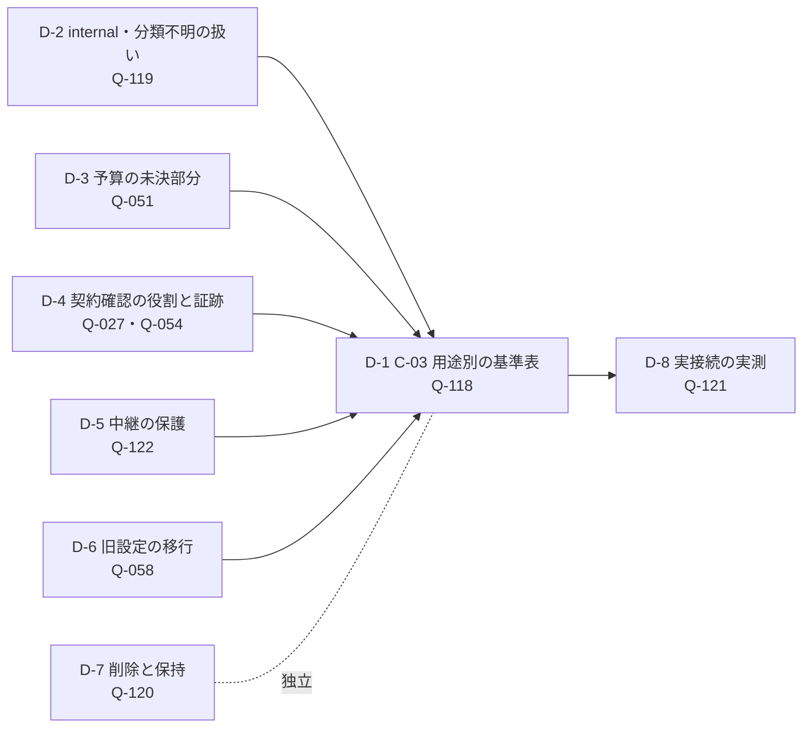

# 残タスクの判断資料

作成: 2026-11-09。根拠はすべて [要求定義書](requirements-definition.md) の原文（`L<行番号>`）と、このリポジトリのコード（`ファイル:行`）です。担当者の指名や「確認済み」の記録は、利用者や組織しか作れないため、この資料では作りません（Q-027 の回答 L1336「実際の担当者の指定・確認済み記録は創作しない」）。

## 0. 決定の記録（2026-11-09）

利用者の決定と、利用者から「論理的に良いものを選んで完了させる」と任された事項の、選択と実装の場所です。要求定義書の編集者は限定せず、承認条件と変更履歴を維持します。各決定の要求定義書への反映状況は下表に記載します。

**現行ポリシーへの注記（D-26）:** D-1〜D-25 に記録した用途ごとの送信許可・未許可判定や、送信直前の用途別確認は当時の判断履歴です。これらの同意・許可条件は D-26 で置き換えられました。予算、回数・サイズ上限、接続設定、要求ごとのデータ最小化と検証は引き続き有効です。

| ID | 決定 | 決めた人 | 既決事項への影響 | 実装 |
|---|---|---|---|---|
| D-1 | 段階的な許可の第 1 行「現状の説明（`explain`）× Microsoft Foundry」だけを許可。他の 15 行は、第 1 行の実測（D-8）と見直しまで TBD（D-9 で 1 行追加） | 利用者が AI に一任 | Q-118 に許可行が 1 行できる | `src/ai/policy.ts` の `C03_TABLE`、中継の転送（`server/relay.ts`） |
| D-2 | internal の情報も外部へ送ってよい | 利用者 | **Q-055（internal は Foundry に送らない、L1351）と Q-119 の一部を改める。** 社外向け表示での非表示（FR-002・FR-117）は変わらない。D-26 により、AI リクエストに含まれる人物情報を含むデータは AI 設定で一括同意できる | `src/ai/redact.ts`。各 AI リクエストに含める情報を最小化する |
| D-3 | 月の総予算は 100,000 円の 1 つの枠。後で変更する可能性がある | 利用者 | PARAM-117 と PARAM-120 を 1 つの枠にする（推奨の「内枠」ではなく、利用者の決定） | 設定画面で変更可。`AiRuntimeSettings.monthlyBudgetJpy` |
| D-4 | 契約・権利の処理は、アプリの起動前に済んでいる前提。画面に警告を表示する | 利用者 | Q-027・Q-054 の「確認・記録」はアプリの外で行う前提になる | AI の接続設定・実接続中のバナーに警告。送信時の確認画面は D-25 で廃止 |
| D-5 | 中継の保護を、Azure への展開に備えて変更できるようにする。既定は推奨の値。CSP を承認 | 利用者 | P-05 を既定値として採用。CSP の 2 つの例外（`style-src 'unsafe-inline'`、`img-src data: blob:`）を承認 | 環境変数（[relay-config.md](relay-config.md)）、`build/csp.ts` |
| D-6 | P-01（旧設定の非破壊の移行）を承認 | 利用者 | — | AI の接続設定の画面 |
| D-7 | P-03（削除と保持）を承認。推奨の保持期間（利用量の記録 13 か月、削除は明示操作だけ） | 利用者 | — | 設定画面の「データの保持と削除」、AI の接続設定の画面の記録の削除 |
| D-8 | P-04 と追加 2 点（操作ごとの判定の基準、測定中は他の負荷を流さない） | 利用者 | — | `src/config/measurement.ts`、`npm run measure`、`npm run kpi1`、[measurement-plan.md](measurement-plan.md)、性能試験の直列実行 |
| I-1〜I-6 | 推奨の選択肢 | 利用者が AI に一任 | — | 下の §4 の各行 |
| D-9 | 当初は `deliverableDraft` を独立した未承認用途とした。後の D-23 がこの用途に限って実接続を許可 | 利用者が AI に一任（選択肢の比較は §0.1）、後に明示許可 | 現在の条件は D-23 と §3.1 | `src/ai/policy.ts` の `C03_TABLE.deliverableDraft`、`src/modules/project/deliverableDraft.ts` |
| D-10 | サンプルの数値の食い違いは、KPI（担当者・出典・期間がある値）を正として文章の側を直す。再発を防ぐため、現状分析の自動判定に「数値の照合」を加える | 利用者が AI に一任（§0.1） | なし | `src/data/sample.ts`（issue-cash）、`src/modules/project/discussion.ts`（rec-demo-1）、`deliverables.ts` の `asis-reconcile` |
| D-11 | 投資回収の判定は構築期間を含め、上限は Project ごとに設定できる（既定 3 年はアプリの仮定と表示し、設定した人と日付を残す）。ToDo 帯を自動で開く条件は、画面の高さ 900px ではなく、固定の領域（開いた一覧を含む）が画面の高さの 35% 以内のとき | 利用者が AI に一任（§0.1） | なし | `deliverables.ts` の `paybackYears`・`paybackLimit`、`DeliverablesScreen.tsx` の「判定の基準」、`deliverablesUi.tsx` の `shouldAutoExpand` |
| D-12 | **利用者の決定（2026-11-10）。** Projectパックをアプリ内で生成AIに作らせる用途 `packBuild` を、設定済みの接続先（Azure の Microsoft Foundry、または GitHub Copilot）で許可する。費用は月 100,000 円まで（D-3 の 1 つの枠） | 利用者（依頼「設定済みのLLM(AzureもしくはGitHub Copilot)を使ってください」「予算は100,000円/月まで許可します」） | C-03 の許可行が 2 行になる（`explain`・`packBuild`）。`explain` は Foundry だけのまま。§3.1 への行・FR-311・PARAM-145〜149 の正式な反映は未完了（下の §0.2） | `src/ai/policy.ts` の `C03_TABLE.packBuild`、`src/modules/project/packGenerate.ts`、`PackGenerateDialog.tsx`、中継（`server/relay.ts`・`copilot.ts`・`site.ts`） |
| D-13 | **2026-11-11、利用者の接続設定改善依頼に基づく実装判断。** Foundry の `connectionTest` を固定の合成文だけで許可し、応答を検証してから保存する。顧客・Project・資料は送らない。API キー・単価・費用への同意を先に用意し、出力 256 トークン、30 秒、5 秒間隔、本日 30 回、D-3 の共通予算の範囲とする | 利用者の依頼「Microsoft Foundryに接続ができない設定を入力しても意味がないので、アプリケーションのLLM接続設定を変更してください」に対する実装判断 | C-03 の許可は `explain`・`connectionTest`・`packBuild` の 3 行。テストは設定の専用経路だけで行い、任意の文の送信には使えない。§3.1 への反映は未完了 | `src/ai/foundry.ts`、`settingsStore.ts`、`AiConnectionForm.tsx`、`server/relay.ts`。旧保存値は非破壊で「接続未確認」とし、キーまたは設定の変更で検証を無効にする |
| D-14 | **利用者の決定（2026-11-11）。** 「Copilot で作成」（FR-311・`packBuild`）で、接続先が **Microsoft Foundry のときだけ** Microsoft Work IQ から社内情報を取得して資料に加える。BAS（中継プロセス）が Work IQ の REST API（`https://workiq.svc.cloud.microsoft/rest/conversations` → `/{id}/chat`、Web のグラウンディングは無効）を直接呼ぶ。認証は利用者のアプリの登録（パブリック クライアント、委任 `WorkIQAgent.Ask`）によるデバイス コードのサインインで、リフレッシュ トークンは中継の暗号化保管庫だけに置く。Work IQ へ送るのは企業名・Project 名・目的・重点・基準日から中継が作る固定の質問 1 回。回答と引用は `internal`・`origin: m365` の出典 `source-workiq-1` として Foundry に送る。GitHub Copilot SDK のときは画面に出さず、中継も拒否する（`foundryOnly`。2026-11-19 の追記で変更）。失敗は生成記録に残して作成を続ける。**追記（利用者、2026-11-11）:** テナントがカスタム アプリへの管理者の同意を出せない制約は変えられないため、既定の接続方法を **Microsoft の Work IQ CLI（`@microsoft/workiq`）をローカルの MCP stdio サーバーとして中継が起動する方式**にする。CLI 自身のサインイン（Microsoft 公開のクライアント、Windows の WAM）を使い、読み取り専用の `retrieve`（strategy `grounding`）だけを呼ぶ。EULA への同意は利用者が画面で行い、BAS は代行しない。REST のアプリ登録方式は選択肢として残す。**追記（利用者、2026-11-19）:** 接続先が **GitHub Copilot SDK のときも** Work IQ を使える（Copilot では必須ではない。Foundry では従来どおり必須）。**追記（利用者、2026-11-19 第 2 回）:** Copilot でも、Work IQ の取得を設定・検証済みなら作成ダイアログの選択は既定でオン（Foundry と同じ。Project ごとに前回の選択を引き継ぎ、外せば Work IQ なしで作成できる）。選択の文言で回答と引用が GitHub Copilot に送られることを示す。根拠: 同じ Project・同じモデル（claude-sonnet-5.5）で、Work IQ なしの作成は分析の準備 8 項目中 1、Work IQ CLI ありは 8 項目中 8（KPI 4 件すべてが Work IQ の出典付き。§15）。取得は Foundry と同じく中継が固定の質問で行い、回答と引用は `internal`・`origin: m365` の出典として GitHub Copilot（`api.githubcopilot.com`）に送る。Copilot のエージェントに Work IQ の MCP/プラグインを道具として渡す方式は、実測（docs/workiq-agentic-retrieval-study.md §14）で 20 KB を超える `retrieve` の結果が一時ファイルに逃がされて読めない・`ask` は許可が必要・回答に引用が残らない・実行ごとに挙動が変わるため採らない。あわせて、BAS の Copilot セッションでは利用者の MCP サーバー・プラグイン（Work IQ を含む）を名前で無効にし、Work IQ は中継経由だけで届く。中継は他の接続先を `providerNotAllowed` で拒否する | 利用者（依頼「WorkIQを利用できるように実装をしてください」「Microsoft FoundryをLLMのプロバイダーとして選択した場合のみ有効」「直接なんらかのWorkIQのAPIやAgentを呼び出してもOK」「この制限は変えられません。他にBusiness Analytics Studioから、WorkIQを使う方法を調査して、実装をしてください」「GitHub CopilotでもWorkIQのプラグインを設定していたら、WorkIQへ問い合わせができるかを調査してください。もし、そうだとしたらGitHub Copilotも利用できると思います」） | `packBuild` の送信データに Work IQ の回答（internal、D-2 の範囲）が加わる。Work IQ の費用（Copilot Credits または Microsoft 365 Copilot のライセンス）はアプリの予算に含まれない。CLI 方式では CLI 自身の外部接続を `BAS_RELAY_OUTBOUND_HOSTS` で強制できない。CLI の `research`（`scripts/lib/research.ts`）の WorkIQ は従来どおり BLOCKED。§3.1・FR-311 への反映は未完了 | `server/workiq.ts`、`server/workiqCli.ts`、`server/relay.ts`（`/relay/workiq*`）、`server/vault.ts`（`workiqRefreshToken`・`workiqCliKey`）、`src/ai/policy.ts` の `WORKIQ_SOURCE`、`packGenerate.ts`、`PackGenerateDialog.tsx`、`AiConnectionForm.tsx` の `WorkIqSettings` |
| D-15 | **利用者の決定（2026-11-12）。** Projectパックの作成は、時間が多少伸びても、利用者の 1 回の操作で分析に必要なデータがそろって終わることを優先する。計測（[docs/workiq-agentic-retrieval-study.md](workiq-agentic-retrieval-study.md) §9）に基づき、`packBuild` の出力上限を 16,000 → 32,000 トークン（段階の回答が 15,525 トークンまで使っていた）、1 回の送信のタイムアウトを 300 → 600 秒、1 回の作成の送信回数の上限を 14 → 15（失敗または JSON のない回答の再送 2 回を含む）、Work IQ の追加取得の質問を 1 回 4 → 8 件、追加取得の資料を 36,000 → 48,000 文字、Work IQ CLI の項目ごとの資料を 6,000 → 9,000 文字、Work IQ の一時的なエラーの再試行を 1 → 2 回にする。どの送信も中継の文字数（200,000）とアプリの推定トークン（100,000）の上限に収まるよう、資料の本文を必要なときだけ比例して短くする | 利用者（依頼「Projectパックの作成の時間が多少伸びてもいいので、必要な情報を1度の私のアクションで、完了させることを優先します。クエリの回数やタイムアウトの待ち時間などを増やしてもいいです」） | 1 回の作成の最大費用の表示が増える（出力上限の 2 倍・送信 1 回分）。入力上限 100,000 トークン・1 日 64 回・月の予算（D-3）は変えない。1 日の残り回数がこの作成の最大回数に足りないときは作成画面に警告を出す。§3.1・PARAM-147〜149 への反映は未完了 | `src/ai/policy.ts`（`PER_USE_LIMITS.packBuild`・`PACK_BUILD_MAX_CALLS`・`PACK_BUILD_TIMEOUT_MS`・`PACK_BUILD_MAX_PROMPT_CHARS`・`WORKIQ_ITEM_MAX_CHARS`）、`packGenerate.ts`、`server/workiq.ts`（`MAX_WORKIQ_TOPICS`）、`server/workiqCli.ts`、`PackGenerateDialog.tsx` |
| D-16 | **選択肢 E を実装（2026-11-12、利用者の実装依頼に基づく）。** 分析に必要なデータの「案件・成果物・取り組み」は、社内の資料に金額・進捗がない（Work IQ の実測 55 件で金額 20%・進捗 0%）ため、案件・成果物・施策のエンティティでは埋まらない。OKR（`OkrExtension`）と同じ形の任意の拡張 `extensions.engagements`（名前・種類・期間・顧客・状態・担当・回数・結果を原文どおりの文字列で持ち、数値を必須にしない。各項目に出典）を加え、充足はこの一覧と案件・成果物・施策の合計で数える。金額・進捗まで資料にあるものは従来どおりエンティティにする。比べた選択肢: 何もしない・数え方だけ変える・数値を任意にする・施策だけ緩める・新しいエンティティ種別・資料の添付。詳細と論理は [engagements-readiness-decision.md](engagements-readiness-decision.md) | 利用者の選択一任と、その後の実装依頼 | 過去の標本では 89% を数値を作らずに表せる見込み。既存の数値の必須条件と計算は変えない。合成データの日英生成テストで 8/8 を検証。実サービスでの再計測は未実施（同文書 §11）。要求・受入条件は [要求定義書 §3.11](requirements-definition.md#311-Projectパックの実施記録) に反映済み | `src/data/extensionSchemas.ts`、`src/data/verify.ts`、`packGenerate.ts`（生成規則・部分修正・項目ごとの除外）、`analysisReadiness.ts`、`EngagementsPanel.tsx`（社外表示では非表示）、`docs/pack.schema.json`、日英の取り込み用プロンプト |
| D-17 | **利用者の決定（2026-11-12）。** [企業と Project の整合調査](company-project-alignment-study.md) の U-1〜U-7 を採用し、企業アンカーと整合案の C-03 用途追加を許可。既存の `packBuild` と同じ設定済み Foundry／Copilot SDK を使い、整合案は別行・別確認とする。Project の公開ニュース検索は既存の Google News RSS を使い、利用者が公開可能と確認した検索語だけを追加する | 利用者（「推奨案を採用」「C-03を許可」「全ての機能を実装」） | 企業データは版付きで共有、Project パックには写しを保存。Work IQ にアンカーを送らず、企業・部門の目標は人が出典付きで入力。負の対照 90% は評価目標であり、合成試験だけで実運用の精度を確定しない | `src/data/companyAnchor.ts`、`src/state/companyAnchors.ts`、`src/modules/project/companyAlignment.ts`、`src/ai/policy.ts` |
| D-18 | **利用者の決定（2026-11-12）。** Projectパックの作成中、検査済みパックと資料を使って SWOT・ファイブフォース・バリューチェーン・3C・バランスト・スコアカードの全手法を生成AIで分析し、Project 別の分析データとして保存する。分析画面を開く操作は保存済み結果の閲覧だけとし、分析を再実行しない。追加送信は回数・費用見積もり・同意・進捗・利用記録に含める | 利用者（依頼「[Projectパック]を作成するプロセスで、`分析`画面にある全ての項目について分析を実行するステップを追加してください。画面を開いたら、分析を始めるのではなく、分析結果を閲覧できるようにしてください。」および分析方法の選択「ai」） | `packBuild` の許可範囲内で検査済みパックと取得資料を再送。人が確認できる画面で結果を開き、既存の分析編集・再計算は維持 | `src/modules/project/packGenerate.ts`、`PackGenerateDialog.tsx`、`AnalysisScreen.tsx`、`src/ai/policy.ts`、`tests/pack-generate.test.ts`、`e2e/ai.spec.ts` |
| D-19 | **利用者の決定（2026-11-12）。** 外部調査を承認する。ただしこの承認は公開 Web の公式サイト調査に限定する。利用者が明示入力した HTTPS URL を入口とし、その公開サイト内の HTML ページだけを最大 6 ページ読み取り、URL・取得日時・本文をローカルの調査キャッシュへ記録する。顧客名や社内情報を検索語として送らず、検索エンジン・Work IQ・生成 AI による追加調査やロゴ画像の自動取得は許可しない。サイトの利用条件と知財の許諾は利用者が確認する | 利用者（明示回答「外部調査を承認します。」） | `--official-url` が指定された場合だけ実際に取得する。生成 AI の `brandResearch` 用途は C-03 未承認のまま。ロゴ画像は別途利用者の許諾チェックと手動選択／パック内画像が必要 | `scripts/lib/research.ts`、`scripts/bas.ts`、`server/site.ts`、`docs/integration-catalog.md`、`tests/ops-pipeline.test.ts`、`tests/pack-generate.test.ts` |
| D-20 | **利用者の決定（2026-11-12）。** 議論画面の「AI に提案を依頼」（FR-050・`recommend`）を、設定済みの接続先（Microsoft Foundry、または GitHub Copilot SDK）で許可する。送るのはテーマ名、テーマに関係する項目（internal を含む、D-2。人物は FR-219 の確認後）、テーマの添付ファイル（テキストは依頼の文に入れ、32,000 文字に収まるよう短くする。画像・PDF は選んだモデルが読める形式だけをファイルとして送る）。他のテーマ・記録・アプリ内のデータは送らない。送信ごとに、項目数・社外秘と人物の件数・送る添付と送らない添付・概算費用を確認してから送る。上限は 1 日 30 回、5 秒間隔、入力 48,000 トークン（推定）、出力 4,000 トークン（出力には推論分が含まれ、短い 5 行の提案で 1,494 トークンを実測したため）、90 秒、D-3 の共通予算。応答は「AI 提案」として記録し、決定にするのは利用者の操作だけ（FR-050） | 利用者（明示回答「`**要判断**`: 承認します。」） | C-03 の許可行が 5 行になる（`recommend`・`explain`・`connectionTest`・`packBuild`・`alignmentProposal`）。Foundry の実請求は不明で予算で制限されない | `src/ai/policy.ts` の `C03_TABLE.recommend`・`PER_USE_LIMITS.recommend`、`src/modules/project/mocks.ts`（`suggestionRequest`・`parseSuggestions`）、`DiscussionScreen.tsx`、`src/modules/ai/AiCommon.tsx`（添付の確認）、`server/relay.ts`（専用の指示文・文字数） |
| D-21 | **本会話の依頼に基づく実装判断（2026-11-13）。** 経営・KPI/OKR・Project の結び付け、貢献のシミュレーション、解決策の種類ごとの成果物（FR-312〜FR-316）は、端末内の決定的な計算（種付きの乱数のモンテカルロ・鎖のデータからの文書の組み立て）だけで実装する。Azure の資源と GitHub Copilot SDK は利用が許可されたが、数値と結び付けを生成 AI に作らせると「値を作らない・数値に出典」の規則と C-03 の用途別の承認に反し、再現性も失うため使わない。新しい C-03 用途・外部送信・費用は発生しない（Azure の予算 10,000 円/月は未使用）。KPI/OKR の定義の取得は既存のProjectパック作成（`packBuild`・Work IQ）の指示に加えるだけで、送信先・回数は変えない | 本会話の利用者（依頼「Microsoft Azureのリソースを使用してよいです。GitHub Copilot SDKも使用してよいです」） | 定義案・成果物の文は人が仕上げる（【要記入】）。生成 AI による下書きは、別途 C-03 の用途の承認を得てから追加できる | `src/modules/project/strategy.ts`・`simulate.ts`・`solutionDocs.ts`・`StrategyPanels.tsx`、`src/data/kpiDefinition.ts`、[strategy-linkage-study.md](strategy-linkage-study.md) |
| D-22 | **本会話の依頼に基づく判断（2026-11-15）。** 段のダッシュボードのエグゼクティブサマリー（FR-319・`stepBrief`）を、設定済みの接続先（Microsoft Foundry、または GitHub Copilot SDK）で許可する。送るのは段の名前、その段のファクト台帳、ファクトが参照する項目（社外向けの表示では非表示の項目を除く。人物は送らない）、ルールベースのサマリーの文だけ。送信ごとに項目数・社外秘の件数・概算費用を確認してから送る。上限は 1 日 30 回、5 秒間隔、入力 16,000・出力 4,000 トークン、D-3 の共通予算。数値とグラフは決定的な計算のまま（D-21）で、AI は文だけを書き、その数値をファクト台帳と照合して台帳にない数値を「未確認」と示す | 本会話の利用者（依頼「［Copilotで生成］ボタンをつけていいです」） | C-03 の許可行が 6 行になる。取り消すときは `C03_TABLE.stepBrief` を未確定に戻せば、ボタンはルールベースの文を「モック」と表示するだけになる | `src/ai/policy.ts` の `C03_TABLE.stepBrief`・`PER_USE_LIMITS.stepBrief`、`src/modules/project/stepBrief.ts`・`StepBriefPanel.tsx`、`server/relay.ts`（専用の指示文） |
| D-23 | **本会話の依頼に基づく判断（2026-11-15）。** 成果物とタスクの提案 `deliverableDraft` に限り、設定済みの Foundry または GitHub Copilot SDK を使用する。送信内容・接続先・費用・自由文中の人物情報とデータ所有者の許可を毎回確認する。社外向けでは非公開項目とプロジェクト自由文を除く。出力はドラフトとして保存し、個別の承認まで確定しない。送信拒否・接続失敗・不完全応答をモックで代用しない。上限は 1 日 30 回、5 秒間隔、入力 16,000・出力 8,000 トークン、D-3 の共通予算 | 利用者（「モックではなく、実装をしてください。AzureやGitHub Copilotの予算を使うことを許可します。」） | 他用途は承認しない。Foundry の実請求は不明でアプリ予算により制限されない | `src/ai/policy.ts`、`src/modules/project/deliverableDraft.ts`、`src/modules/project/deliverablesUi.tsx` |
| D-24 | **利用者の依頼（2026-11-16）。** 旧概要を戦略概要へ置換し、全5段で目標→任意のKPI/OKR→課題→解決策の関係図・状況別の評価軸・次のタスクを示す。`strategyOverview` のAI送信を設定済みのFoundry／Copilot SDKで許可し、本文・関連付け・理由付き優先度・分析をドラフト化して人の確定後に反映する。元データ・作業先・表示対象・言語の変更時は再生成を要求する | 利用者（「Copilotで最適化」「ドラフト」「確定」およびAzure・Copilot各10,000円/月の許可） | D-21の決定的計算・実績数値非生成は維持。新規Azure資源は作らない。既知の利用料のみプロバイダー別10,000円/月または低いアプリ予算で確認し、不明料金・他アプリやAzure資源の請求を保証しない | `overviewModel.ts`・`StrategyOverview.tsx`・`packEdits.ts` のバッチ確定、`ai/policy.ts`・`ai/client.ts`・`server/relay.ts`。§3.12とC-03へ反映 |
| D-25 | **利用者の依頼（2026-11-16）。** 生成AIへの送信前に毎回表示していた確認画面を廃止し、AI設定で一度だけ、データと添付を送る権限を確認する。同意は端末に保存し、いつでも取り消せる。未同意・取消時は実送信を許可しない。提供者・接続先・モデルの変更時は同意を無効にする。 | 利用者（「Copilotなどにメッセージを送る際の、添付の警告画面は削除」「AIの設定時に、この承諾を1度で」） | 毎回の確認をなくす。個別用途審査は当時の C-03 に基づき残していたが、データ範囲と同意の解釈は D-26 で拡張。料金・提供者の説明は AI 設定で確認する | `settingsStore.ts`・`AiSettingsPanel.tsx`（AI 設定は `AiSettingsDialog` の 1 か所だけ。左のメニュー・起動画面・Project 管理・作成ダイアログ・各画面のリンクはすべてこのダイアログを開き、`/ai-settings` 画面は廃止して旧ブックマークはダイアログを開く。2026-11-16 利用者「AI設定が2つの画面から出来ることに大きな問題があります。どちらか一つにしてください」による）・`AiCommon.tsx`・`ai/client.ts`・`ai/policy.ts`、C-03 の条件、AI 送信 E2E |
| D-26 | **利用者の依頼（2026-11-16）。** AI 設定で一度同意した後は、AI 機能ごとの送信ルール・個別確認を設けず、各 AI リクエストに含めるデータの送信を一括で許可する。設定画面の同意文で、自由文や添付を含むリクエスト内容が選択した提供者へ送信されることを明示し、同意をいつでも取り消せるようにする。これは無関係な端末内データや接続資格情報をまとめて送る許可ではなく、技術上の用途別上限・予算・最小化・出力検証は維持する | 利用者（「最初に機微な情報などを送信することに同意しているという点で、全てのデータを送信することに合意したとみなします」） | C-03 の個別用途送信許可・送信確認は終了。接続設定、全体同意、実接続スイッチ、予算と技術上限のゲートは維持。要求ごとのデータ選択・社外向け除外・結果ドラフトの人による確定は維持 | `src/ai/gate.ts`・`src/ai/client.ts`・`src/ai/policy.ts`・`server/relay.ts`・`AiSettingsPanel.tsx`・AI 関連テスト |
| D-27 | **本会話の依頼に基づく実装判断（2026-11-17）。** Microsoft 365 Copilot の業務分析レポート（Markdown）の取り込み（FR-321）は、生成 AI に送らず端末内の決定的な読み取りで行う。レポートは社内（internal）・AI 作成の 1 件の出典とし、文は改変せず全段落を保持する。各段の判断支援の既定値はレポートの優先度・根拠ラベルからだけ付けて「レポート」と表示し、ないものは中立の 3 を「未評価」と表示する（値を作らない）。利用者の評価は Project ごとに端末に保存し、成果物の完了判定（ToDo）には使わない。レポートだけから作る要求定義書の草案も決定的に作り（記述のない箇所と関連は【要記入】）、解決策の鎖から作る FR-315 の成果物とその ToDo（`dlv-docs`）とは別に、保存できる草案として示す。取り込み時の推定（FR-322）も生成 AI を使わず、語の一致度・SMAA・試行のシミュレーション・種類の手掛かり語から決定的に推奨を作る。推奨には理由と見直す条件を付け、利用者が選ぶまで【推定】と示す。事実（基準値・根本原因・未決事項の答え）は推定しない | 利用者（「設定された範囲でAI機能を使用して良いです」）。AI を使わなくても読み取れる構造で、送信すると社内の文書を外へ出すことになるため、送信は既存の用途（`stepBrief` など、D-22・D-26）の範囲に留める | 新しい AI の用途・送信はない。社外向けの表示ではレポート由来の判断支援を出さない | `src/data/reportImport.ts`・`packImport.ts`・`extensionSchemas.ts`・`verify.ts`、`src/modules/project/decisionSupport.ts`・`DecisionSupport.tsx`・`reportRequirements.ts`・`reportDrafts.ts`・`stores.ts`（`proj.decision`） |
| D-28 | **本会話の依頼に基づく判断（2026-11-18、2026-11-19 補足）。** KPI/OKR のドラフト作成（FR-325・`kpiOkrDraft`）を、設定済みの Microsoft Foundry または GitHub Copilot SDK で許可する。候補の採用は Project の目的、既存の KPI/OKR、未採用の社内候補（合計 30,000 文字まで）を送り、ID・目標の文・理由だけを書かせ、数値は記載から決定的に入れる。不足分の作成は会社情報とパックの課題・原因・KPI の要約（最大 30 項目、各名前 120・説明 240 文字）も送り、根拠 ID と KPI 参照を検証する。新しい指標の数値・期限は空欄、出どころは保存・再編集後も「定義案」。パック・Project・保留中ドラフトにない種類だけを明示操作で提案し、既存項目を変えない。上限は 1 日 30 回、5 秒間隔、入力 16,000・出力 4,000 トークン、D-3 の共通予算。D-25 の設定時同意を使い、送信内容と概算費用を示す | 本会話の利用者（2026-11-18 のドラフト作成・編集・保存の依頼、2026-11-19 の「Projectパックの作成後に、KPI/OKRが無い場合に、ドラフトのKPI/OKRを作成する機能」の依頼） | 新しい AI 用途・接続・設定画面は増やさない。実接続・同意・予算の既存ゲートを使う。未取得は未定義と断定しない。人物エンティティ・添付・パック全体は送らない | `src/ai/policy.ts`、`src/modules/project/kpiAdopt.ts`・`KpiAdoptUi.tsx`・`stores.ts`（`proj.kpiDrafts`）、`server/relay.ts`。検証: `tests/kpi-adopt.test.ts`・`e2e/kpi-adopt.spec.ts` |
| D-29 | **本会話の依頼に基づく実装判断（2026-11-18）。** ［リソースの最適化］（FR-326）は、業種を決定的な辞書で分類し（AI に推定させない）、業種共通の最小費用流（人→仕事、拠点→地域）で厳密に解く。説明文は計算した事実から作り、出どころ（パック・算出・仮定・シミュレーション）の印を付ける。AI の説明は新しい用途を作らず既存の `explain`（Microsoft Foundry）で、画面に出した事実の文だけを送り、人物名は「担当者n」に置き換える（FR-219 の確認を経ないため）。接続がなければ事実をそのまま示す | 利用者の依頼「AIを使用してよいです」に対する実装判断 | 説明が AI の誤りに左右されない。最適解は既存の輸送問題の解・総当たりと一致することをテストで示す | `src/domain/resourceIndustry.ts`、`src/domain/resourceModel.ts`、`src/modules/resource/`、`tests/resource.test.ts`、`e2e/resource.spec.ts` |
| D-30 | **本会話の依頼に基づく実装判断（2026-11-18）。** FR-325 の［Copilotでドラフト作成］を、アプリと同じプロンプト・リレーの処理・実データで実モデル（Foundry・Copilot SDK）に送って測り（`scripts/kpi-draft-bench.ts`）、見つかった欠陥を AI に頼らず決定的に直す。(1) Azure のコンテンツ フィルターの拒否は旧形式で再試行せず `contentFiltered` として示す（再試行が `unsupported_parameter` で理由を隠していた）。(2) `kpiId` のない主要な結果は数値と語で社内 KPI に照合し（PARAM-174）、同じ指標のドラフトを重ねない。照合は誤ってつなぐより、つながずにドラフトを残す方を選ぶ。(3) プロンプトに既存 KPI の目標を含め、同じ指標を再び選ばせない | 利用者の依頼「実際のモデルでの品質は未確認: 調査をしてください」に対する実装判断 | FR-325 に AC-919・AC-920、PARAM-174 を追加。業務上の適切さは担当チームの判定に残す | 品質は自己申告でなく、Azure のエラーコード・保存した生の応答・規則による指標（候補 ID・上限・数値・重複・安定性）で判断。`server/relay.ts`、`src/modules/project/kpiAdopt.ts`、`tests/kpi-adopt.test.ts`、`tests/ai-relay.test.ts` |
| D-31 | **本会話の依頼に基づく判断（2026-11-19）。** Azure AI Speech・Azure AI Vision を Microsoft Foundry の MAI モデルの最新版に置き換えない。依頼の条件「MAI の方が性能が良い場合」を満たす根拠がないため。**音声合成（FR-080）:** 最新の MAI-Voice-2.1／MAI-Voice-2.1-Flash はプレビュー（SLA なし）で、別のサービスではなく Azure Speech の同じ API の「声の名前」として使う。対応 23 言語に日本語がなく、Japan East の Foundry リソースの音声一覧（2026-11-19 に実測）でも、MAI の声 289 件・26 ロケールのうち `ja-JP` は 0 件だった（Learn の言語表にある旧版の `ja-JP-Haruto:MAI-Voice-2-Flash` もこのリソースにはない）。日本語が主の本アプリで置き換えると、日本語の読み上げができなくなる。公開されている比較は英語だけで、聴取試験ではなく文字起こしからの推定。**手書き認識（FR-090）:** MAI には文字認識のモデルがない（MAI-Image は画像の生成・編集、MAI-Thinking-1 は文字の入力だけ）。音声認識の MAI-Transcribe-2 は、本アプリに音声認識の機能がないため対象外 | 利用者の条件付き依頼（「Azure AI SpeechやAzure AI Visionよりも、Microsoft Foundryで使えるMAI-xxの最新版の方が、性能が良い場合は…置き換えてください」）に対する判断 | FR-080・FR-090・FR-182・FR-328、設定画面、中継、接続確認は変えない。**見直す条件:** (1) 接続確認で使う音声一覧に `ja-JP` の最新の MAI-Voice が現れ、一般提供になる。(2) 日本語・英語の同じ台本で、現行の Neural／HD の声と盲検で聴き比べ（MOS／CMOS）、MAI が優ると示される。(3) Foundry に文字認識・手書き認識の MAI モデルが出る。音声合成は API が同じなので、条件を満たせば声の名前の変更で切り替えられる | 変更なし（文書だけ）。根拠: Microsoft Learn「MAI-Voice in Azure Speech」「MAI-Transcribe in Azure Speech」「Foundry Models sold by Azure」「Language and voice support for Azure Speech」と、`GET https://<名前>.cognitiveservices.azure.com/tts/cognitiveservices/voices/list`（中継の接続確認と同じ無料の要求） |
| D-35 | **本会話の依頼に基づく判断（2026-11-18）。** 事業効果のドラフト作成（FR-335・`valueDraft`）を、設定済みの接続先（Microsoft Foundry、または GitHub Copilot SDK）で許可し、AI が金額を含む下書きを作ることを認める。条件: (1) 金額には計算式と入力を必ず付けさせ、アプリが eval を使わずに再計算して最頻値と照合し、パックの値を名乗る入力は値と照合する（PARAM-188）。(2) 検算できない金額は「検算できない」と示して一括採用しない。(3) 下書きは人が採用するまで保存データを変えず、採用後も出どころ（計算式・入力・照合結果）を残す。(4) 資本コストは出典の本文に % で書かれているときだけ根拠ありとする。AI を使わない［ルールで下書き］を併せて置き、接続がなくても同じ検証で解決できるようにする。上限は 1 日 30 回・5 秒間隔・入力 16,000・出力 8,000 トークン、D-3 の共通予算、D-25 の設定時同意 | 本会話の利用者（依頼「［Copilotで最適化］や［Copilotでドラフト作成］などアプリケーションの中でAIを使ってでも、可能な限り各課題の項目をアプリケーション自身が解決をできるようにしてください」） | D-21 の「貢献の数値を生成 AI で作らない」を FR-335 の効果の下書きについて緩める（KPI への貢献の数値は従来どおり人が入れる）。C-03 に `valueDraft` の許可行が増える。取り消すときは `AI_USES` から `valueDraft` を外せば、ボタンは理由を示して送信せず、ルールの下書きは残る | `src/ai/policy.ts`（`valueDraft`・`PER_USE_LIMITS.valueDraft`）、`server/relay.ts`（`VALUE_DRAFT_SYSTEM_PROMPT`、JSON 応答）、`src/modules/project/valueModel.ts`（`valueDraftPrompt`・`parseValueDraft`・`evalFormula`・`ruleDraft`・採用）、`ValueResolve.tsx`、`tests/value-model.test.ts`、`e2e/project-value.spec.ts` |
| D-36 | **本会話の依頼に基づく判断（2026-11-18）。** 事業効果の数値の説明（FR-336・`valueExplain`）を、設定済みの接続先（Microsoft Foundry、または GitHub Copilot SDK）で許可する。AI は説明文だけを書き、図はアプリが計算と同じ中間の値から描く。AI に送るのはアプリが計算したファクト台帳・名前・ルールの説明だけで、文中の数値は台帳と照合し、ないものを「台帳にない数値」と示す。接続がないときは同じ台帳から端末内で作った説明をモックとして示す（FR-011）。上限は 1 日 30 回・5 秒間隔・入力 16,000・出力 4,000 トークン、D-3 の共通予算、D-25 の設定時同意 | 本会話の利用者（依頼「数値の根拠のメカニズムを経営者やビジネス面での意思決定者が理解しやすい説明とVisualや図を動的に作成する機能を追加…［Copilotで説明］ボタンを押した後に、それを表示」） | C-03 に `valueExplain` の許可行が増える。取り消すときは `AI_USES` から外せば、ボタンは端末内の説明だけを示す | `src/ai/policy.ts`（`valueExplain`）、`server/relay.ts`（`VALUE_EXPLAIN_SYSTEM_PROMPT`、JSON 応答）、`src/modules/project/valueExplain.ts`（文献・台帳・計算の例・木・ルールの説明・照合）、`ValueExplain.tsx`、`valueEngine.ts`（`linePv`） |
| D-37 | **本会話の依頼に基づく判断（2026-11-19）。** Microsoft Foundry の `Microsoft-Decision-1.1`（決定モデル。質問ごとに yes の確率〈`noul`〉・選択・順位などの構造化された答えだけを返す）を、FR-325 の［Copilotでドラフト作成］の前段の絞り込み（`kpiOkrScreen`）に使う。社内の KPI/OKR の候補ごとに「Project の目的を測るか」（PARAM-189 以上で残す）と「既存の KPI/OKR と同じ指標か」（PARAM-190 以上で外す）を 1 回の要求でまとめて問い、残った候補だけを `kpiOkrDraft` に送る。文の作成・候補の選択・数値の読み取りは従来どおり。候補 ID は送らず `c1`… の不透明な鍵にする（最大 32 件。超える分・答えがない候補は絞り込まない）。決定モデルが使えない・失敗したときは理由を示して絞り込まずに従来の流れへ戻り、すべて外れたときは chat を呼ばない。接続は chat と別のリソース・API キー（中継の保管庫 `decisionKey`、端末へは返さない）で、AI 設定のダイアログの 1 つの区画から合成データの試験に成功したときだけ保存し、キーを変えると署名が無効になり再試験まで使わない。実接続・送信の同意・D-3 の共通予算を共有し、上限は PARAM-191 | 本会話の利用者（依頼「AI機能が必要なPRDの中で、Microsoft Foundryの`Decision モデル`を使った方が効果的なケースをリストアップして、もし1つでもあるようなら、`Decision モデル`をデプロイをして、それを使うように変更」）。候補: FR-325 の候補の選別（採用）、D-17 の整合提案の分類・FR-186／D-24 の戦略の軸と優先度（閉じた判断を文の中で行う箇所。今回は対象外） | chat に「どれを選ぶか」と「どう書くか」を同時にさせると、無関係・重複の候補を選ぶ欠陥（D-30）が文の質と混ざって検証しにくい。閉じた判断を確率で返すモデルに分け、閾値と除外理由を画面に示して人が確かめられる。費用は 1 回の絞り込みで約 1,400 トークン（Azure の単価 6.64566 円／100 万トークン〈Global, 2026-11-01〉で約 0.01 円）。実リソースは `rg-bas-decision`／`bas-decision-vrcfb`、デプロイ `decision-1-1`（GlobalStandard・容量 50）。**見直す条件:** 実データで絞り込みが妥当な候補を外す（偽陰性）ことが分かったときは PARAM-189 を下げる。D-17・FR-186 へ広げるときは同じ接続を使い、用途を `DECISION_USES` に足す | `src/ai/decision.ts`（定数・検証・単価）、`server/relay.ts`（`/relay/decision`・`/relay/decision/screen`、`decision.json` の HMAC 署名）、`src/modules/ai/decisionClient.ts`・`DecisionSettings.tsx`・`AiSettingsPanel.tsx`・`settingsStore.ts`（`isDecisionReady`）、`src/modules/project/kpiAdopt.ts`（`kpiScreenRequest`・`applyKpiScreen`）・`KpiAdoptUi.tsx`。検証: `tests/ai-relay.test.ts`・`tests/kpi-adopt.test.ts`・`e2e/ai.spec.ts`・`e2e/kpi-adopt.spec.ts`、実デプロイでの中継経由の呼び出し（2026-11-19） |
| I-4 | 被写界深度は「見送り」を推奨していたが、既定で無効・High 品質と演出が有効なときだけ使え、FPS が下がると最初に切る形なら KPI-5 を損なわないため実装に変更 | 利用者が AI に一任 | — | 3D ビュー |

**D-37 認証・設定の補足（2026-11-20、利用者の追加依頼。上の独立接続と合成試験必須の判断を置き換え）:** AI 設定の Foundry 共通接続に成功したら、Decision モデルの選択欄だけを表示する。Speech・Vision の設定項目、各サービスの試験・同意・役割付与の操作、Decision の手入力と長い説明は削除する。読み取り専用でリソース・権限・デプロイを確認し、欠落・拒否は管理者への Azure セットアップ依頼、確認不能は通信等の確認案内とし、正常時は説明を増やさない。モデルは選択で保存、「使用しない」で解除し、選択のための有料試験は送らない。参照権限の確認を推論権限の証明とはしない。後から推論が拒否された場合も管理者への案内を示す。共通リソース・認証・テナント・現在のキーに結び付く署名と、実データを送る際の同意・実接続・予算は維持する。旧 Speech の個別接続の廃止・削除も維持する。根拠: [公式の認証手順](https://learn.microsoft.com/azure/foundry/foundry-models/how-to/use-foundry-models-microsoft-decision#call-the-decision-api)。操作と保管は [リレー設定](relay-config.md#microsoft-foundry-decision)、検証は `tests/ai-relay.test.ts`・`e2e/ai.spec.ts`。

### 0.1 D-9〜D-11 の選択肢と選んだ理由（2026-11-09）

**D-9 成果物のドラフトの実接続**

| 選択肢 | 内容 | 評価 |
|---|---|---|
| A | `structure` の行を承認して実接続する | 不採用。D-1 は「`explain` の実測（D-8）の後に見直す」と決めており、実測は実機で人が行うもので未実施。§3.1 も「行のない用途は送らない」 |
| B | 現状のまま `structure` を借りる | 不採用。後で分析の下書きのために `structure` を承認すると、成果物のドラフトも気づかないうちに実接続になる |
| **C（採用）** | 専用の用途 `deliverableDraft` を作り、未承認の行として表に載せる。承認の条件と行の案をここに残す | 承認の判断が用途ごとに独立し、AI の接続設定の画面にも未承認の行として見える |

行の案（承認時に §3.1 に記載する下書き。**未承認**）: 接続先は Microsoft Foundry。送る情報は `explain` と同じ範囲（D-2 により internal を含む。人物は FR-219 の確認の後だけ。社外向けの表示では internal を除く）。有効の条件は `explain` と同じ（実接続の切替・中継の設定・単価・送信ごとの確認）。1 回の上限は、出力が 1 成果物で 5〜6 項目になるため出力 3,000 トークン程度を候補とする（PARAM は未決）。月の予算は D-3 の 1 つの枠。
**当初の昇格条件:** `explain` の実測と見直し、§3.1 への追加、利用者の承認。後の明示依頼により D-23 がこの用途の実接続を許可した。

**D-10 サンプルの数値の食い違い**

| 選択肢 | 内容 | 評価 |
|---|---|---|
| A | 文章に合わせて KPI の値を変える | 不採用。KPI は担当者・出典・期間を持つ記録で、文章は二次的な記述 |
| B | 文章だけを直す | 一度は直るが、利用者のデータで同じ食い違いが起きても気づけない |
| **C（採用）** | KPI を正として文章を直し、自動判定「数値の照合」を加える | 直した結果を、人ではなく判定が示せる。反例（「14 日」に戻す）で失敗することをテストで確認 |

直した箇所: 課題「回収サイクルが長い」の説明（68 日 → 現状 61 日、基準時点 68 日、目標 45 日）、議論の記録 rec-demo-1（14 日 → 16 日、2026 年度の月次平均）。照合は KPI と同じ単位の数値だけを見て、日付（「3 月 31 日」）と増減（「5 日短縮」）は除く。

**D-11 投資回収の上限と、ToDo 帯を自動で開く条件**

| 論点 | 選択肢 | 採用と理由 |
|---|---|---|
| 投資回収の数え方 | A. 投資額 ÷ 年間効果のまま／**B. 施策の開始から、構築期間を足す** | B。効果は最後の施策が終わってから出る前提（保守的）。サンプルでは最長 1.2 年程度で、既定の 3 年に収まる |
| 上限の値 | A. 3 年で固定／B. 業種ごとの表／**C. Project ごとに設定（既定 3 年）** | C。正しい値は顧客の投資基準で、アプリが決められない。B は根拠のある出典がない。既定値は「アプリの仮定」と画面に表示し、設定した人と日付を残す（0.5〜10 年） |
| 自動で開く条件 | A. 画面の高さ 900px 以上（従来）／B. 開かない／**C. 固定の領域が画面の高さの一定割合以内** | C（35%）。実測（Playwright）で、帯の見出しの下端が 173px、開いた一覧が 142px（固定の領域は計 315px）。占める割合は 1920×1080 の 100% 表示で 33%、1440×900 で 40%、1080p の 125% 表示で 43%。最初に考えた 40% では 1440×900 が 39.9% となり、数ピクセルの差で結果が変わるため、よく使われる画面の大きさから離れた 35%（境界は画面の高さ約 900px）にした。作業の領域は 65% 以上残る。結果は従来の 900px とほぼ同じだが、新しい規則は実際の高さを測るので、一覧の項目数や見出しの高さが変わっても追従する |

以下の §1〜§7 は、決定前の分析（選択肢と推奨）です。

### 0.2 D-12 Projectパックの生成（2026-11-10）

**要求定義書への反映の下書き（実装済み。FR・PARAM の番号は正本では未採番）**

**2026-11-15 の変更:** Foundry と GitHub Copilot の単価入力を不要とし、どちらの料金も不明として扱う。月予算は料金不明分の請求上限を保証しない。以下は当時の判断の記録。

- **C-03 §3.1 の行** 用途「Projectパックの作成（`packBuild`）」: 接続先 = Microsoft Foundry または GitHub Copilot SDK（利用者が設定で選ぶ）。送る情報 = 企業名・Project 名・目的・基準日・公式サイトの URL、中継が公式サイトから取得したページ本文、ニュースの見出し、利用者が添付した資料と調査メモ（D-2 により internal を含む）。アプリ内のほかのデータは送らない。有効の条件 = 実接続の切替（FR-132）＋選んだ接続先が中継に保存済み（Foundry はエンドポイント・デプロイ・キー、Copilot は CLI のサインインとモデル）＋単価の入力＋開始前に送信内容・データの所有者の承認・概算費用を利用者が確認。費用の上限 = 月 100,000 円（D-3 の枠）。
- **FR-311** 企業と Project の画面（起動時の選択画面・Project の管理）に「Projectパックを Copilot で作成」を置く。押すと必須（企業名・Project 名・目的・基準日）と任意（公式サイト・業種・重点・ニュースの利用・社内資料・調査メモ）の入力を出し、未入力の必須項目を最初から示す。開始すると、公開情報の取得 → 基盤 → 業務 → 検査と修正 → 検査済みパックの全 5 手法の分析 → 取得報告と保存を進捗バーと経過時間・費用とともに示し、中止できる。検査に通ったProjectパックだけを、入力・取得した出典・生成記録・費用（`extensions.generation`）と取得報告（`extensions.collection`）とともに Project に保存する（取り込みと同じ全か無か）。5 手法の分析結果は Project 別の分析データとして保存する。分析画面を開いたときは、保存済みの結果を表示し、分析を再実行しない。同じ画面から AI の設定（接続先・キー・Copilot のモデル・単価・予算・実接続）を開ける。
- **受け入れの基準（案）** ① 出典（`source`）はアプリが取得・添付したものだけで、モデルが作った出典は捨てる ② 検査（verify）の誤りは、問題のある項目だけを最大 3 回（PARAM-006）直させ、残りは依存するものごと除外して記録する ③ 出典の本文に見つからない数値を「要確認」として示す ④ 失敗・中止のときは何も保存しない ⑤ 公開情報の取得は https・公開アドレスだけ（社内のアドレスに接続しない）⑥ 全 5 手法それぞれに全カテゴリの分析結果があり、画面を開くだけでは追加送信が起きない。
- **PARAM** PARAM-145 公式サイトから読むページ数 = 6（試行 10。そのうち Project の目的・重点の語をリンクに含むページは最大 2。ページ数の上限は D-19 のまま）。PARAM-146 1 回に送る資料と調査メモの文字数 = 40,000。PARAM-147 1 段階のエンティティ数 = 40、`packBuild` の 1 日の送信回数 = 64・入力 100,000・出力 32,000 トークン（D-15。以前は 16,000）。PARAM-148 1 回の作成の送信回数 = 最大 16（Work IQ なしは 8、Work IQ ありは追加取得の最大回数 r（1〜4。既定 3）に応じて 8＋2r。5 手法分析 1 回、失敗または JSON のない回答の再送 2 回を含む。D-15・D-18）。PARAM-149 1 回の送信のタイムアウト = 600 秒（D-15。以前は 300 秒）。

**選択肢と選んだ理由**

| 論点 | 選択肢 | 採用と理由 |
|---|---|---|
| 公開情報の根拠 | A. モデルの記憶 ／ B. モデルに Web を検索させる ／ **C. 中継が公式サイトとニュースを決まった手順で取得し、その本文だけを渡す** | C。A は出典 URL を作ってしまう。B は社内資料と同じセッションで検索語が外に出る（copilot-customer-pack-prompt.md の「2 回に分ける理由」と同じ問題）。C なら URL と取得日時が本物で、送るのは公開の URL だけ |
| 出典 | A. モデルに source を作らせる ／ **B. アプリが資料ごとに source を作り、モデルには id だけを使わせる** | B。モデルが作った source は捨て、それに頼る値は検査で除外される |
| 誤りの直し方 | A. パック全体を出し直させる ／ **B. 問題のある項目だけを置き換え・削除させ、残りは決まった規則で除外** | B。正しい項目に触れない（bas skill の規則）。出力が短く安い |
| Copilot の接続 | A. GitHub のトークンを中継に保存 ／ **B. Copilot SDK で CLI のサインインを使う** | B。秘密情報を増やさない。セッションはツールなし・システムプロンプト置換・呼び出しごとに削除 |
| 取得報告 | A. モデルに書かせる ／ **B. アプリが実際の中身から作り、「complete」は主張しない** | B。モデルの不足の説明は取り込み、説明がない区分は検査規則の必須項目を不足として示す |

**実データでの確認（2026-11-10）** GitHub Copilot（Claude Sonnet 5）と公開企業の公式サイトで実行し、検査に通ること・修正 0 回・作られた出典 0 件・根拠のない数値 0 件を確認した。公式サイトだけでは拠点（緯度・経度・能力が必須）・製品（単価が必須）・KPI の値が出典で埋まらないため、これらは「unavailable」と不足項目として報告される。値を増やすには社内資料か Microsoft 365 Copilot の調査メモを添える。

### 0.3 企業情報と Project の入力・Project 同士の関係（2026-11-10）

**要求定義書への反映の下書き（実装済み）**

- **FR-137〜139 の追記** 企業は「企業情報」（業種・公式サイト・企業メモ）を 1 社に 1 つ持ち、その企業のすべての Project で共通に使う。Project はProjectパック作成の入力（目的〈複数行〉・重点・基準日・調査メモ・情報源の設定・資料のファイル名）を持つ。管理画面は企業ごとに「企業情報 → Project の一覧（すべての入力を表示）→ Project 同士の関係」の順に表示し、企業情報と Project を編集・削除できる。Project のファイル（FR-139）には企業情報・入力・その Project にかかわる関係を含める。
- **関係** 種類は「同じ課題」「依存（向きあり）」「相関」の 3 つ。同じ企業の Project どうしだけ、1 組に 1 つ。依存の循環は登録しない。「同じ課題」でつながる Project はまとまりとして警告し、統合するかを人が決める（自動で統合しない）。
- **同じ業務課題の警告と統合（2026-11-11 追記）** 業務上の根拠（「同じ課題」の関係、名前・目的・重点の業務テーマ〈17 テーマの同義語・日英辞書〉、両方のProjectパックにある同じ課題・原因・KPI/OKR・施策・データ、文章の重なり）の点数を合計し、閾値以上の組み合わせを根拠とともに警告する。全 Project（3 つ以上）に共通するテーマ・項目は根拠から外す。統合は、比較・残す Project の選択・統合後の名前と目的の確認・起きることの表示・統合前の控え（JSON）・「顧客と合意した」の確認の後だけ行う。統合すると、入力をまとめ、関係を残す Project に付け替え（2 つの間・重複・循環になる関係は削除して表示）、統合される側のProjectパックと作業データを削除し、AI 利用記録を付け替え、統合の記録（名前・日付・根拠・元の入力）を残す Project に残す。「別の課題として確認済み」は組み合わせごとに保存し、根拠が増えたら再び警告する。依存・相関として登録した組み合わせは警告しない。
- **Projectパックは Project に 1 つ** パックがある Project の操作は「不足データを再取得」になり、前回の入力を読み込み、保存すると置き換える。
- **PARAM** PARAM-150 関係の候補を示す文章の類似度 = 0.2 以上（名前・目的・重点の 2 文字単位の重なり〈Jaccard〉。候補は最大 5 件）。
- **PARAM** PARAM-151 同じ業務課題として警告する根拠の強さ = 0.5 以上（0〜1）。
- **PARAM** PARAM-152 根拠 1 件の点数（上限）: 同じ課題の関係 0.5（0.5）／業務テーマ 0.25（0.5）／課題・原因 0.25（0.5）／KPI・OKR 0.2（0.4）／施策 0.15（0.3）／データ 0.1（0.2）／文章の重なり = 類似度（0.4、PARAM-150 以上のときだけ）。合計の上限 1。
- **PARAM** PARAM-153 「別の課題として確認済み」の組み合わせを再び警告する根拠の増加 = 0.25 以上。
- **PARAM** PARAM-154 Projectパックの 2 つの項目を同じとみなす名前の重なり = 0.6 以上（正規化した名前の 2 文字単位の Jaccard。一致・3 文字以上の包含も同じとみなす）。

**選択肢と選んだ理由**

| 論点 | 選択肢 | 採用と理由 |
|---|---|---|
| 企業情報の置き場所 | A. Project ごとに入力／**B. 企業に 1 つ、Project は参照** | B。同じ顧客で Project を作るたびに入力し直さない。直すと次の作成からすべての Project に使われる |
| 課題の関係の見せ方 | A. 企業と Project を 1 つの木にする／**B. 企業を中心に Project を円に並べ、関係を種類ごとの線（同じ課題=赤の太線、依存=青の矢印、相関=橙の破線）で示し、同じ内容を表でも示す** | B。企業と Project を混ぜず、「別の課題」と言われたものの重なりと依存が一目でわかる。色だけに頼らず線の形と表でも区別する |
| 関係の候補 | A. 生成 AI に判定させる／**B. アプリの決まった計算（文章の重なり）で候補だけを示す** | B。送信なし・費用なし・同じ入力なら同じ結果。判定は人がする（候補は関係ではない） |
| 同じProjectパックの 2 回目 | A. 別のパックとして追加／**B. 1 つを置き換え（不足データの再取得）** | B。Project とパックを 1 対 1 に保ち、どのデータで議論したかを迷わない |
| 同じ業務課題の判定 | A. 生成 AI に意味の近さを判定させる／**B. 業務テーマの同義語辞書とProjectパックの項目の一致を、決まった点数で合計する** | B。新しい AI の用途は C-03 の承認が必要（未承認）。送信・費用なし、同じ入力なら同じ結果、根拠を 1 つずつ示せるので顧客に説明できる。辞書にない言い方は見落とすため、判定は人が確かめる |
| 統合の実行 | A. 警告と同時に自動で統合／B. 統合せず関係だけ登録／**C. 根拠・比較・失うものを示し、「顧客と合意した」の確認後に統合** | C。統合はProjectパックと作業データの削除を伴い、元に戻すのは控えの JSON からだけ。誤統合の損失が大きいので、人の合意を必須にする |
| 統合した Project のProjectパック | A. 2 つのパックを結合／**B. 残す Project のパックを残し、統合後に再取得・作成する** | B。パックの結合は検証済みの構造を壊すおそれがある。まとめた目的で「不足データを再取得」すれば一貫したパックになる |

## 1. 残タスクの 3 つの種類

以下の残タスク評価は 2026-11-09 時点の履歴であり、生成 AI の用途別送信許可に関する結論は D-26 で置き換えられました。現行条件は要求定義書 C-03 と D-25・D-26 を参照してください。

残タスクは、前に進めるために必要なものが違う 3 種類に分かれます。

| 種類 | 進めるのに必要なもの | 件数 | 例 |
|---|---|---|---|
| **A. 決定が必要** | 利用者（と組織の契約担当）の判断 | 8 | C-03 の基準表、internal の扱い、予算の未決部分、契約確認の役割、中継の保護、旧設定の移行、削除と保持、実測の条件 |
| **B. 実装で完了できる** | 作業時間だけ | 6 | ユースケースの書き戻し、「Copilot の案」の反映先、2D の段階表示、被写界深度、CSP の実装、Windows の鍵ファイルの権限 |
| **C. 実機・人で測るしかない** | 機材・参加者・実際の接続 | 4 | KPI-1（実 LLM での生成時間）、4K・60 fps、実機のペン、利用テスト |

**種類 A の 8 件が決まるまで、生成 AI への送信は 1 件も有効になりません。** これは実装の不足ではなく、要求定義書が求めている状態です（C-03「未記載または未確定は既定無効」、§3.1）。

## 2. 決定どうしの依存関係と、決める順序

C-03 の表の 1 行は「提供者・送信データ・有効化条件・費用上限」の 4 欄でできています（§3.1 の表）。各欄を決める材料は次のとおりです。

| C-03 の欄 | 材料になる決定 |
|---|---|
| 送信データ | D-2（何を送ってよいか） |
| 費用上限 | D-3（単価・為替・按分） |
| 提供者 | D-4（契約を確認できた提供者だけ） |
| 有効化条件 | D-5（中継が安全に送れる）と D-6（どの接続設定を使うか） |

そのため、**D-1 を最初に議論しても埋まりません。** 推奨する順序は次のとおりです。

1. **D-2 と D-4**（何を・どこへ）。互いに独立なので同時に決められます。
2. **D-3**（いくらまで）。単価は D-4 の契約確認で得られます。
3. **D-5 と D-6**（どう送るか）。実装で閉じる部分が大きく、早く終わります。
4. **D-1**（用途ごとに 1 行ずつ許可するか）。
5. **D-8**（許可した行だけを実測）。
6. **D-7** はどの段階で決めてもかまいません（送信とは独立）。

## 3. 決定が必要なタスク（種類 A）

選択肢の評価は次の 4 つの軸で行います。

| 軸 | 意味 |
|---|---|
| 最悪の影響 | うまくいかなかったときに起こる最悪のこと（情報漏洩・費用超過・作業停止） |
| 取り消し | 後から元に戻せるか（送ってしまった情報は戻せない） |
| 既決との整合 | すでに回答済みの事項と矛盾しないか |
| 実装の費用 | 決定後の作業量 |

### D-1. 旧 C-03 用途別の基準表（履歴・D-26 で置換）

**現状**
- 15 の用途（議論の構造化、要約、提言、チャット、現状の説明、プレゼン作成、活用分析、Copilot で分析実行、AI 取り込み、ストーリー動画、接続テスト、顧客調査、ブランド調査、Projectパック生成など）のすべての欄が TBD です（§3.1 の表）。
- 利用者の回答（L1300）:「実サービスへの新たな送信は許可しない。接続テストを含め既定無効を維持する」。許可した行はまだありません。
- 実装: `src/ai/policy.ts` の `C03_TABLE` は全行 TBD です。送信の判定は 2 か所で止まります。
  - ブラウザー側: `src/ai/gate.ts` の `evaluateGate`
  - 中継側: `server/relay.ts` の `relayAiDecision`

**未決**: どの用途を、どの提供者で、何を送り、どの条件で、いくらまで許可するか。

**選択肢**

| 選択肢 | 内容 | 最悪の影響 | 取り消し | 既決との整合 | 実装の費用 |
|---|---|---|---|---|---|
| ① 全用途を一括で許可 | 15 行を同じ条件で埋める | 高: 送る量が最も多く、internal の混入や費用の超過が全用途で起こりうる | 不可（送った情報は戻らない） | **不整合**: C-03 は「用途・提供者の組合せごとに判断」（§3.1） | 小 |
| ② 低リスクの 1 用途から段階的に許可 | 最初に 1 行だけ許可し、実測（D-8）と監査の後に次の行へ進む | 低: 影響が 1 用途に限られる | 行を TBD に戻せば次の送信から止まる | 整合: 行ごとの判断。Q-001 の「了承を得た案件だけ」とも合う | 中: 行ごとに受入テストを追加 |
| ③ 当面すべて不許可（現状維持） | 表を TBD のままにする | なし（送信ゼロ） | 不要 | 整合（L1300 の現在の回答そのもの） | なし |
| ④ ローカルの LLM に限って許可 | 端末内のモデルだけを提供者として許可 | 低: 端末外に出ない | 可 | **要確認**: §3.1 の候補にない提供者。C-05 の推奨構成に含まれない | 大: 新しい提供者の実装と品質の検証 |

**推奨: ③ を当面続け、D-2〜D-6 が決まったら ② に移る。**

**最初の 1 行の候補は「現状の説明」（`explain`、FR-274）を、Microsoft Foundry で、`shareable` の情報だけ送る行**です。理由は次の 4 つです。
1. 数値の上限がすでに決まっている唯一の用途です。1 日 30 回、入力 8000・出力 1500 トークン、間隔 5 秒（Q-050、L1308）。費用の最大値を計算できます（D-3 の例を参照）。
2. 入力は画面に表示しているデータで、自由入力の文章ではありません。そのため、送る内容を事前に列挙できます。チャット（`chat`）は利用者が自由に書いた文章を送るため、内容を事前に確定できず、後回しにします。
3. AI が使えないときの代替説明が、すでに実装されています（FR-277）。止めても機能が失われません。
4. Foundry への `internal` 送信の禁止は、すでに決まっています（Q-055、L1351）。送信データの欄の半分はすでに確定しています。

**② の各段階で行を戻す条件**（運用の案）
- 予算の警告（80%）に月内で 2 回達した。
- internal の混入をテストで 1 件でも検出した。
- 提供者の契約条件（データ保持・学習への利用）が変わった。

**決定後に変更する場所**
- `src/ai/policy.ts` の `C03_TABLE` の該当行と、`openQuestions` を空にすること。
- 中継に転送処理を追加します（`server/relay.ts`。現在は承認された行でも `liveNotImplemented` で拒否）。
- 要求定義書 §3.1 の表。

**受入テスト**（決定どおりであることを第三者が確かめる方法）
- 許可した 1 行だけが `evaluateGate().allowed === true` になり、残り 14 行は `c03NotApproved` のままであること。
  - `tests/ai-core.test.ts` には、架空に承認した行で同じ形のテストがすでにあります（L1300「架空承認は実許可ではない」）。
- 中継に送る要求の本文に、`internal` の id と、internal の出典を引用する項目が含まれないこと。スタブの提供者で実際の HTTP 本文を検査します。
- 予算の停止（100%）の後は、提供者への呼び出しが 0 回であること。

### D-2. internal・分類不明・派生情報の送信（Q-119）

**現状**
- Foundry への `internal` 送信は禁止で確定しています（Q-055、L1351）。
- 分類不明の情報と internal 由来の派生情報は「確認できるまで外部送信不可」と決まっています。Foundry 以外への internal 送信にも新たな許可はありません（L1301）。
- 実装: `src/ai/redact.ts` の `selectOutbound` は、internal の項目と、internal の出典を引用する項目を除外します（`tests/ai-core.test.ts` で確認済み）。

**未決**
- 「確認できる」の条件、確認の方法と確認者。
- 送信先別の可否表。

**選択肢**

| 選択肢 | 内容 | 最悪の影響 | 取り消し | 既決との整合 | 実装の費用 |
|---|---|---|---|---|---|
| ① 送信は `shareable` に明示的に分類された項目だけ（許可リスト） | 分類が `shareable` で、かつ出典がすべて `shareable` の項目だけを送る。それ以外はすべて送らない | 低: 漏洩の経路が「誤って shareable に分類した」場合だけになる | 可（分類を直せば次から送らない） | 整合: L1301 の「確認できるまで不可」を、分類の付与を確認とみなす形で具体化 | 小: 現在の `selectOutbound` とほぼ同じ |
| ② 除外リスト（internal と分類不明だけを除外） | 分類がない項目も送る | 中: 新しいデータ型で分類を付け忘れると送ってしまう | 不可 | **不整合**: 分類不明は不可（L1301） | 小 |
| ③ 送信の直前に、データ責任者が 1 件ずつ承認 | 毎回の送信に人の承認を入れる | 低 | 可 | 整合 | 大: 運用の負担が大きく、会議中に使えない（§4 のファシリテーターは「即時」） |
| ④ 要約・匿名化してから送る | internal の内容を要約して送る | 中〜高: 要約から元の情報を推測できる（L1301 が検証を求める「要約経由の漏出」） | 不可 | **不整合**: 派生情報は不可（L1301） | 大 |

**推奨: ①（shareable の許可リスト）。**

理由は次のとおりです。
- 既決の 2 つ（Q-055 の internal 禁止、Q-119 の分類不明・派生の禁止）を同時に満たす最も単純な規則です。
- 「確認」の手段を **Projectパックでの分類の付与**（FR-117、データ責任者が付与）に一本化できます。付与の記録はProjectパックのファイル（Git の外。C-02）に残るので、追加の仕組みも要りません。
- ③ は安全ですが、会議中の即時性（§4 のファシリテーター）を損ないます。①で不十分と分かったときの追加策に回します。

**実装の補足**: 現在の `selectOutbound` は ② に近い形です（`classification === 'internal'` で除外）。スキーマが `classification` を必須にしているため、現状では分類不明の項目は存在しません。それでも将来、任意項目（`extensions`）経由で文章を送る機能が増えると穴になります。①に決まったら、判定を「`shareable` のときだけ送る」に反転してください。

**受入テスト**
- 分類がない・未知の値・`internal` の出典を引用している項目が、送信の候補から 0 件になること。
- 公開情報と internal が混ざった文（例: 用語集の説明に社外秘の数値が入っている）が、送信本文に現れないこと。
- 非表示の項目も除外されること（L1301 の検証の観点）。

### D-3. 予算の未決部分（Q-051）

**現状**（L1309）
- 確定: 月の総予算 10 万円、警告 80%、停止 100%、チャットの費用を合算、日本時間の暦月、本アプリの費用を Project 横断で合算、円・税込で表示。
- 実装: `src/ai/budget.ts`。日本時間の暦月は `jstMonth`、警告と停止は `checkBudget` で、テスト済みです。

**未決**
1. 固定費・共有費の按分
2. 為替換算
3. 確認済みの単価
4. PARAM-117（総予算）と PARAM-120（Copilot で分析実行の予算、どちらも 10 万円）を 1 つの枠にするか、別枠にするか
5. 複数端末の合算の要否

**選択肢と推奨**

| 論点 | 選択肢 | 推奨 | 理由 |
|---|---|---|---|
| 4. 1 つの枠か別枠か | ① 1 つの枠（合計 10 万円）／② 別枠（合計 20 万円）／③ 内枠（総額 10 万円のうち分析実行は X 円まで） | **③ 内枠** | ② だと最悪で月 20 万円になり、「月の総予算」（PARAM-117）という名前と矛盾します。① では分析実行が総額を使い切り、他の用途（現状の説明）が止まる恐れがあります。③ なら上限は 10 万円のまま、用途間の食い合いも防げます。X の値は利用者が決めます |
| 2. 為替 | ① 請求書の円額を正とし、事前の見積りは保守的な固定レートで計算／② 毎日の実勢レート | **①** | ローカル完結（C-01）のアプリが為替 API に接続すると、新しい外部送信先が増えます（Q-122 の許可リストが広がる）。見積りは安全側に倒し、実際の額は Azure の請求（円）と突き合わせます |
| 1. 固定費・共有費 | ① 本アプリに専用のデプロイだけを数え、共有費は按分しない／② 使用量に比例して按分 | **①** | 按分の規則は組織の会計の判断で、アプリでは決められません。専用デプロイにすれば按分の問題そのものが消えます。D-4 の契約確認で「専用デプロイを使う」を条件にしておくのが簡単です |
| 3. 単価 | ① 設定画面で利用者が入力し、未入力なら送信 0 回／② 既定値を同梱 | **①** | ストーリー動画ではすでに同じ方式です（Q-065、L1311、PARAM-130）。同梱の既定値は古くなり、L1309 の「仮定の単価で上限を保証したと扱わない」に反します |
| 5. 複数端末 | ① 端末ごとに集計し、表示に「この端末だけの集計」と明記／② サーバーで合算 | **①**（Azure 側で上限を別途設定） | ② は外部のサーバーが必要で、C-01（外部サーバーなし）に反します。端末をまたぐ上限は、提供者側の予算アラートやクォータで担保するのが確実です |

**費用の最大値の計算例**（単価は**架空の例**で、確認済みの値ではありません）

入力 300 円／100 万トークン、出力 1,200 円／100 万トークンと仮定すると、「現状の説明」の上限いっぱいの使い方で次のようになります。

- 1 回あたり: 8,000 × 300 / 1,000,000 + 1,500 × 1,200 / 1,000,000 = 2.4 + 1.8 = **4.2 円**
- 1 日あたり: 30 回 × 4.2 円 = 126 円
- 31 日の月: **3,906 円**（総予算 10 万円の約 4%）

実際の単価で同じ計算をすれば、D-1 の「費用上限」欄の根拠になります。

**受入テスト**
- 内枠を超えた分析実行が止まり、同じ月の現状の説明は動くこと。
- 単価が未入力のときは送信 0 回になること（ストーリー動画と同じ）。
- 月をまたぐと集計が 0 に戻ること（`tests/ai-core.test.ts` で確認済み）。

### D-4. 契約確認の役割と証跡（Q-027・Q-054、提案 P-02）

**現状**
- 「顧客データの実接続前に契約条件を担当者が確認・記録し、TBD の連携は解消まで有効化しない」が決まっています（L1336、L1348）。
- 役割の案（P-02、L1491）:
  - 連携管理担当: 契約・規約の版、費用、SLA、制限、変更通知を確認する。
  - データ責任者: 送信内容、保持・学習への利用、個人情報を確認し、送信範囲を承認する。
- 外部連携カタログ `docs/integration-catalog.md` と検査コマンド `npm run integrations:check` は実装済みです。

**未決**: 実際の担当者、証跡の置き場所、P-02 の承認。

**選択肢**

| 選択肢 | 内容 | 最悪の影響 | 既決との整合 | 運用の負担 |
|---|---|---|---|---|
| ① P-02 のとおり 2 つの役割（別の人） | 契約の確認と送信範囲の承認を別の人が行う | 低: 1 人の見落としを、もう 1 人が拾える | 整合 | 中 |
| ② 1 人で両方 | 小さな組織向け | 中: 1 人の見落としがそのまま通る | 整合（役割の数の指定はない） | 小 |
| ③ 確認を省き、提供者の標準の規約を前提にする | — | 高: 学習への利用・保持期間を確認しないまま顧客データを送る | **不整合**（L1336「確認・記録」） | なし |

**推奨: ①。ただし 1 人しかいない組織では ② を認め、記録に「兼務」と明記する。**

理由:
- 契約の条件（費用・SLA）と、送るデータの範囲（個人情報・社外秘）は、確認に必要な知識が違います（調達・法務と、データの持ち主）。分けると見落としが減ります。
- ただし、人数の制約で使えなくなる規則は守られません。兼務を明記して許すほうが現実的です。

**証跡の置き場所**: P-02 ⑤ の 2 案のうち、**`docs/integration-catalog.md` の各連携の行**を推奨します。
- 検査コマンドがすでにその表を読み、必須列の欠落と秘密情報の混入を検出します（`scripts/bas.ts integrations check`）。列を足すだけで、「確認済みでない連携」を機械的に検出できます。
- 付属表を別に作ると、2 つの表の食い違いを検査する仕組みが別に必要になります。

**決定後に変更する場所**
- `docs/integration-catalog.md` に列を追加します（`契約の版`、`確認日`、`確認した役割`、`状態 TBD／確認済み`）。
- 検査で、`状態 = 確認済み` でない連携が C-03 の許可行に使われていればエラーにします。

**受入テスト**: 1 項目でも TBD が残る連携を C-03 の行で許可すると、`integrations check` が終了コード 1 になること。

### D-5. 中継の保護（Q-122、提案 P-05）

**現状**
- 回答（L1304）で、loopback 限定、Origin／Host の完全一致、起動ごとのトークン、入力検証、CSP、外向き接続先の許可リストを具体化することが決まっています。ワイルドカードや承認のない例外は使いません。
- 具体値は P-05（L1494）で、承認待ちです。

**今回直したこと**: 起動ごとのトークンは方針が決まっていたのに、実装が固定値 `'1'` でした。今回の作業で次のように直しました。
- 起動ごとに 32 バイトの乱数で作り（`server/relay.ts` の `newRelayToken`）、同じ配信元の loopback のページにだけ `/relay/session` で渡します。
- ブラウザーのメモリだけに持ち、保存領域には残しません（`src/modules/ai/relayClient.ts`）。
- `/relay/session` 以外のすべての経路で検査し、比較は定数時間で行います（`timingSafeEqual`）。
- `tests/ai-relay.test.ts` で「トークンなし・固定値・別の起動のトークン・1 文字違い」をすべて拒否することを確かめました。`e2e/ai.spec.ts` では、実際のブラウザーでの受け渡しを確かめました。

**未決と選択肢**

| 論点 | 選択肢 | 推奨 | 理由 |
|---|---|---|---|
| `::1`（IPv6 の loopback）を許すか | ① 許す／② `127.0.0.1` だけ | **② 127.0.0.1 だけ** | アプリは `127.0.0.1` で待ち受けているため（`vite.config.ts`、起動スクリプト）、`::1` から接続が来ることは通常ありません。使われない入口は閉じるのが原則です。現在の実装は `::1` を受け付けています（`server/relay.ts:29`）。承認されれば 1 行の変更です |
| Host の `localhost` を許すか | ① 許す／② `127.0.0.1:<ポート>` の完全一致だけ | **② 完全一致だけ** | `localhost` は OS の設定で別のアドレスに解決されることがあります。完全一致なら DNS リバインディングの対策が単純になります。現在の実装は `localhost` を許し、ポートも照合していません（`server/relay.ts:30`） |
| Origin がない要求 | ① 拒否／② Fetch Metadata が `same-origin` か `none` なら許す | **① 拒否**（GET の `/relay/session` も含む） | P-05 ③ の案どおりです。現在の実装は Origin がなくても許しています（`isSameOrigin`）。ただし、同じ配信元からの GET には、ブラウザーが Origin を付けません。**① にするなら、トークンの取得を POST にする必要があります**（実装の小さな変更） |
| CSP | ① P-05 ⑥ の案（`default-src 'self'` ほか）／② 例外を足した案 | **① に `style-src 'self' 'unsafe-inline'` と `img-src 'self' data: blob:` を加えたもの** | Fluent UI（Griffel）は実行時にスタイルを挿入し、インクの PNG 出力や 3D は `data:`／`blob:` を使います。P-05 の案のままでは画面が崩れます。地図は同梱の TopoJSON で、外部のタイルを使わないため、外部の例外は**不要**です。この 2 つの例外は承認が必要です（L1304「承認のない例外は使わない」） |
| 外向き接続先の許可リスト | — | **空のまま**（D-1 で許可した提供者のエンドポイントだけを足す） | P-05 ⑦ のとおりです |

**受入テスト**
- `::1`、`localhost`、Origin のない要求、別のポートの Host が 403 になること。
- CSP の違反が、全画面の E2E で 0 件であること。`securitypolicyviolation` イベントを集めて検査します。

### D-6. 旧設定の移行（Q-058、提案 P-01）

**現状**
- 回答（L1400）: 保存済み設定を勝手に削除せず、新たな自動有効化も行いません。具体案は P-01（L1490）で、承認待ちです。
- 今回の実装には旧形式の設定がありません。新しく作った AI 設定（現在は `AiSettingsDialog` の 1 か所）は最初から共通の接続（FR-275）だけを使います。

**選択肢**

| 選択肢 | 内容 | 推奨 | 理由 |
|---|---|---|---|
| ① P-01 をそのまま承認 | 旧設定は読むだけ。移すのは利用者の操作だけ。移した後も無効のまま | **推奨** | 既決（削除しない・自動で有効にしない）を最も素直に満たします。このリポジトリには旧設定がないため、移行の処理は「旧設定なし」の 1 状態で終わり、実装の費用はほぼありません |
| ② 移行を省く | 旧設定を無視する | — | 他の環境に旧設定がある場合、利用者が設定を失ったと感じます。既決の「削除しない」の趣旨に反します |

**受入テスト**: P-01 ⑦ の 4 状態（旧のみ・共通のみ・両方で食い違い・どちらもなし）で、外部への呼び出しが 0 回であること、自動で有効にならないこと、旧設定が残ること。

### D-7. 削除と保持（Q-120、提案 P-03）

**現状**
- 回答（L1302）: 新たな自動削除・実データの削除は行いません。
- 実装:
  - Project を削除すると、その Project の localStorage のキーと、インクの IndexedDB のデータを消します（`src/state/projects.ts` の `deleteProject` と `onProjectDeleted`。`tests/projects.test.ts` で確認済み）。
  - 費用の記録（`bas.ai.ledger`）は Project の外にあり、Project を消しても残ります。

**選択肢**（対象ごとの保持期間）

| 対象 | 推奨 | 理由 |
|---|---|---|
| 費用の集計（日付・用途・トークン数・概算費用） | **13 か月保持**し、内容（プロンプト・回答）は含めない | 当月の上限の判定には当月分があれば足ります。前年同月と比べられるよう 13 か月とします。内容を持たないので、漏洩の影響は小さくなります（P-03 の共通の案） |
| Project とその分析・ワークスペース | 利用者が削除するまで保持（自動削除なし） | 既決（L1302） |
| 調査キャッシュ | 有効期限 30 日（PARAM-004）を過ぎても**自動では消さず**、`build` で再調査を提案する | 既決の「自動削除なし」に合わせます。現在の実装もこの動作です |
| エクスポートした成果物 | アプリの管理の外（利用者のファイル） | アプリから削除できない対象は、削除の規則の対象外とすると明記します |
| バックアップ | アプリでは作らない | 端末の保護は利用者の責任です（C-01、Q-040 B） |

**受入テスト**: Project の削除後、その Project の scope のキー・IndexedDB のレコードが 0 件で、費用の集計は残ること（前半は確認済み）。

### D-8. 実接続の実測の条件（Q-121、提案 P-04）

**現状**
- 回答（L1303）: 初期 2 社、p50 と最大値で集計し、実接続の測定後にだけ達成とみなします。スタブの結果は証拠にしません。
- 具体案は P-04（L1493）で、承認待ちです。

**推奨: P-04 をそのまま承認し、次の 1 点だけ補う。** 60 fps の判定に、PARAM-065（移動・リサイズ中は 30 fps 以上）との関係を明記します。

**補う内容と理由**: P-04 ⑥ の「p50 が 16.7 ms 以下で、33.4 ms を超えるフレームがない」は 60 fps の判定です。一方で、PARAM-065 は移動・リサイズ中に 30 fps 以上を求めています。

| 操作 | 判定に使う値 |
|---|---|
| 移動・リサイズ | PARAM-065（30 fps、フレーム間隔 33.4 ms 以下） |
| 3D の表示と演出 | KPI-5（60 fps、PARAM-007） |

操作ごとに判定に使う値を分けて書かないと、同じ測定で合否が食い違います。

**今回の環境での参考値**（証拠ではありません）: ヘッドレスの Chromium（SwiftShader）では、3D の地図で約 27 fps でした。GPU のある実機での測定が必要です。

**測定の条件を固定すべき実例**: ライブフィードの負荷試験（毎秒 20 件 × 8 秒、`e2e/motion-feed.spec.ts`）を 2026-11-09 に同じ PC で流した結果です。

| 条件 | 描画できた件数 | p95 | 判定 |
|---|---|---|---|
| E2E を 6 並列で同時に実行（3D のソフトウェア描画を含む） | 108 件 | 54.3 ms | 不合格（期待 128 件以上） |
| 単独で 3 回 | 158〜162 件 | 20.7〜31.5 ms | 3 回とも合格 |

同じコードでも、同時に動く処理によって合否が変わります。P-04 ② の「基準端末を 1 台に固定し、環境を記録する」に、**測定中は他の負荷を流さない**を加えることを推奨します。

## 4. 実装で完了できるタスク（種類 B）

| ID | タスク | 選択肢 | 推奨 | 理由 |
|---|---|---|---|---|
| I-1 | 議論のエクスポートから復元するとき、ユースケースを書き戻す | ① 書き戻す（同じ id は上書き、新しい id は追加）／② 書き戻さず、取り込み候補として一覧で示す | **②** | エクスポートした後に、ユースケース画面で編集されている場合があります。自動で上書きすると利用者の作業が消えます（§5「変更と取消」）。候補として示し、選んだものだけを取り込みます |
| I-2 | 「Copilot で分析実行」で反映した案を、既存の画面に表示する | ① 各画面が上書きデータを読んで表示を差し替える／② 画面には「AI の案を反映済み」の印と差分だけを表示する | **②** | Projectパックの元の値（出典つき、FR-115）と、AI の案（出典なし、FR-116 の作成者 `ai`）が見分けられなくなると、FR-050（顧客の決定と AI の提案の区別）に反します |
| I-3 | 2D の段階表示（FR-035、SHOULD） | ① 地図・ガント・表に LOD を入れる／② 見送る | **①（地図だけ）** | 件数の多い拠点のサンプルでは、地図で名前のラベルが重なります。ガントと表は件数が少なく、効果が小さいです |
| I-4 | 被写界深度（FR-067、任意） | ① 後処理で実装／② 見送る | **② 見送る** | 任意の項目です。ヘッドレスでの 27 fps を見ると、後処理を足すと KPI-5（60 fps）の達成をさらに難しくします。GPU 実機での測定（D-8）の後に再評価します |
| I-5 | CSP の実装 | — | D-5 の承認後に `index.html` へ追加 | 例外の承認が必要です（D-5） |
| I-6 | Windows での鍵ファイルの保護 | ① `icacls` で本人だけに制限／② Windows の DPAPI で鍵を保護 | **②** | DPAPI はログオンしている利用者の資格情報で鍵を保護します。ファイルをコピーしても別の利用者・別の PC では開けません。① はファイルのコピーを防げません。Node から DPAPI を呼ぶには小さなネイティブ部品か PowerShell の呼び出しが必要で、依存の追加（C-06 のライセンス確認）を伴います |

## 5. 実機・人で測るしかないタスク（種類 C）

| ID | タスク | 前提 | 推奨の進め方 |
|---|---|---|---|
| M-1 | KPI-1（Projectパックの生成から起動まで 6 分以内、中央値 4 分） | D-1 で `packBuild` の行を許可 | P-04 の条件で 2 社 × 10 回。現在の決定的な生成では `build` は約 0.1 秒で、LLM の時間がそのまま KPI-1 の大部分になります |
| M-2 | 4K・60 fps（KPI-5） | GPU のある PC | D-8 の判定で、3D の 4 タブと演出の強度ごとに測ります |
| M-3 | 実機のペンと複数指のタッチ | Surface などのペン対応の端末、iPad の Safari（NFR-ENV-001） | インクの E2E と同じ操作を手動で行い、録画を証跡にします |
| M-4 | 利用テスト（F-3.4.2） | 参加者 5〜8 名 | [usability-test.md](usability-test.md) の計画どおりに行います |

## 6. 今回の監査で見つけて直した食い違い

| 食い違い | 根拠 | 修正 | 確認 |
|---|---|---|---|
| 出力 1500 トークン・入力 8000 トークン・間隔 5 秒・1 日 30 回（PARAM-113〜116）を、**全用途に**当てていた。そのため、プレゼンテーションの作成（PARAM-132 = 4000）の要求が必ず拒否されていた | 要求定義書 §3.1「これらを表の全用途に適用すると推定しない」 | 用途ごとの上限 `PER_USE_LIMITS` を作成（`src/ai/policy.ts`）。現状の説明は 4 つの上限、チャットは 1 日の回数だけ、プレゼンテーションは出力 4000。月の予算はすべての用途に適用 | `tests/ai-core.test.ts`「applies PARAM-113〜116 only where decided」 |
| 起動ごとのトークンが決まっていたのに、固定値 `'1'` だった | L1304 | D-5 のとおり | `tests/ai-relay.test.ts`、`e2e/ai.spec.ts` |

## 7. 決めないと何が起こらないか

| 決まらないもの | 止まっていること |
|---|---|
| D-1〜D-6 | 生成 AI のすべての実接続（現状の説明・チャット・Copilot で分析実行・プレゼン作成・ストーリー動画・AI 取り込み・顧客調査）。機能はすべてモックで動いています |
| D-8 | KPI-1・KPI-5 の「達成」の判定 |
| D-7 | 削除の規則の文書化（実装はすでに自動削除なしで動いています） |
