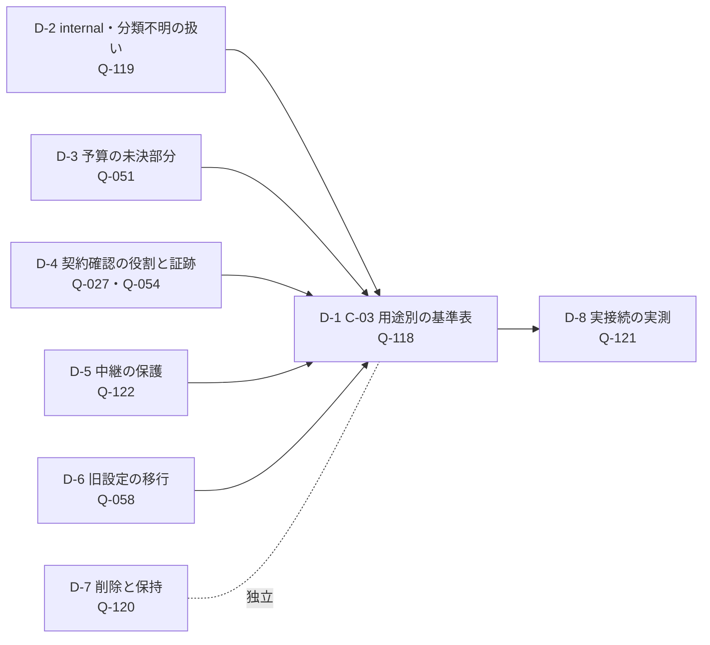

# 残タスクの判断資料

作成: 2026-11-09。根拠はすべて [要求定義書](requirements-definition.md) の原文（`L<行番号>`）と、このリポジトリのコード（`ファイル:行`）です。担当者の指名や「確認済み」の記録は、利用者や組織しか作れないため、この資料では作りません（Q-027 の回答 L1336「実際の担当者の指定・確認済み記録は創作しない」）。

## 0. 決定の記録（2026-11-09）

利用者の決定と、利用者から「論理的に良いものを選んで完了させる」と任された事項の、選択と実装の場所です。**要求定義書の本文は rd-author だけが編集できる（G-1）ため、ここに記録し、要求定義書への反映は rd-author の作業として残します。**

| ID | 決定 | 決めた人 | 既決事項への影響 | 実装 |
|---|---|---|---|---|
| D-1 | 段階的な許可の第 1 行「現状の説明（`explain`）× Microsoft Foundry」だけを許可。他の 15 行は、第 1 行の実測（D-8）と見直しまで TBD（D-9 で 1 行追加） | 利用者が AI に一任 | Q-118 に許可行が 1 行できる | `src/ai/policy.ts` の `C03_TABLE`、中継の転送（`server/relay.ts`） |
| D-2 | internal の情報も外部へ送ってよい | 利用者 | **Q-055（internal は Foundry に送らない、L1351）と Q-119 の一部を改める。** 社外向け表示での非表示（FR-002・FR-117）と、人物を含む送信前の確認（FR-219）は変わらない | `src/ai/redact.ts`。送信前の確認に internal の件数を表示 |
| D-3 | 月の総予算は 100,000 円の 1 つの枠。後で変更する可能性がある | 利用者 | PARAM-117 と PARAM-120 を 1 つの枠にする（推奨の「内枠」ではなく、利用者の決定） | 設定画面で変更可。`AiRuntimeSettings.monthlyBudgetJpy` |
| D-4 | 契約・権利の処理は、アプリの起動前に済んでいる前提。画面に警告を表示する | 利用者 | Q-027・Q-054 の「確認・記録」はアプリの外で行う前提になる | AI の接続設定・送信前の確認・実接続中のバナーに警告 |
| D-5 | 中継の保護を、Azure への展開に備えて変更できるようにする。既定は推奨の値。CSP を承認 | 利用者 | P-05 を既定値として採用。CSP の 2 つの例外（`style-src 'unsafe-inline'`、`img-src data: blob:`）を承認 | 環境変数（[relay-config.md](relay-config.md)）、`build/csp.ts` |
| D-6 | P-01（旧設定の非破壊の移行）を承認 | 利用者 | — | AI の接続設定の画面 |
| D-7 | P-03（削除と保持）を承認。推奨の保持期間（利用量の記録 13 か月、削除は明示操作だけ） | 利用者 | — | 設定画面の「データの保持と削除」、AI の接続設定の画面の記録の削除 |
| D-8 | P-04 と追加 2 点（操作ごとの判定の基準、測定中は他の負荷を流さない） | 利用者 | — | `src/config/measurement.ts`、`npm run measure`、`npm run kpi1`、[measurement-plan.md](measurement-plan.md)、性能試験の直列実行 |
| I-1〜I-6 | 推奨の選択肢 | 利用者が AI に一任 | — | 下の §4 の各行 |
| D-9 | **提案（未承認）。** 「Copilotでドラフト作成」は `structure` を借りず、専用の用途 `deliverableDraft` を C-03 の表に持つ。行は未承認のままにし、実接続はしない | 利用者が AI に一任（選択肢の比較は §0.1） | なし（許可行は増えない）。§3.1 への行の追加は rd-author の作業 | `src/ai/policy.ts` の `C03_TABLE.deliverableDraft`、`src/modules/project/deliverableDraft.ts` |
| D-10 | サンプルの数値の食い違いは、KPI（担当者・出典・期間がある値）を正として文章の側を直す。再発を防ぐため、現状分析の自動判定に「数値の照合」を加える | 利用者が AI に一任（§0.1） | なし | `src/data/sample.ts`（issue-cash）、`src/modules/project/discussion.ts`（rec-demo-1）、`deliverables.ts` の `asis-reconcile` |
| D-11 | 投資回収の判定は構築期間を含め、上限は Project ごとに設定できる（既定 3 年はアプリの仮定と表示し、設定した人と日付を残す）。ToDo 帯を自動で開く条件は、画面の高さ 900px ではなく、固定の領域（開いた一覧を含む）が画面の高さの 35% 以内のとき | 利用者が AI に一任（§0.1） | なし | `deliverables.ts` の `paybackYears`・`paybackLimit`、`DeliverablesScreen.tsx` の「判定の基準」、`deliverablesUi.tsx` の `shouldAutoExpand` |
| D-12 | **利用者の決定（2026-11-10）。** 顧客パックをアプリ内で生成AIに作らせる用途 `packBuild` を、設定済みの接続先（Azure の Microsoft Foundry、または GitHub Copilot）で許可する。費用は月 100,000 円まで（D-3 の 1 つの枠） | 利用者（依頼「設定済みのLLM(AzureもしくはGitHub Copilot)を使ってください」「予算は100,000円/月まで許可します」） | C-03 の許可行が 2 行になる（`explain`・`packBuild`）。`explain` は Foundry だけのまま。§3.1 への行・FR-311・PARAM-145〜149 の追加は rd-author の作業（下の §0.2） | `src/ai/policy.ts` の `C03_TABLE.packBuild`、`src/modules/project/packGenerate.ts`、`PackGenerateDialog.tsx`、中継（`server/relay.ts`・`copilot.ts`・`site.ts`） |
| D-13 | **2026-11-11、利用者の接続設定改善依頼に基づく実装判断。** Foundry の `connectionTest` を固定の合成文だけで許可し、応答を検証してから保存する。顧客・Project・資料は送らない。API キー・単価・費用への同意を先に用意し、出力 256 トークン、30 秒、5 秒間隔、本日 30 回、D-3 の共通予算の範囲とする | 利用者の依頼「Microsoft Foundryに接続ができない設定を入力しても意味がないので、アプリケーションのLLM接続設定を変更してください」に対する実装判断 | C-03 の許可は `explain`・`connectionTest`・`packBuild` の 3 行。テストは設定の専用経路だけで行い、任意の文の送信には使えない。§3.1 への反映は rd-author の作業 | `src/ai/foundry.ts`、`settingsStore.ts`、`AiConnectionForm.tsx`、`server/relay.ts`。旧保存値は非破壊で「接続未確認」とし、キーまたは設定の変更で検証を無効にする |
| D-14 | **利用者の決定（2026-11-11）。** 「Copilot で作成」（FR-311・`packBuild`）で、接続先が **Microsoft Foundry のときだけ** Microsoft Work IQ から社内情報を取得して資料に加える。BAS（中継プロセス）が Work IQ の REST API（`https://workiq.svc.cloud.microsoft/rest/conversations` → `/{id}/chat`、Web のグラウンディングは無効）を直接呼ぶ。認証は利用者のアプリの登録（パブリック クライアント、委任 `WorkIQAgent.Ask`）によるデバイス コードのサインインで、リフレッシュ トークンは中継の暗号化保管庫だけに置く。Work IQ へ送るのは企業名・Project 名・目的・重点・基準日から中継が作る固定の質問 1 回。回答と引用は `internal`・`origin: m365` の出典 `source-workiq-1` として Foundry に送る。GitHub Copilot SDK のときは画面に出さず、中継も拒否する（`foundryOnly`）。失敗は生成記録に残して作成を続ける。**追記（利用者、2026-11-11）:** テナントがカスタム アプリへの管理者の同意を出せない制約は変えられないため、既定の接続方法を **Microsoft の Work IQ CLI（`@microsoft/workiq`）をローカルの MCP stdio サーバーとして中継が起動する方式**にする。CLI 自身のサインイン（Microsoft 公開のクライアント、Windows の WAM）を使い、読み取り専用の `retrieve`（strategy `grounding`）だけを呼ぶ。EULA への同意は利用者が画面で行い、BAS は代行しない。REST のアプリ登録方式は選択肢として残す | 利用者（依頼「WorkIQを利用できるように実装をしてください」「Microsoft FoundryをLLMのプロバイダーとして選択した場合のみ有効」「直接なんらかのWorkIQのAPIやAgentを呼び出してもOK」「この制限は変えられません。他にBusiness Analytics Studioから、WorkIQを使う方法を調査して、実装をしてください」） | `packBuild` の送信データに Work IQ の回答（internal、D-2 の範囲）が加わる。Work IQ の費用（Copilot Credits または Microsoft 365 Copilot のライセンス）はアプリの予算に含まれない。CLI 方式では CLI 自身の外部接続を `BAS_RELAY_OUTBOUND_HOSTS` で強制できない。CLI の `research`（`scripts/lib/research.ts`）の WorkIQ は従来どおり BLOCKED。§3.1・FR-311 への反映は rd-author の作業 | `server/workiq.ts`、`server/workiqCli.ts`、`server/relay.ts`（`/relay/workiq*`）、`server/vault.ts`（`workiqRefreshToken`・`workiqCliKey`）、`src/ai/policy.ts` の `WORKIQ_SOURCE`、`packGenerate.ts`、`PackGenerateDialog.tsx`、`AiConnectionForm.tsx` の `WorkIqSettings` |
| I-4 | 被写界深度は「見送り」を推奨していたが、既定で無効・High 品質と演出が有効なときだけ使え、FPS が下がると最初に切る形なら KPI-5 を損なわないため実装に変更 | 利用者が AI に一任 | — | 3D ビュー |

### 0.1 D-9〜D-11 の選択肢と選んだ理由（2026-11-09）

**D-9 成果物のドラフトの実接続**

| 選択肢 | 内容 | 評価 |
|---|---|---|
| A | `structure` の行を承認して実接続する | 不採用。D-1 は「`explain` の実測（D-8）の後に見直す」と決めており、実測は実機で人が行うもので未実施。§3.1 も「行のない用途は送らない」 |
| B | 現状のまま `structure` を借りる | 不採用。後で分析の下書きのために `structure` を承認すると、成果物のドラフトも気づかないうちに実接続になる |
| **C（採用）** | 専用の用途 `deliverableDraft` を作り、未承認の行として表に載せる。承認の条件と行の案をここに残す | 承認の判断が用途ごとに独立し、AI の接続設定の画面にも未承認の行として見える |

行の案（承認時に rd-author が §3.1 に書く下書き。**未承認**）: 接続先は Microsoft Foundry。送る情報は `explain` と同じ範囲（D-2 により internal を含む。人物は FR-219 の確認の後だけ。社外向けの表示では internal を除く）。有効の条件は `explain` と同じ（実接続の切替・中継の設定・単価・送信ごとの確認）。1 回の上限は、出力が 1 成果物で 5〜6 項目になるため出力 3,000 トークン程度を候補とする（PARAM は未決）。月の予算は D-3 の 1 つの枠。
**昇格の条件:** (1) `explain` の実測（D-8）が済み、見直しが終わる (2) rd-author が §3.1 に行を追加する (3) 利用者が承認する。3 つがそろうまで、ドラフトは端末内のモックで作り「モック」と表示する。

**D-10 サンプルの数値の食い違い**

| 選択肢 | 内容 | 評価 |
|---|---|---|
| A | 文章に合わせて KPI の値を変える | 不採用。KPI は担当者・出典・期間を持つ記録で、文章は二次的な記述 |
| B | 文章だけを直す | 一度は直るが、利用者のデータで同じ食い違いが起きても気づけない |
| **C（採用）** | KPI を正として文章を直し、自動判定「数値の照合」を加える | 直した結果を、人ではなく判定が示せる。反例（「14 日」に戻す）で失敗することをテストで確認 |

直した箇所: 課題「回収サイクルが長い」の説明（68 日 → 現状 61 日、基準時点 68 日、目標 45 日）、議論の記録 rec-demo-1（14 日 → 16 日、2026 年度の月次平均）。照合は KPI と同じ単位の数値だけを見て、日付（「3 月 31 日」）と増減（「5 日短縮」）は除く。

**D-11 投資回収の上限と、ToDo 帯を自動で開く条件**

| 論点 | 選択肢 | 採用と理由 |
|---|---|---|
| 投資回収の数え方 | A. 投資額 ÷ 年間効果のまま／**B. 施策の開始から、構築期間を足す** | B。効果は最後の施策が終わってから出る前提（保守的）。サンプルでは最長 1.2 年程度で、既定の 3 年に収まる |
| 上限の値 | A. 3 年で固定／B. 業種ごとの表／**C. Project ごとに設定（既定 3 年）** | C。正しい値は顧客の投資基準で、アプリが決められない。B は根拠のある出典がない。既定値は「アプリの仮定」と画面に表示し、設定した人と日付を残す（0.5〜10 年） |
| 自動で開く条件 | A. 画面の高さ 900px 以上（従来）／B. 開かない／**C. 固定の領域が画面の高さの一定割合以内** | C（35%）。実測（Playwright）で、帯の見出しの下端が 173px、開いた一覧が 142px（固定の領域は計 315px）。占める割合は 1920×1080 の 100% 表示で 33%、1440×900 で 40%、1080p の 125% 表示で 43%。最初に考えた 40% では 1440×900 が 39.9% となり、数ピクセルの差で結果が変わるため、よく使われる画面の大きさから離れた 35%（境界は画面の高さ約 900px）にした。作業の領域は 65% 以上残る。結果は従来の 900px とほぼ同じだが、新しい規則は実際の高さを測るので、一覧の項目数や見出しの高さが変わっても追従する |

以下の §1〜§7 は、決定前の分析（選択肢と推奨）です。

### 0.2 D-12 顧客パックの生成（2026-11-10）

**rd-author への転記の下書き（実装済み。番号は空いている最小の値）**

- **C-03 §3.1 の行** 用途「顧客パックの作成（`packBuild`）」: 接続先 = Microsoft Foundry または GitHub Copilot SDK（利用者が設定で選ぶ）。送る情報 = 企業名・Project 名・目的・基準日・公式サイトの URL、中継が公式サイトから取得したページ本文、ニュースの見出し、利用者が添付した資料と調査メモ（D-2 により internal を含む）。アプリ内のほかのデータは送らない。有効の条件 = 実接続の切替（FR-132）＋選んだ接続先が中継に保存済み（Foundry はエンドポイント・デプロイ・キー、Copilot は CLI のサインインとモデル）＋単価の入力＋開始前に送信内容・データの所有者の承認・概算費用を利用者が確認。費用の上限 = 月 100,000 円（D-3 の枠）。
- **FR-311** 企業と Project の画面（起動時の選択画面・Project の管理）に「顧客パックを Copilot で作成」を置く。押すと必須（企業名・Project 名・目的・基準日）と任意（公式サイト・業種・重点・ニュースの利用・社内資料・調査メモ）の入力を出し、未入力の必須項目を最初から示す。開始すると、公開情報の取得 → 基盤 → 業務 → 検査と修正 → 取得報告と保存 を進捗バーと経過時間・費用とともに示し、中止できる。検査に通った顧客パックだけを、入力・取得した出典・生成記録・費用（`extensions.generation`）と取得報告（`extensions.collection`）とともに Project に保存する（取り込みと同じ全か無か）。同じ画面から AI の設定（接続先・キー・Copilot のモデル・単価・予算・実接続）を開ける。
- **受け入れの基準（案）** ① 出典（`source`）はアプリが取得・添付したものだけで、モデルが作った出典は捨てる ② 検査（verify）の誤りは、問題のある項目だけを最大 3 回（PARAM-006）直させ、残りは依存するものごと除外して記録する ③ 出典の本文に見つからない数値を「要確認」として示す ④ 失敗・中止のときは何も保存しない ⑤ 公開情報の取得は https・公開アドレスだけ（社内のアドレスに接続しない）。
- **PARAM** PARAM-145 公式サイトから読むページ数 = 6（試行 10）。PARAM-146 1 回に送る資料と調査メモの文字数 = 40,000。PARAM-147 1 段階のエンティティ数 = 40、`packBuild` の 1 日の送信回数 = 64・入力 100,000・出力 16,000 トークン。PARAM-148 1 回の作成の送信回数 = 最大 14（Work IQ なしは 5、Work IQ ありは追加取得の最大回数 r（1〜4。既定 3）に応じて 5＋2r。予備 1）。PARAM-149 1 回の送信のタイムアウト = 300 秒。

**選択肢と選んだ理由**

| 論点 | 選択肢 | 採用と理由 |
|---|---|---|
| 公開情報の根拠 | A. モデルの記憶 ／ B. モデルに Web を検索させる ／ **C. 中継が公式サイトとニュースを決まった手順で取得し、その本文だけを渡す** | C。A は出典 URL を作ってしまう。B は社内資料と同じセッションで検索語が外に出る（copilot-customer-pack-prompt.md の「2 回に分ける理由」と同じ問題）。C なら URL と取得日時が本物で、送るのは公開の URL だけ |
| 出典 | A. モデルに source を作らせる ／ **B. アプリが資料ごとに source を作り、モデルには id だけを使わせる** | B。モデルが作った source は捨て、それに頼る値は検査で除外される |
| 誤りの直し方 | A. パック全体を出し直させる ／ **B. 問題のある項目だけを置き換え・削除させ、残りは決まった規則で除外** | B。正しい項目に触れない（bas skill の規則）。出力が短く安い |
| Copilot の接続 | A. GitHub のトークンを中継に保存 ／ **B. Copilot SDK で CLI のサインインを使う** | B。秘密情報を増やさない。セッションはツールなし・システムプロンプト置換・呼び出しごとに削除 |
| 取得報告 | A. モデルに書かせる ／ **B. アプリが実際の中身から作り、「complete」は主張しない** | B。モデルの不足の説明は取り込み、説明がない区分は検査規則の必須項目を不足として示す |

**実データでの確認（2026-11-10）** GitHub Copilot（Claude Sonnet 5）と公開企業の公式サイトで実行し、検査に通ること・修正 0 回・作られた出典 0 件・根拠のない数値 0 件を確認した。公式サイトだけでは拠点（緯度・経度・能力が必須）・製品（単価が必須）・KPI の値が出典で埋まらないため、これらは「unavailable」と不足項目として報告される。値を増やすには社内資料か Microsoft 365 Copilot の調査メモを添える。

### 0.3 企業情報と Project の入力・Project 同士の関係（2026-11-10）

**rd-author への転記の下書き（実装済み）**

- **FR-137〜139 の追記** 企業は「企業情報」（業種・公式サイト・企業メモ）を 1 社に 1 つ持ち、その企業のすべての Project で共通に使う。Project は顧客パック作成の入力（目的〈複数行〉・重点・基準日・調査メモ・情報源の設定・資料のファイル名）を持つ。管理画面は企業ごとに「企業情報 → Project の一覧（すべての入力を表示）→ Project 同士の関係」の順に表示し、企業情報と Project を編集・削除できる。Project のファイル（FR-139）には企業情報・入力・その Project にかかわる関係を含める。
- **関係** 種類は「同じ課題」「依存（向きあり）」「相関」の 3 つ。同じ企業の Project どうしだけ、1 組に 1 つ。依存の循環は登録しない。「同じ課題」でつながる Project はまとまりとして警告し、統合するかを人が決める（自動で統合しない）。
- **同じ業務課題の警告と統合（2026-11-11 追記）** 業務上の根拠（「同じ課題」の関係、名前・目的・重点の業務テーマ〈17 テーマの同義語・日英辞書〉、両方の顧客パックにある同じ課題・原因・KPI/OKR・施策・データ、文章の重なり）の点数を合計し、閾値以上の組み合わせを根拠とともに警告する。全 Project（3 つ以上）に共通するテーマ・項目は根拠から外す。統合は、比較・残す Project の選択・統合後の名前と目的の確認・起きることの表示・統合前の控え（JSON）・「顧客と合意した」の確認の後だけ行う。統合すると、入力をまとめ、関係を残す Project に付け替え（2 つの間・重複・循環になる関係は削除して表示）、統合される側の顧客パックと作業データを削除し、AI 利用記録を付け替え、統合の記録（名前・日付・根拠・元の入力）を残す Project に残す。「別の課題として確認済み」は組み合わせごとに保存し、根拠が増えたら再び警告する。依存・相関として登録した組み合わせは警告しない。
- **顧客パックは Project に 1 つ** パックがある Project の操作は「不足データを再取得」になり、前回の入力を読み込み、保存すると置き換える。
- **PARAM** PARAM-150 関係の候補を示す文章の類似度 = 0.2 以上（名前・目的・重点の 2 文字単位の重なり〈Jaccard〉。候補は最大 5 件）。
- **PARAM** PARAM-151 同じ業務課題として警告する根拠の強さ = 0.5 以上（0〜1）。
- **PARAM** PARAM-152 根拠 1 件の点数（上限）: 同じ課題の関係 0.5（0.5）／業務テーマ 0.25（0.5）／課題・原因 0.25（0.5）／KPI・OKR 0.2（0.4）／施策 0.15（0.3）／データ 0.1（0.2）／文章の重なり = 類似度（0.4、PARAM-150 以上のときだけ）。合計の上限 1。
- **PARAM** PARAM-153 「別の課題として確認済み」の組み合わせを再び警告する根拠の増加 = 0.25 以上。
- **PARAM** PARAM-154 顧客パックの 2 つの項目を同じとみなす名前の重なり = 0.6 以上（正規化した名前の 2 文字単位の Jaccard。一致・3 文字以上の包含も同じとみなす）。

**選択肢と選んだ理由**

| 論点 | 選択肢 | 採用と理由 |
|---|---|---|
| 企業情報の置き場所 | A. Project ごとに入力／**B. 企業に 1 つ、Project は参照** | B。同じ顧客で Project を作るたびに入力し直さない。直すと次の作成からすべての Project に使われる |
| 課題の関係の見せ方 | A. 企業と Project を 1 つの木にする／**B. 企業を中心に Project を円に並べ、関係を種類ごとの線（同じ課題=赤の太線、依存=青の矢印、相関=橙の破線）で示し、同じ内容を表でも示す** | B。企業と Project を混ぜず、「別の課題」と言われたものの重なりと依存が一目でわかる。色だけに頼らず線の形と表でも区別する |
| 関係の候補 | A. 生成 AI に判定させる／**B. アプリの決まった計算（文章の重なり）で候補だけを示す** | B。送信なし・費用なし・同じ入力なら同じ結果。判定は人がする（候補は関係ではない） |
| 同じ顧客パックの 2 回目 | A. 別のパックとして追加／**B. 1 つを置き換え（不足データの再取得）** | B。Project とパックを 1 対 1 に保ち、どのデータで議論したかを迷わない |
| 同じ業務課題の判定 | A. 生成 AI に意味の近さを判定させる／**B. 業務テーマの同義語辞書と顧客パックの項目の一致を、決まった点数で合計する** | B。新しい AI の用途は C-03 の承認が必要（未承認）。送信・費用なし、同じ入力なら同じ結果、根拠を 1 つずつ示せるので顧客に説明できる。辞書にない言い方は見落とすため、判定は人が確かめる |
| 統合の実行 | A. 警告と同時に自動で統合／B. 統合せず関係だけ登録／**C. 根拠・比較・失うものを示し、「顧客と合意した」の確認後に統合** | C。統合は顧客パックと作業データの削除を伴い、元に戻すのは控えの JSON からだけ。誤統合の損失が大きいので、人の合意を必須にする |
| 統合した Project の顧客パック | A. 2 つのパックを結合／**B. 残す Project のパックを残し、統合後に再取得・作成する** | B。パックの結合は検証済みの構造を壊すおそれがある。まとめた目的で「不足データを再取得」すれば一貫したパックになる |

## 1. 残タスクの 3 つの種類

残タスクは、前に進めるために必要なものが違う 3 種類に分かれます。

| 種類 | 進めるのに必要なもの | 件数 | 例 |
|---|---|---|---|
| **A. 決定が必要** | 利用者（と組織の契約担当）の判断 | 8 | C-03 の基準表、internal の扱い、予算の未決部分、契約確認の役割、中継の保護、旧設定の移行、削除と保持、実測の条件 |
| **B. 実装で完了できる** | 作業時間だけ | 6 | ユースケースの書き戻し、「Copilot の案」の反映先、2D の段階表示、被写界深度、CSP の実装、Windows の鍵ファイルの権限 |
| **C. 実機・人で測るしかない** | 機材・参加者・実際の接続 | 4 | KPI-1（実 LLM での生成時間）、4K・60 fps、実機のペン、利用テスト |

**種類 A の 8 件が決まるまで、生成 AI への送信は 1 件も有効になりません。** これは実装の不足ではなく、要求定義書が求めている状態です（C-03「未記載または未確定は既定無効」、§3.1）。

## 2. 決定どうしの依存関係と、決める順序

C-03 の表の 1 行は「提供者・送信データ・有効化条件・費用上限」の 4 欄でできています（§3.1 の表）。各欄を決める材料は次のとおりです。

| C-03 の欄 | 材料になる決定 |
|---|---|
| 送信データ | D-2（何を送ってよいか） |
| 費用上限 | D-3（単価・為替・按分） |
| 提供者 | D-4（契約を確認できた提供者だけ） |
| 有効化条件 | D-5（中継が安全に送れる）と D-6（どの接続設定を使うか） |

そのため、**D-1 を最初に議論しても埋まりません。** 推奨する順序は次のとおりです。

1. **D-2 と D-4**（何を・どこへ）。互いに独立なので同時に決められます。
2. **D-3**（いくらまで）。単価は D-4 の契約確認で得られます。
3. **D-5 と D-6**（どう送るか）。実装で閉じる部分が大きく、早く終わります。
4. **D-1**（用途ごとに 1 行ずつ許可するか）。
5. **D-8**（許可した行だけを実測）。
6. **D-7** はどの段階で決めてもかまいません（送信とは独立）。

## 3. 決定が必要なタスク（種類 A）

選択肢の評価は次の 4 つの軸で行います。

| 軸 | 意味 |
|---|---|
| 最悪の影響 | うまくいかなかったときに起こる最悪のこと（情報漏洩・費用超過・作業停止） |
| 取り消し | 後から元に戻せるか（送ってしまった情報は戻せない） |
| 既決との整合 | すでに回答済みの事項と矛盾しないか |
| 実装の費用 | 決定後の作業量 |

### D-1. C-03 の用途別の基準表（Q-118）

**現状**
- 15 の用途（議論の構造化、要約、提言、チャット、現状の説明、プレゼン作成、活用分析、Copilot で分析実行、AI 取り込み、ストーリー動画、接続テスト、顧客調査、ブランド調査、顧客パック生成など）のすべての欄が TBD です（§3.1 の表）。
- 利用者の回答（L1300）:「実サービスへの新たな送信は許可しない。接続テストを含め既定無効を維持する」。許可した行はまだありません。
- 実装: `src/ai/policy.ts` の `C03_TABLE` は全行 TBD です。送信の判定は 2 か所で止まります。
  - ブラウザー側: `src/ai/gate.ts` の `evaluateGate`
  - 中継側: `server/relay.ts` の `relayAiDecision`

**未決**: どの用途を、どの提供者で、何を送り、どの条件で、いくらまで許可するか。

**選択肢**

| 選択肢 | 内容 | 最悪の影響 | 取り消し | 既決との整合 | 実装の費用 |
|---|---|---|---|---|---|
| ① 全用途を一括で許可 | 15 行を同じ条件で埋める | 高: 送る量が最も多く、internal の混入や費用の超過が全用途で起こりうる | 不可（送った情報は戻らない） | **不整合**: C-03 は「用途・提供者の組合せごとに判断」（§3.1） | 小 |
| ② 低リスクの 1 用途から段階的に許可 | 最初に 1 行だけ許可し、実測（D-8）と監査の後に次の行へ進む | 低: 影響が 1 用途に限られる | 行を TBD に戻せば次の送信から止まる | 整合: 行ごとの判断。Q-001 の「了承を得た案件だけ」とも合う | 中: 行ごとに受入テストを追加 |
| ③ 当面すべて不許可（現状維持） | 表を TBD のままにする | なし（送信ゼロ） | 不要 | 整合（L1300 の現在の回答そのもの） | なし |
| ④ ローカルの LLM に限って許可 | 端末内のモデルだけを提供者として許可 | 低: 端末外に出ない | 可 | **要確認**: §3.1 の候補にない提供者。C-05 の推奨構成に含まれない | 大: 新しい提供者の実装と品質の検証 |

**推奨: ③ を当面続け、D-2〜D-6 が決まったら ② に移る。**

**最初の 1 行の候補は「現状の説明」（`explain`、FR-274）を、Microsoft Foundry で、`shareable` の情報だけ送る行**です。理由は次の 4 つです。
1. 数値の上限がすでに決まっている唯一の用途です。1 日 30 回、入力 8000・出力 1500 トークン、間隔 5 秒（Q-050、L1308）。費用の最大値を計算できます（D-3 の例を参照）。
2. 入力は画面に表示しているデータで、自由入力の文章ではありません。そのため、送る内容を事前に列挙できます。チャット（`chat`）は利用者が自由に書いた文章を送るため、内容を事前に確定できず、後回しにします。
3. AI が使えないときの代替説明が、すでに実装されています（FR-277）。止めても機能が失われません。
4. Foundry への `internal` 送信の禁止は、すでに決まっています（Q-055、L1351）。送信データの欄の半分はすでに確定しています。

**② の各段階で行を戻す条件**（運用の案）
- 予算の警告（80%）に月内で 2 回達した。
- internal の混入をテストで 1 件でも検出した。
- 提供者の契約条件（データ保持・学習への利用）が変わった。

**決定後に変更する場所**
- `src/ai/policy.ts` の `C03_TABLE` の該当行と、`openQuestions` を空にすること。
- 中継に転送処理を追加します（`server/relay.ts`。現在は承認された行でも `liveNotImplemented` で拒否）。
- 要求定義書 §3.1 の表（rd-author が編集）。

**受入テスト**（決定どおりであることを第三者が確かめる方法）
- 許可した 1 行だけが `evaluateGate().allowed === true` になり、残り 14 行は `c03NotApproved` のままであること。
  - `tests/ai-core.test.ts` には、架空に承認した行で同じ形のテストがすでにあります（L1300「架空承認は実許可ではない」）。
- 中継に送る要求の本文に、`internal` の id と、internal の出典を引用する項目が含まれないこと。スタブの提供者で実際の HTTP 本文を検査します。
- 予算の停止（100%）の後は、提供者への呼び出しが 0 回であること。

### D-2. internal・分類不明・派生情報の送信（Q-119）

**現状**
- Foundry への `internal` 送信は禁止で確定しています（Q-055、L1351）。
- 分類不明の情報と internal 由来の派生情報は「確認できるまで外部送信不可」と決まっています。Foundry 以外への internal 送信にも新たな許可はありません（L1301）。
- 実装: `src/ai/redact.ts` の `selectOutbound` は、internal の項目と、internal の出典を引用する項目を除外します（`tests/ai-core.test.ts` で確認済み）。

**未決**
- 「確認できる」の条件、確認の方法と確認者。
- 送信先別の可否表。

**選択肢**

| 選択肢 | 内容 | 最悪の影響 | 取り消し | 既決との整合 | 実装の費用 |
|---|---|---|---|---|---|
| ① 送信は `shareable` に明示的に分類された項目だけ（許可リスト） | 分類が `shareable` で、かつ出典がすべて `shareable` の項目だけを送る。それ以外はすべて送らない | 低: 漏洩の経路が「誤って shareable に分類した」場合だけになる | 可（分類を直せば次から送らない） | 整合: L1301 の「確認できるまで不可」を、分類の付与を確認とみなす形で具体化 | 小: 現在の `selectOutbound` とほぼ同じ |
| ② 除外リスト（internal と分類不明だけを除外） | 分類がない項目も送る | 中: 新しいデータ型で分類を付け忘れると送ってしまう | 不可 | **不整合**: 分類不明は不可（L1301） | 小 |
| ③ 送信の直前に、データ責任者が 1 件ずつ承認 | 毎回の送信に人の承認を入れる | 低 | 可 | 整合 | 大: 運用の負担が大きく、会議中に使えない（§4 のファシリテーターは「即時」） |
| ④ 要約・匿名化してから送る | internal の内容を要約して送る | 中〜高: 要約から元の情報を推測できる（L1301 が検証を求める「要約経由の漏出」） | 不可 | **不整合**: 派生情報は不可（L1301） | 大 |

**推奨: ①（shareable の許可リスト）。**

理由は次のとおりです。
- 既決の 2 つ（Q-055 の internal 禁止、Q-119 の分類不明・派生の禁止）を同時に満たす最も単純な規則です。
- 「確認」の手段を **顧客パックでの分類の付与**（FR-117、データ責任者が付与）に一本化できます。付与の記録は顧客パックのファイル（Git の外。C-02）に残るので、追加の仕組みも要りません。
- ③ は安全ですが、会議中の即時性（§4 のファシリテーター）を損ないます。①で不十分と分かったときの追加策に回します。

**実装の補足**: 現在の `selectOutbound` は ② に近い形です（`classification === 'internal'` で除外）。スキーマが `classification` を必須にしているため、現状では分類不明の項目は存在しません。それでも将来、任意項目（`extensions`）経由で文章を送る機能が増えると穴になります。①に決まったら、判定を「`shareable` のときだけ送る」に反転してください。

**受入テスト**
- 分類がない・未知の値・`internal` の出典を引用している項目が、送信の候補から 0 件になること。
- 公開情報と internal が混ざった文（例: 用語集の説明に社外秘の数値が入っている）が、送信本文に現れないこと。
- 非表示の項目も除外されること（L1301 の検証の観点）。

### D-3. 予算の未決部分（Q-051）

**現状**（L1309）
- 確定: 月の総予算 10 万円、警告 80%、停止 100%、チャットの費用を合算、日本時間の暦月、本アプリの費用を Project 横断で合算、円・税込で表示。
- 実装: `src/ai/budget.ts`。日本時間の暦月は `jstMonth`、警告と停止は `checkBudget` で、テスト済みです。

**未決**
1. 固定費・共有費の按分
2. 為替換算
3. 確認済みの単価
4. PARAM-117（総予算）と PARAM-120（Copilot で分析実行の予算、どちらも 10 万円）を 1 つの枠にするか、別枠にするか
5. 複数端末の合算の要否

**選択肢と推奨**

| 論点 | 選択肢 | 推奨 | 理由 |
|---|---|---|---|
| 4. 1 つの枠か別枠か | ① 1 つの枠（合計 10 万円）／② 別枠（合計 20 万円）／③ 内枠（総額 10 万円のうち分析実行は X 円まで） | **③ 内枠** | ② だと最悪で月 20 万円になり、「月の総予算」（PARAM-117）という名前と矛盾します。① では分析実行が総額を使い切り、他の用途（現状の説明）が止まる恐れがあります。③ なら上限は 10 万円のまま、用途間の食い合いも防げます。X の値は利用者が決めます |
| 2. 為替 | ① 請求書の円額を正とし、事前の見積りは保守的な固定レートで計算／② 毎日の実勢レート | **①** | ローカル完結（C-01）のアプリが為替 API に接続すると、新しい外部送信先が増えます（Q-122 の許可リストが広がる）。見積りは安全側に倒し、実際の額は Azure の請求（円）と突き合わせます |
| 1. 固定費・共有費 | ① 本アプリに専用のデプロイだけを数え、共有費は按分しない／② 使用量に比例して按分 | **①** | 按分の規則は組織の会計の判断で、アプリでは決められません。専用デプロイにすれば按分の問題そのものが消えます。D-4 の契約確認で「専用デプロイを使う」を条件にしておくのが簡単です |
| 3. 単価 | ① 設定画面で利用者が入力し、未入力なら送信 0 回／② 既定値を同梱 | **①** | ストーリー動画ではすでに同じ方式です（Q-065、L1311、PARAM-130）。同梱の既定値は古くなり、L1309 の「仮定の単価で上限を保証したと扱わない」に反します |
| 5. 複数端末 | ① 端末ごとに集計し、表示に「この端末だけの集計」と明記／② サーバーで合算 | **①**（Azure 側で上限を別途設定） | ② は外部のサーバーが必要で、C-01（外部サーバーなし）に反します。端末をまたぐ上限は、提供者側の予算アラートやクォータで担保するのが確実です |

**費用の最大値の計算例**（単価は**架空の例**で、確認済みの値ではありません）

入力 300 円／100 万トークン、出力 1,200 円／100 万トークンと仮定すると、「現状の説明」の上限いっぱいの使い方で次のようになります。

- 1 回あたり: 8,000 × 300 / 1,000,000 + 1,500 × 1,200 / 1,000,000 = 2.4 + 1.8 = **4.2 円**
- 1 日あたり: 30 回 × 4.2 円 = 126 円
- 31 日の月: **3,906 円**（総予算 10 万円の約 4%）

実際の単価で同じ計算をすれば、D-1 の「費用上限」欄の根拠になります。

**受入テスト**
- 内枠を超えた分析実行が止まり、同じ月の現状の説明は動くこと。
- 単価が未入力のときは送信 0 回になること（ストーリー動画と同じ）。
- 月をまたぐと集計が 0 に戻ること（`tests/ai-core.test.ts` で確認済み）。

### D-4. 契約確認の役割と証跡（Q-027・Q-054、提案 P-02）

**現状**
- 「顧客データの実接続前に契約条件を担当者が確認・記録し、TBD の連携は解消まで有効化しない」が決まっています（L1336、L1348）。
- 役割の案（P-02、L1491）:
  - 連携管理担当: 契約・規約の版、費用、SLA、制限、変更通知を確認する。
  - データ責任者: 送信内容、保持・学習への利用、個人情報を確認し、送信範囲を承認する。
- 外部連携カタログ `docs/integration-catalog.md` と検査コマンド `npm run integrations:check` は実装済みです。

**未決**: 実際の担当者、証跡の置き場所、P-02 の承認。

**選択肢**

| 選択肢 | 内容 | 最悪の影響 | 既決との整合 | 運用の負担 |
|---|---|---|---|---|
| ① P-02 のとおり 2 つの役割（別の人） | 契約の確認と送信範囲の承認を別の人が行う | 低: 1 人の見落としを、もう 1 人が拾える | 整合 | 中 |
| ② 1 人で両方 | 小さな組織向け | 中: 1 人の見落としがそのまま通る | 整合（役割の数の指定はない） | 小 |
| ③ 確認を省き、提供者の標準の規約を前提にする | — | 高: 学習への利用・保持期間を確認しないまま顧客データを送る | **不整合**（L1336「確認・記録」） | なし |

**推奨: ①。ただし 1 人しかいない組織では ② を認め、記録に「兼務」と明記する。**

理由:
- 契約の条件（費用・SLA）と、送るデータの範囲（個人情報・社外秘）は、確認に必要な知識が違います（調達・法務と、データの持ち主）。分けると見落としが減ります。
- ただし、人数の制約で使えなくなる規則は守られません。兼務を明記して許すほうが現実的です。

**証跡の置き場所**: P-02 ⑤ の 2 案のうち、**`docs/integration-catalog.md` の各連携の行**を推奨します。
- 検査コマンドがすでにその表を読み、必須列の欠落と秘密情報の混入を検出します（`scripts/bas.ts integrations check`）。列を足すだけで、「確認済みでない連携」を機械的に検出できます。
- 付属表を別に作ると、2 つの表の食い違いを検査する仕組みが別に必要になります。

**決定後に変更する場所**
- `docs/integration-catalog.md` に列を追加します（`契約の版`、`確認日`、`確認した役割`、`状態 TBD／確認済み`）。
- 検査で、`状態 = 確認済み` でない連携が C-03 の許可行に使われていればエラーにします。

**受入テスト**: 1 項目でも TBD が残る連携を C-03 の行で許可すると、`integrations check` が終了コード 1 になること。

### D-5. 中継の保護（Q-122、提案 P-05）

**現状**
- 回答（L1304）で、loopback 限定、Origin／Host の完全一致、起動ごとのトークン、入力検証、CSP、外向き接続先の許可リストを具体化することが決まっています。ワイルドカードや承認のない例外は使いません。
- 具体値は P-05（L1494）で、承認待ちです。

**今回直したこと**: 起動ごとのトークンは方針が決まっていたのに、実装が固定値 `'1'` でした。今回の作業で次のように直しました。
- 起動ごとに 32 バイトの乱数で作り（`server/relay.ts` の `newRelayToken`）、同じ配信元の loopback のページにだけ `/relay/session` で渡します。
- ブラウザーのメモリだけに持ち、保存領域には残しません（`src/modules/ai/relayClient.ts`）。
- `/relay/session` 以外のすべての経路で検査し、比較は定数時間で行います（`timingSafeEqual`）。
- `tests/ai-relay.test.ts` で「トークンなし・固定値・別の起動のトークン・1 文字違い」をすべて拒否することを確かめました。`e2e/ai.spec.ts` では、実際のブラウザーでの受け渡しを確かめました。

**未決と選択肢**

| 論点 | 選択肢 | 推奨 | 理由 |
|---|---|---|---|
| `::1`（IPv6 の loopback）を許すか | ① 許す／② `127.0.0.1` だけ | **② 127.0.0.1 だけ** | アプリは `127.0.0.1` で待ち受けているため（`vite.config.ts`、起動スクリプト）、`::1` から接続が来ることは通常ありません。使われない入口は閉じるのが原則です。現在の実装は `::1` を受け付けています（`server/relay.ts:29`）。承認されれば 1 行の変更です |
| Host の `localhost` を許すか | ① 許す／② `127.0.0.1:<ポート>` の完全一致だけ | **② 完全一致だけ** | `localhost` は OS の設定で別のアドレスに解決されることがあります。完全一致なら DNS リバインディングの対策が単純になります。現在の実装は `localhost` を許し、ポートも照合していません（`server/relay.ts:30`） |
| Origin がない要求 | ① 拒否／② Fetch Metadata が `same-origin` か `none` なら許す | **① 拒否**（GET の `/relay/session` も含む） | P-05 ③ の案どおりです。現在の実装は Origin がなくても許しています（`isSameOrigin`）。ただし、同じ配信元からの GET には、ブラウザーが Origin を付けません。**① にするなら、トークンの取得を POST にする必要があります**（実装の小さな変更） |
| CSP | ① P-05 ⑥ の案（`default-src 'self'` ほか）／② 例外を足した案 | **① に `style-src 'self' 'unsafe-inline'` と `img-src 'self' data: blob:` を加えたもの** | Fluent UI（Griffel）は実行時にスタイルを挿入し、インクの PNG 出力や 3D は `data:`／`blob:` を使います。P-05 の案のままでは画面が崩れます。地図は同梱の TopoJSON で、外部のタイルを使わないため、外部の例外は**不要**です。この 2 つの例外は承認が必要です（L1304「承認のない例外は使わない」） |
| 外向き接続先の許可リスト | — | **空のまま**（D-1 で許可した提供者のエンドポイントだけを足す） | P-05 ⑦ のとおりです |

**受入テスト**
- `::1`、`localhost`、Origin のない要求、別のポートの Host が 403 になること。
- CSP の違反が、全画面の E2E で 0 件であること。`securitypolicyviolation` イベントを集めて検査します。

### D-6. 旧設定の移行（Q-058、提案 P-01）

**現状**
- 回答（L1400）: 保存済み設定を勝手に削除せず、新たな自動有効化も行いません。具体案は P-01（L1490）で、承認待ちです。
- 今回の実装には旧形式の設定がありません。新しく作った AI の接続設定画面（`/ai-settings`）は最初から共通の接続（FR-275）だけを使います。

**選択肢**

| 選択肢 | 内容 | 推奨 | 理由 |
|---|---|---|---|
| ① P-01 をそのまま承認 | 旧設定は読むだけ。移すのは利用者の操作だけ。移した後も無効のまま | **推奨** | 既決（削除しない・自動で有効にしない）を最も素直に満たします。このリポジトリには旧設定がないため、移行の処理は「旧設定なし」の 1 状態で終わり、実装の費用はほぼありません |
| ② 移行を省く | 旧設定を無視する | — | 他の環境に旧設定がある場合、利用者が設定を失ったと感じます。既決の「削除しない」の趣旨に反します |

**受入テスト**: P-01 ⑦ の 4 状態（旧のみ・共通のみ・両方で食い違い・どちらもなし）で、外部への呼び出しが 0 回であること、自動で有効にならないこと、旧設定が残ること。

### D-7. 削除と保持（Q-120、提案 P-03）

**現状**
- 回答（L1302）: 新たな自動削除・実データの削除は行いません。
- 実装:
  - Project を削除すると、その Project の localStorage のキーと、インクの IndexedDB のデータを消します（`src/state/projects.ts` の `deleteProject` と `onProjectDeleted`。`tests/projects.test.ts` で確認済み）。
  - 費用の記録（`bas.ai.ledger`）は Project の外にあり、Project を消しても残ります。

**選択肢**（対象ごとの保持期間）

| 対象 | 推奨 | 理由 |
|---|---|---|
| 費用の集計（日付・用途・トークン数・概算費用） | **13 か月保持**し、内容（プロンプト・回答）は含めない | 当月の上限の判定には当月分があれば足ります。前年同月と比べられるよう 13 か月とします。内容を持たないので、漏洩の影響は小さくなります（P-03 の共通の案） |
| Project とその分析・ワークスペース | 利用者が削除するまで保持（自動削除なし） | 既決（L1302） |
| 調査キャッシュ | 有効期限 30 日（PARAM-004）を過ぎても**自動では消さず**、`build` で再調査を提案する | 既決の「自動削除なし」に合わせます。現在の実装もこの動作です |
| エクスポートした成果物 | アプリの管理の外（利用者のファイル） | アプリから削除できない対象は、削除の規則の対象外とすると明記します |
| バックアップ | アプリでは作らない | 端末の保護は利用者の責任です（C-01、Q-040 B） |

**受入テスト**: Project の削除後、その Project の scope のキー・IndexedDB のレコードが 0 件で、費用の集計は残ること（前半は確認済み）。

### D-8. 実接続の実測の条件（Q-121、提案 P-04）

**現状**
- 回答（L1303）: 初期 2 社、p50 と最大値で集計し、実接続の測定後にだけ達成とみなします。スタブの結果は証拠にしません。
- 具体案は P-04（L1493）で、承認待ちです。

**推奨: P-04 をそのまま承認し、次の 1 点だけ補う。** 60 fps の判定に、PARAM-065（移動・リサイズ中は 30 fps 以上）との関係を明記します。

**補う内容と理由**: P-04 ⑥ の「p50 が 16.7 ms 以下で、33.4 ms を超えるフレームがない」は 60 fps の判定です。一方で、PARAM-065 は移動・リサイズ中に 30 fps 以上を求めています。

| 操作 | 判定に使う値 |
|---|---|
| 移動・リサイズ | PARAM-065（30 fps、フレーム間隔 33.4 ms 以下） |
| 3D の表示と演出 | KPI-5（60 fps、PARAM-007） |

操作ごとに判定に使う値を分けて書かないと、同じ測定で合否が食い違います。

**今回の環境での参考値**（証拠ではありません）: ヘッドレスの Chromium（SwiftShader）では、3D の地図で約 27 fps でした。GPU のある実機での測定が必要です。

**測定の条件を固定すべき実例**: ライブフィードの負荷試験（毎秒 20 件 × 8 秒、`e2e/motion-feed.spec.ts`）を 2026-11-09 に同じ PC で流した結果です。

| 条件 | 描画できた件数 | p95 | 判定 |
|---|---|---|---|
| E2E を 6 並列で同時に実行（3D のソフトウェア描画を含む） | 108 件 | 54.3 ms | 不合格（期待 128 件以上） |
| 単独で 3 回 | 158〜162 件 | 20.7〜31.5 ms | 3 回とも合格 |

同じコードでも、同時に動く処理によって合否が変わります。P-04 ② の「基準端末を 1 台に固定し、環境を記録する」に、**測定中は他の負荷を流さない**を加えることを推奨します。

## 4. 実装で完了できるタスク（種類 B）

| ID | タスク | 選択肢 | 推奨 | 理由 |
|---|---|---|---|---|
| I-1 | 議論のエクスポートから復元するとき、ユースケースを書き戻す | ① 書き戻す（同じ id は上書き、新しい id は追加）／② 書き戻さず、取り込み候補として一覧で示す | **②** | エクスポートした後に、ユースケース画面で編集されている場合があります。自動で上書きすると利用者の作業が消えます（§5「変更と取消」）。候補として示し、選んだものだけを取り込みます |
| I-2 | 「Copilot で分析実行」で反映した案を、既存の画面に表示する | ① 各画面が上書きデータを読んで表示を差し替える／② 画面には「AI の案を反映済み」の印と差分だけを表示する | **②** | 顧客パックの元の値（出典つき、FR-115）と、AI の案（出典なし、FR-116 の作成者 `ai`）が見分けられなくなると、FR-050（顧客の決定と AI の提案の区別）に反します |
| I-3 | 2D の段階表示（FR-035、SHOULD） | ① 地図・ガント・表に LOD を入れる／② 見送る | **①（地図だけ）** | 件数の多い拠点のサンプルでは、地図で名前のラベルが重なります。ガントと表は件数が少なく、効果が小さいです |
| I-4 | 被写界深度（FR-067、任意） | ① 後処理で実装／② 見送る | **② 見送る** | 任意の項目です。ヘッドレスでの 27 fps を見ると、後処理を足すと KPI-5（60 fps）の達成をさらに難しくします。GPU 実機での測定（D-8）の後に再評価します |
| I-5 | CSP の実装 | — | D-5 の承認後に `index.html` へ追加 | 例外の承認が必要です（D-5） |
| I-6 | Windows での鍵ファイルの保護 | ① `icacls` で本人だけに制限／② Windows の DPAPI で鍵を保護 | **②** | DPAPI はログオンしている利用者の資格情報で鍵を保護します。ファイルをコピーしても別の利用者・別の PC では開けません。① はファイルのコピーを防げません。Node から DPAPI を呼ぶには小さなネイティブ部品か PowerShell の呼び出しが必要で、依存の追加（C-06 のライセンス確認）を伴います |

## 5. 実機・人で測るしかないタスク（種類 C）

| ID | タスク | 前提 | 推奨の進め方 |
|---|---|---|---|
| M-1 | KPI-1（顧客パックの生成から起動まで 6 分以内、中央値 4 分） | D-1 で `packBuild` の行を許可 | P-04 の条件で 2 社 × 10 回。現在の決定的な生成では `build` は約 0.1 秒で、LLM の時間がそのまま KPI-1 の大部分になります |
| M-2 | 4K・60 fps（KPI-5） | GPU のある PC | D-8 の判定で、3D の 4 タブと演出の強度ごとに測ります |
| M-3 | 実機のペンと複数指のタッチ | Surface などのペン対応の端末、iPad の Safari（NFR-ENV-001） | インクの E2E と同じ操作を手動で行い、録画を証跡にします |
| M-4 | 利用テスト（F-3.4.2） | 参加者 5〜8 名 | [usability-test.md](usability-test.md) の計画どおりに行います |

## 6. 今回の監査で見つけて直した食い違い

| 食い違い | 根拠 | 修正 | 確認 |
|---|---|---|---|
| 出力 1500 トークン・入力 8000 トークン・間隔 5 秒・1 日 30 回（PARAM-113〜116）を、**全用途に**当てていた。そのため、プレゼンテーションの作成（PARAM-132 = 4000）の要求が必ず拒否されていた | 要求定義書 §3.1「これらを表の全用途に適用すると推定しない」 | 用途ごとの上限 `PER_USE_LIMITS` を作成（`src/ai/policy.ts`）。現状の説明は 4 つの上限、チャットは 1 日の回数だけ、プレゼンテーションは出力 4000。月の予算はすべての用途に適用 | `tests/ai-core.test.ts`「applies PARAM-113〜116 only where decided」 |
| 起動ごとのトークンが決まっていたのに、固定値 `'1'` だった | L1304 | D-5 のとおり | `tests/ai-relay.test.ts`、`e2e/ai.spec.ts` |

## 7. 決めないと何が起こらないか

| 決まらないもの | 止まっていること |
|---|---|
| D-1〜D-6 | 生成 AI のすべての実接続（現状の説明・チャット・Copilot で分析実行・プレゼン作成・ストーリー動画・AI 取り込み・顧客調査）。機能はすべてモックで動いています |
| D-8 | KPI-1・KPI-5 の「達成」の判定 |
| D-7 | 削除の規則の文書化（実装はすでに自動削除なしで動いています） |
