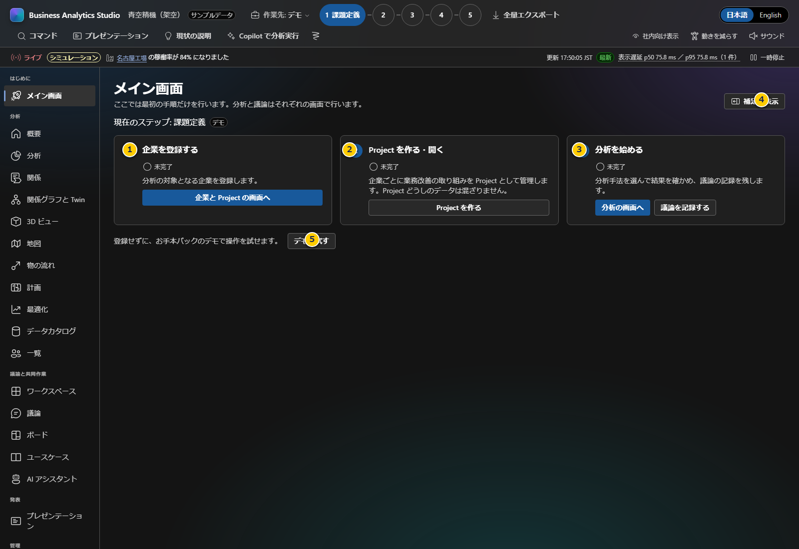

# 第1章 Windowsのセットアップと初回起動

この章では、Windows PCにBASを準備し、サンプル画面が表示されるところまで確認します。ここでいう自動化は、Node.jsが既にインストールされた後に、依存関係の復元・ビルド・スキーマ確認をセットアップスクリプトが行うことです。Node.jsそのものを自動インストールするものではありません。

**前:** [ユーザーガイド目次](README.md)

**次:** [第2章 画面の見方と最初の操作](02-orientation.md)

## 事前に用意するもの

- Windows PCとPowerShell
- Node.js 22.18.0以上と、Node.jsに付属するnpm
- BAS一式を置き、その中にファイルを書き込めるフォルダー
- 初回セットアップ時のnpmレジストリへの接続
- Webブラウザー

管理者権限、Python、DB、npmのグローバルパッケージは不要です。会社支給PCではNode.jsの配布元や通信許可について、社内ITの手順を優先してください。

## セットアップ

1. 社内で承認された方法でBASのリポジトリ一式を用意します。`package.json`、`package-lock.json`、`setup.ps1`が同じルートフォルダーにあることを確認します。
2. Node.js 22.18.0以上をインストールします（[公式ダウンロード](https://nodejs.org/)）。ターミナルを開き直します。
3. PowerShellでリポジトリのルートへ移動し、確認します。

   ```powershell
   node --version
   npm --version
   ```

4. 自動セットアップを実行します。

   ```powershell
   powershell -ExecutionPolicy Bypass -File .\setup.ps1
   ```

   このオプションは起動したPowerShellプロセスに限られ、PC全体の実行ポリシーを変更しません。スクリプトはNode.jsのバージョンを確認し、`npm ci`でロックファイルに固定された依存を復元し、アプリをビルドして顧客パックスキーマを確認します。スクリプトの処理はこのフォルダー内に限られます。

5. `Setup finished.` を確認します。失敗した場合は表示される `Next action` に従います。ロック済み依存を入れ直す必要があるときだけ、次を実行します。

   ```powershell
   powershell -ExecutionPolicy Bypass -File .\setup.ps1 -Force
   ```

同じロックファイルに対して成功済みなら依存インストールは省略されます。ビルドのみ省く場合の `-SkipBuild`、変更を行わず確認だけする `-DryRun` もあります。セットアップの初回はnpmレジストリからパッケージを取得しますが、顧客データを送信しません。

## アプリを起動する

```bat
run.cmd
```

アプリの起動後、PCに設定済みの既定のWebブラウザーでURL（既定 `http://127.0.0.1:4173`）が自動で開きます。ブラウザーの追加インストールは行いません。ポートを変える場合は `run.cmd --port 4180` とし、そのポートのURLが開きます。ポート使用中は自動で変えず、エラーとして通知します。終了は起動したコンソールで **Ctrl+C** です。

別のフォルダーから `run.cmd` を起動しても、アプリのルートを基準に動きます。毎回、現在のソースから `npm.cmd run build` でビルドしてから起動します。ビルド済みでも省略せず、コード更新（`git pull` など）後に手動でビルドする必要はありません。ビルドに失敗した場合は古いビルドで起動せず、エラーを表示して停止します。起動時のパッケージ取得は行いません。

### 表示を確認する



このキャプチャはアプリが正常に起動した後のホーム画面です。左側の画面メニュー、ヘッダーに表示される「サンプルデータ」、ホームの最初の手順が見えることを確認します。画面の各部分は[第2章](02-orientation.md)で説明します。

## 実行・確認用コマンド

| 目的 | コマンド |
|---|---|
| セットアップ | `powershell -ExecutionPolicy Bypass -File .\setup.ps1` |
| 依存の強制再インストール | `powershell -ExecutionPolicy Bypass -File .\setup.ps1 -Force` |
| 最新のソースから毎回ビルドして起動 | `run.cmd` |
| 代替の静的サーバーで起動 | `.\start.ps1` |

`start.ps1` は自動ビルドせず、`dist/` があり、ソースより新しいことを確認して静的サーバーを起動します。`run.cmd` は毎回ビルドした後、Vite previewでローカルAPIとAI中継を含めて起動します。いずれも既定では `127.0.0.1` で待ち受けます。

## 困ったとき

- Nodeが見つからない、または古い: Node.js 22.18.0以上を確認し、ターミナルを開き直します。
- npm通信が失敗: 社内プロキシ、レジストリ接続、証明書をIT担当者へ確認します。
- 依存・ビルド不足: リポジトリルートで `setup.ps1` を再実行します。
- `run.cmd` で「Build failed」と出る: 直前のビルドエラーを解消してから、再度 `run.cmd` を実行します。古いビルドでは起動しません。
- `start.ps1` で「The app was not rebuilt after the last change」と出る: `npm.cmd run build` を実行してから起動し直します。
- 変更が画面に出ない: 以前のサーバーを Ctrl+C で停止し、`run.cmd` で起動し直してブラウザーを再読み込みします。
- ポート使用中: 他のアプリを閉じるか、別ポートを指定します。

次は[画面の見方と最初の操作](02-orientation.md)へ進んでください。
