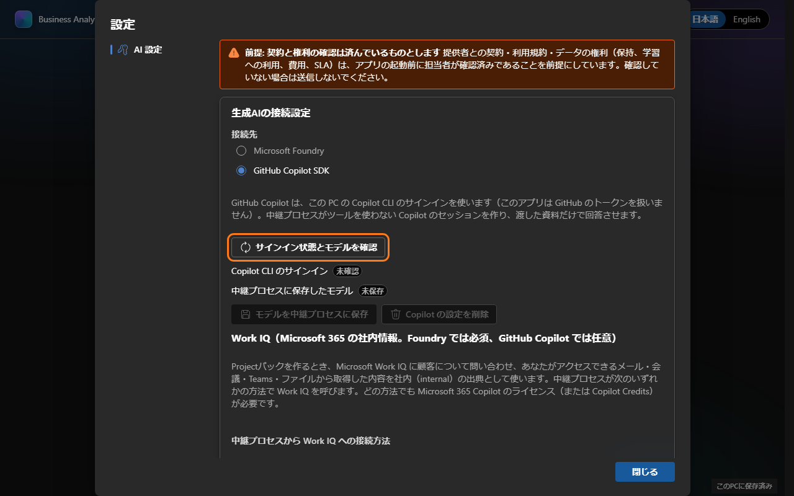
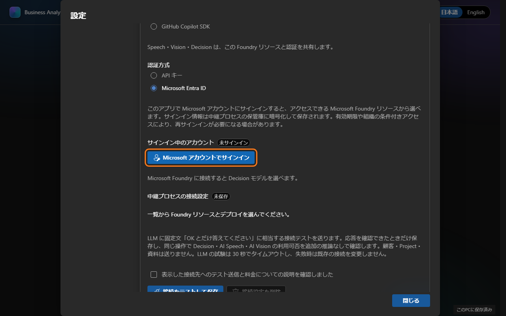
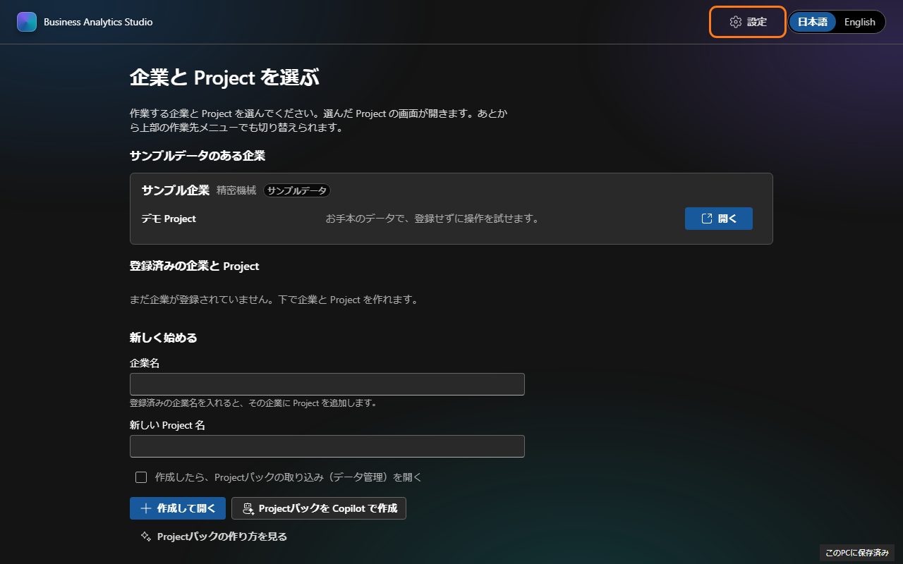
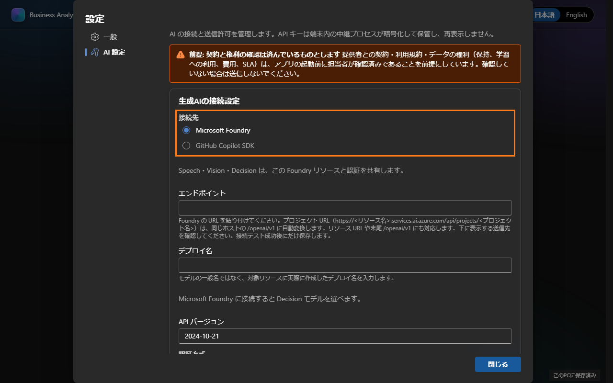
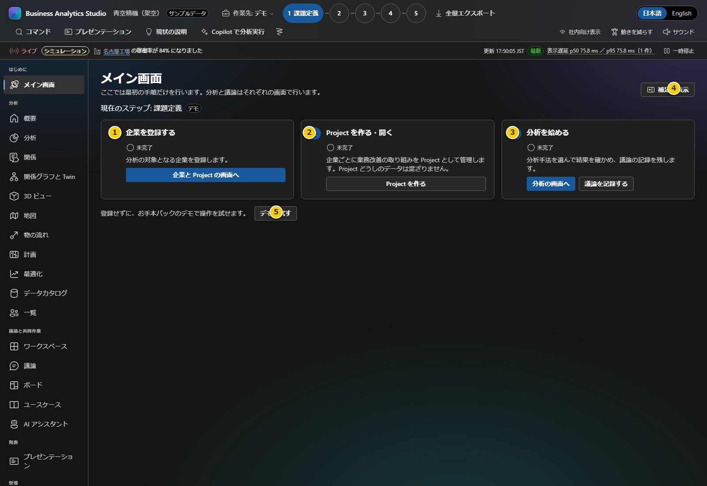

# 第1章 Windowsのセットアップ・起動・終了

この章では、Windows PCにBASを準備し、使う生成AIを選んで接続を確かめ、起動して終了するところまでを説明します。準備は1つのスクリプト（`setup.ps1`）で行います。Azure側の準備（Microsoft Foundryのリソース作成と社内ユーザーの追加）は管理者の作業なので、[第9章 管理者向け：AzureとGitHub Copilotの準備・社内ユーザーの追加](09-admin-setup.md)に分けています。

> Node.js をインストールできない PC（顧客の PC など）では、ポータブル zip を展開して `start.cmd` を開くだけで使えます。[ポータブル版の手順書](../site/guide.md)を参照してください。

**前:** [ユーザーガイド目次](README.md)

**次:** [第2章 画面の見方と最初の操作](02-orientation.md)

## 全体の流れと担当

| 手順 | だれが | すること | 確認の目安 |
|---|---|---|---|
| 1 | 利用者 | BAS一式を用意し、`setup.ps1` を実行する | `Setup finished.` が表示される |
| 2 | 利用者 | 生成AIを選ぶ（使わない／GitHub Copilot／Microsoft Foundry／両方） | 選んだAIの確認が `OK` になる |
| 2a | GitHub の組織の管理者 | Copilot のライセンス（シート）と Copilot CLI の利用許可 | 利用者の `copilot check` が `OK` |
| 2b | Azure の管理者 | Foundry のリソース・モデル・グループを用意し、利用者をグループへ追加 | 利用者の Foundry の確認が `OK` |
| 3 | 利用者 | `run.cmd` で起動し、AI 設定で接続をテストして保存する | 「接続確認済み・保存済み」 |
| 4 | 利用者 | 使い終わったら Ctrl+C で終了する | ポートを待ち受けるプロセスが残っていない |

生成AIを使わなくても、BASは組み込みのサンプルと擬似応答（モック）で動きます。生成AIは後からいつでも追加できます。

## 事前に用意するもの

- Windows 10／11（x64 または ARM64）の PC と PowerShell（Windows に標準で入っている Windows PowerShell 5.1 で動きます）
- BAS一式を置き、その中にファイルを書き込めるフォルダー（OneDrive などの同期フォルダーは避けてください）
- 初回セットアップ時の通信: npm レジストリ（`registry.npmjs.org`）。Node.js をスクリプトで入れる場合は `nodejs.org`。GitHub Copilot を使う場合は GitHub、Microsoft Foundry を使う場合は Azure と Microsoft Entra ID のサインイン
- Webブラウザー（PC の既定のブラウザーを使います）

**不要なもの:** PC の管理者権限、Python、データベース、npm のグローバルパッケージ、Azure CLI（Foundry の利用者には不要。確認したいときだけ使います）。会社支給PCでは、ソフトウェアの導入・通信許可について社内ITの手順を優先してください。

## 1. セットアップ（1つのスクリプト）

1. 社内で承認された方法でBASのリポジトリ一式を用意します。`package.json`、`package-lock.json`、`setup.ps1` が同じフォルダーにあることを確認します。
2. そのフォルダーで PowerShell を開き、次を実行します。

   ```powershell
   powershell -ExecutionPolicy Bypass -File .\setup.ps1
   ```

   `-ExecutionPolicy Bypass` は、起動したこの PowerShell だけに効きます。PC 全体の実行ポリシーは変えません（[実行ポリシーの説明（Microsoft Learn）](https://learn.microsoft.com/powershell/module/microsoft.powershell.core/about/about_execution_policies)）。

3. スクリプトは次の順に進みます。途中で止まったときは、赤字の `Setup failed:` と、その下の `Next action:`（次にすること）に従ってください。何度実行しても安全です。

   | 段階 | 表示 | 内容 |
   |---|---|---|
   | Node.js | `==> Checking Node.js and npm` | Node.js 22.18 以上を確認します。ない・古いときは、**このフォルダーだけに** Node.js LTS を入れるか尋ねます（下記） |
   | 依存関係 | `==> Installing the locked dependencies (npm ci)` | `package-lock.json` に固定された版だけをこのフォルダーに入れます。同じロックファイルで成功済みなら省略します |
   | ビルド | `==> Building the app` | アプリを `dist/` にビルドします |
   | 検査 | `==> Checking the customer-pack schema` | Projectパックのスキーマを確認します |
   | 生成AI | `==> Checking GitHub Copilot` ／ `==> Microsoft Foundry` | 選んだ生成AIの準備を確認します（下記の「2. 生成AIを選ぶ」） |

4. 最後に `Setup finished.`、選んだ生成AI、起動と終了の方法が表示されれば完了です。

### Node.js がない・古い PC

Node.js 22.18 以上が見つからないと、スクリプトは「Download Node.js LTS from nodejs.org into this folder?」と尋ねます。`Y` で、公式配布元（[nodejs.org](https://nodejs.org/)）から最新の LTS 版 zip を取得し、公式の `SHASUMS256.txt` と SHA-256 が一致することを確かめてから、BAS フォルダー内の `.bas-runtime\node` に展開します。管理者権限は不要で、PC の PATH や他のアプリは変えません。`run.cmd` と `start.ps1` は、このフォルダーの Node.js があればそれを優先して使います。

質問なしで入れる場合は `-InstallNode` を付けます。社内のソフトウェアカタログで Node.js LTS を入れる決まりがある場合は、そちらで入れてからターミナルを開き直し、`setup.ps1` を実行してください（[Node.js のダウンロード](https://nodejs.org/en/download)）。

```powershell
powershell -ExecutionPolicy Bypass -File .\setup.ps1 -InstallNode
```

### よく使うオプション

| オプション | 用途 |
|---|---|
| `-Ai None` ／ `Copilot` ／ `Foundry` ／ `Both` | 生成AIの選択を質問せずに指定します（指定しないと一覧から選びます。対話できない実行では `None`） |
| `-InstallNode` | Node.js がない・古いとき、質問せずにこのフォルダーへ入れます |
| `-ResourceGroup <名前> -AccountName <名前>` | Foundry の利用権限を確認する対象（管理者から伝えられた値。Azure CLI が必要） |
| `-WorkIq` | Work IQ CLI も確認します（任意。下記） |
| `-Force` | 依存関係を入れ直します |
| `-SkipBuild` | ビルドを省きます |
| `-DryRun` | 何も変更せず、行う内容だけを表示します |

> **実行中のBASがあると依存関係を入れ直せません。** `npm ci` は `node_modules` を入れ替えるため、同じフォルダーの BAS が起動していると、スクリプトはプロセス ID を表示して止まります。先に BAS を終了してください（[4. 終了する](#4-終了する)）。

## 2. 生成AIを選ぶ

スクリプトの途中で次の一覧が出ます。迷ったら、組織で契約済みのサービスを選んでください。

| 選択 | こんなとき | 利用者に必要なもの | 管理者の作業 |
|---|---|---|---|
| `None` | まず画面を試す、AIを使わない | なし | なし |
| `Copilot`（GitHub Copilot） | GitHub Copilot のライセンスがある | GitHub アカウントと Copilot のライセンス | 組織で Copilot CLI を許可（[第9章](09-admin-setup.md#6-github-copilot-を組織で使えるようにする)） |
| `Foundry`（Microsoft Foundry） | Azure で組織のモデルを使う。Work IQ（Microsoft 365 の社内情報）も使いたい | 職場の Microsoft アカウント（Microsoft Entra ID） | リソースの用意と利用者のグループへの追加（[第9章](09-admin-setup.md)） |
| `Both` | 両方を用意しておく | 上の両方 | 上の両方 |

どちらを選んでも、BAS は送信内容を確認するチェックを入れるまで実際には送信しません。料金は GitHub または Azure の契約で発生し、BAS は料金を計算・制限しません。

### GitHub Copilot を使う

1. スクリプトが `node scripts/bas.ts copilot check` を実行し、この PC の Copilot CLI のサインインと使えるモデルを確かめます。プロンプトは送りません。
2. サインインしていなければ「Sign in to GitHub now with the Copilot CLI (npx -y @github/copilot login)?」と尋ねます。`Y` でブラウザーが開くので、GitHub にサインインして許可します。ブラウザーを開けない環境では、ターミナルで次を実行し、表示されたコードを `https://github.com/login/device` に入力します。

   ```powershell
   npx -y @github/copilot login --device-code
   ```

   サインイン情報は Windows の資格情報マネージャーに保存され、BAS はトークンを扱いません（[Copilot CLI のインストールと認証（GitHub Docs）](https://docs.github.com/en/copilot/how-tos/copilot-cli/set-up-copilot-cli/install-copilot-cli)）。

3. `[1/2] Copilot ランタイム: OK`、`[2/2] サインイン: OK (GitHub のユーザー名)` と使えるモデルの一覧が出れば準備完了です（英語環境では `Copilot runtime: OK`、`Sign-in: OK`）。あとからいつでも次で確かめられます。

   ```powershell
   node scripts/bas.ts copilot check
   ```

4. BAS を起動し、**設定** → **AI 設定** で **GitHub Copilot SDK** を選び、**サインイン状態とモデルを確認** → モデルを選んで **モデルを中継プロセスに保存** を押します。

   

| 表示 | 原因 | 次にすること |
|---|---|---|
| `[2/2] サインイン: NG` | この PC の Copilot CLI が未サインイン、またはライセンスのないアカウント | `npx -y @github/copilot login` を実行してから再確認 |
| `使えるモデルがありません` | 組織のポリシーで Copilot CLI やモデルが無効 | GitHub の組織の管理者に、シートの割り当てと Copilot CLI のポリシーを確認してもらう（[第9章](09-admin-setup.md#6-github-copilot-を組織で使えるようにする)） |
| `[1/2] Copilot ランタイム: NG` | 依存関係が不足 | `setup.ps1` を再実行 |

### Microsoft Foundry を使う

利用者の PC に Azure CLI は不要です。BAS が自分で Microsoft Entra ID にサインインし、使ってよい Foundry リソースを一覧から選ばせます。

1. 管理者から次の4つを受け取ります（[第9章](09-admin-setup.md)のスクリプトが最後に表示する「Tell BAS users」の内容です）: **テナント ID**、**Foundry リソース名**、**デプロイ名**、そして **BAS 利用者のグループに追加済みであること**。
2. BAS を起動し、**設定** → **AI 設定** で **Microsoft Foundry** → 認証方式 **Microsoft Entra ID** → **Microsoft アカウントでサインイン** を押します。

   

3. ブラウザーで職場のアカウントにサインインし、BAS に戻ってテナント・リソース・デプロイを選び、確認のチェックを入れて **接続をテストして保存** を押します。詳しい画面の説明は[第7章「Microsoft Entra ID で接続する」](07-real-data-pack.md#microsoft-entra-id-で接続するapi-キーなし)にあります。
4. 「モデル呼び出し権限なし」と出る場合は、グループへの追加がまだ反映されていません。ロールの変更は最大10分、グループへの追加はサインインし直したとき（または約1時間後）に反映されます。BAS の AI 設定でサインアウトしてサインインし直してください（[Azure RBAC のトラブルシューティング（Microsoft Learn）](https://learn.microsoft.com/azure/role-based-access-control/troubleshooting#symptom---role-assignment-changes-are-not-being-detected)）。

**権限を事前に確かめる（任意・Azure CLI がある場合）:** 管理者から受け取ったリソースグループ名とリソース名を指定すると、自分のアカウントが各機能を呼び出せるかを読み取りだけで確かめます。

```powershell
az login
powershell -ExecutionPolicy Bypass -File .\setup.ps1 -SkipBuild -Ai Foundry -ResourceGroup <リソースグループ> -AccountName <リソース名>
```

```text
==> Microsoft Foundry
    Resource:   <リソース名> (japaneast), keys disabled (Entra ID only)
    Endpoint:   https://<サブドメイン>.openai.azure.com/openai/v1
    Deployments: gpt-6.2-sol
    OK  Chat (Cognitive Services OpenAI User)
    --  Speech (Cognitive Services Speech User)
    ...
```

`OK` はその機能を呼び出せる、`--` は呼び出せない（管理者が付与していない）ことを表します。BAS に必須なのは `Chat` だけです。Speech・Vision・Decision は使う場合だけ管理者に依頼してください。

> API キーで接続する方法もあります（[第7章「Foundry の接続を設定する」](07-real-data-pack.md#foundry-の接続を設定する)）。ただし、管理者がリソースの API キーを無効にしている場合（`keys disabled`）は使えません。キーは個人に紐づかず退職者の管理もできないため、組織では Microsoft Entra ID をおすすめします。

### Work IQ を使う場合の準備（任意）

Projectパックの作成で Microsoft 365 の社内情報（Microsoft Work IQ）を使う予定があれば、セットアップのときに Work IQ CLI も確認しておくと、後の設定がスムーズです。使わない場合、この手順は不要です。

```powershell
powershell -ExecutionPolicy Bypass -File .\setup.ps1 -WorkIq
```

または、セットアップ後にいつでも次で確認できます。

```powershell
npm run workiq:check
```

確認では Microsoft の Work IQ CLI（`@microsoft/workiq`）をnpmレジストリからダウンロードして起動し、Microsoft 365 のサインインを求められることがあります。Work IQ の検索（課金の対象）は行わず、使用許諾契約（EULA）への同意もしません。サインインしたアカウントが表示されるので、顧客の情報を探すのに使う職場アカウントか確認してください。BAS 画面での設定（EULA への同意と必須の接続検証）は [第7章 Work IQ で社内情報を加える](07-real-data-pack.md#work-iq-で社内情報を加えるmicrosoft-foundry-のときだけ) で説明します。

## 3. 起動する

```bat
run.cmd
```

エクスプローラーで `run.cmd` をダブルクリックしても起動できます。毎回、現在のソースからビルドしてから、ローカル API と AI 中継を含めて起動し、PC の既定のブラウザーで `http://127.0.0.1:4173` を開きます。ビルドに失敗した場合は古いビルドで起動せず、エラーを表示して止まります。起動時のパッケージ取得は行いません。

1. 初回は「企業と Project を選ぶ」画面が開きます。生成AIの設定はここの **設定** から開けます。

   

2. **設定** → **AI 設定** の **接続先** で、セットアップで選んだ生成AIを選びます。

   

3. サンプルを開くと、ホーム画面が表示されます。

   

   左側の画面メニュー、ヘッダーの「サンプルデータ」、ホームの最初の手順が見えることを確認します。画面の各部分は[第2章](02-orientation.md)で説明します。

**ポート:** `run.cmd --port 4180` で変えられます。ポートが使用中なら、その旨を表示して次の空きポートで起動し、実際の URL を開きます（既存のプロセスは止めません）。自動切り替えを無効にする場合は `run.cmd --strictPort` です。同じPC・同じBASフォルダーでは、ポートやブラウザーが変わっても同じ作業データを使えます。

**生成AI と Work IQ は `run.cmd` で起動したときだけ使えます。** 代替の `.\start.ps1` は自動ビルドしない静的サーバーで、AI 中継がありません（`dist/` がソースより古いと起動を止めます）。

旧版でブラウザー内に保存したデータは、**元のブラウザー・プロファイル・URLで新版を一度開く**と端末の共通保存先に移行します。旧URLが `http://127.0.0.1:4173` なら、旧BASを停止してから `run.cmd --port 4173 --strictPort` を実行してください。詳しくは[保存・移行・削除](03-projects.md#保存移行削除)を参照してください。

## 4. 終了する

1. 保存状態が **このPCに保存済み** になっていることを確認します（「このPCに保存中…」の間は待ちます）。BAS は入力のたびに `.bas-local` フォルダーへ保存するので、「保存して終了」の操作はありません。保存中や保存エラーのときにブラウザーを閉じようとすると確認が出ます。
2. ブラウザーのタブを閉じます（タブを閉じてもサーバーは止まりません）。
3. `run.cmd` を起動したウィンドウで **Ctrl+C** を押します。「バッチ ジョブを終了しますか (Y/N)?」（英語版 Windows では `Terminate batch job (Y/N)?`）と出たら **Y** と Enter を押します。ウィンドウの × で閉じても終了します。
4. 次に起動するときは、もう一度 `run.cmd` を実行します。データはそのまま残っています。

**ウィンドウが見つからない・終了したはずなのにポートが使用中のとき:** 待ち受けているプロセスを確認し、BAS（`node.exe`）であることを確かめてから、そのプロセス ID を指定して止めます。強制終了した場合、`run.cmd` のウィンドウには `Startup failed.` と表示されますが、問題ありません。

```powershell
Get-NetTCPConnection -LocalPort 4173 -State Listen | ForEach-Object { Get-Process -Id $_.OwningProcess }
Stop-Process -Id <上で表示された Id>
```

（[Get-NetTCPConnection](https://learn.microsoft.com/powershell/module/nettcpip/get-nettcpconnection)、[Stop-Process](https://learn.microsoft.com/powershell/module/microsoft.powershell.management/stop-process)）

**PC から削除するとき:** 先に BAS を終了し、必要なデータを[バックアップ](08-meetings-and-backup.md)してから、BAS フォルダーごと削除します。Node.js をスクリプトで入れた場合も、そのフォルダー内（`.bas-runtime`）にあるので一緒に消えます。GitHub のサインインを消すには `npx -y @github/copilot logout`、Microsoft のサインインは AI 設定の **サインアウト** を使います。

## 実行・確認用コマンド

| 目的 | コマンド |
|---|---|
| セットアップ（生成AIを一覧から選ぶ） | `powershell -ExecutionPolicy Bypass -File .\setup.ps1` |
| Node.js もこのフォルダーに入れてセットアップ | `powershell -ExecutionPolicy Bypass -File .\setup.ps1 -InstallNode` |
| 依存の強制再インストール | `powershell -ExecutionPolicy Bypass -File .\setup.ps1 -Force` |
| GitHub Copilot のサインイン | `npx -y @github/copilot login` |
| GitHub Copilot の準備の確認 | `node scripts/bas.ts copilot check` |
| Foundry の利用権限の確認（Azure CLI） | `powershell -ExecutionPolicy Bypass -File .\setup.ps1 -SkipBuild -Ai Foundry -ResourceGroup <rg> -AccountName <名前>` |
| 起動（毎回ビルド、AI 中継あり） | `run.cmd` |
| 代替の静的サーバーで起動（AI なし） | `.\start.ps1` |
| 終了 | 起動したウィンドウで Ctrl+C → Y |
| Work IQ CLI の確認（任意） | `npm run workiq:check` |

## 困ったとき

| 症状 | 次にすること |
|---|---|
| `Node.js 22.18 or later is required` | `setup.ps1 -InstallNode` で入れるか、Node.js LTS を入れてターミナルを開き直します |
| `nodejs.org could not be reached` ／ SHA-256 が一致しない | 社内プロキシ・ファイアウォールで `https://nodejs.org` が許可されているか IT 担当者に確認します。一致しない場合はファイルが途中で変えられているので、使わずに再実行します |
| `npm ci` が通信エラー | 社内プロキシ、レジストリ接続、証明書を IT 担当者へ確認します |
| `BAS is still running from this folder` | 表示されたプロセスの BAS を終了してから再実行します |
| `run.cmd` で「Build failed」 | 直前のビルドエラーを解消してから、再度 `run.cmd` を実行します |
| `start.ps1` で「The app was not rebuilt after the last change」 | `npm.cmd run build` を実行してから起動し直します |
| 変更が画面に出ない | 以前のサーバーを Ctrl+C で停止し、`run.cmd` で起動し直してブラウザーを再読み込みします |
| ポートが使用中 | `run.cmd` は次の空きポートで起動します。旧版のデータが見えない場合は、上記の初回移行を確認してください |
| 「データ保護のため操作を停止しました」 | 復旧用コピーをダウンロードし、ディスク容量・保存先の権限を確認して再試行します。確認前にブラウザーの保存領域を消さないでください |
| Copilot の確認が `NG` で終わる | [GitHub Copilot を使う](#github-copilot-を使う)の表を参照 |
| Foundry で「モデル呼び出し権限なし」 | サインアウトしてサインインし直します。10分以上たっても同じなら、管理者にグループへの追加とロールの割り当てを確認してもらいます（[第9章](09-admin-setup.md#確認と困ったとき)） |
| Foundry のリソースが一覧に出ない | テナントが正しいか確認します。リソースに独自のサブドメインがないと選べません（管理者に確認） |
| `npm run workiq:check` が `NG:` で終わる | 表示される「次にすること」に従います。原因別の対処は [第7章の「Work IQ で困ったとき」](07-real-data-pack.md#work-iq-で困ったとき) にあります |

mac・Linux では `setup.sh` と `start.sh` を使います（Node.js は事前に入れてください。生成AIの選択と Node.js の自動導入は Windows 版の `setup.ps1` だけの機能です）。

次は[画面の見方と最初の操作](02-orientation.md)へ進んでください。Azure の管理者は[第9章](09-admin-setup.md)へ進んでください。
