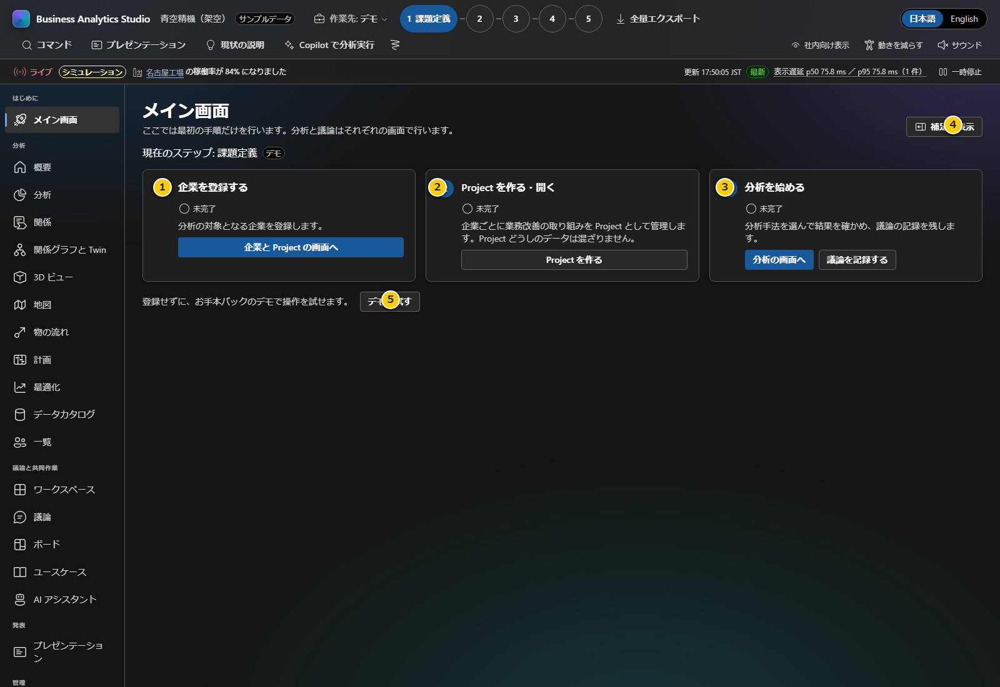

# 第2章 画面の見方と最初の操作

この章では、BAS全体の共通部分と、最初に開くホーム・概要画面を説明します。デモの表示値は架空のサンプルです。

**前:** [第1章 Windowsのセットアップと初回起動](01-setup.md)

**次:** [第3章 企業とProjectの管理](03-projects.md)

## 起動したときの流れ
1. **起動準備:** 保存データやProjectパックの読み込み中にアプリ名と準備中の表示が出ます。準備が終わると自動的に次へ進みます。読み込みに失敗した場合は復旧画面が表示されます。
2. **オープニング:** アプリ名だけを表示します（顧客名やProject名は出しません）。約4.5秒後に閉じ、「スキップ」またはEscでも閉じられます。動きを減らす設定では表示しません。
3. **企業とProjectの選択画面:** 作業する企業とProjectを選びます。「サンプルデータのある企業」（サンプル企業のデモProject）、登録済みの企業とProject、新しい企業とProjectの作成が並びます。Projectパックを取り込んだProjectには「Projectパック取込済み」と表示されます。
4. **Project画面:** 選んだProjectのメイン画面が開きます。

再読み込み時も起動準備は表示しますが、同じタブでは選択した作業先を維持します。Projectパックの切り替えなど、アプリ内部の再読み込みではオープニングを表示しません。途中で選び直すときは、画面上部の作業先メニューの「企業と Project の選択画面へ…」を使います。選択画面に戻ってもProjectの作業データは消えません。

## 共通画面の読み方

概要は2026-11-16に戦略概要へ置き換えています。旧KPIカード・優先度スライダー・KPIタワーは表示しません。

### 画面上部

| 項目 | 説明 |
|---|---|
| 1. アプリ名とサンプル表示 | 「Business Analytics Studio」をクリックすると、起動時の企業とProjectの選択画面に戻ります。画面がサンプル（架空）のデータを使っている間は「サンプルデータ」バッジが出ます。企業名は作業先に表示します。実データで運用する場合はバッジが出ていないことを毎回確認します |
| 2. 作業先 | デモかProjectかを選びます。「企業と Project の選択画面へ…」で起動時の選択画面に戻れます。ProjectにProjectパックを取り込んでいれば、そのProjectを開くと画面がそのパックのデータに切り替わります |
| 3. 業務改善ステップ | 現状分析、あるべき姿、KPI/OKR 定義、ソリューション作成、要求定義・計画の位置を示します |
| 4. 共通操作 | コマンド、プレゼンテーション、現状の説明、インクなどの操作です。AI操作は送信前提やモック表示を確認してください |
| 5. 表示設定 | 社内/社外表示、動きを減らす設定、サウンドを切り替えます。社外表示はアクセス制御ではありません |
| 6. 期待されるビジネスの成果・企業ニュース | KPIの試算や解決策の便益などを表示し、詳細で前提・根拠を確認できます。その下の「企業ニュース」は選択企業について外部から取得した実記事で、出典・公開日時・リンクを表示します |
| 7. ステップの ToDo | 企業ニュースの直下に、現在のステップの成果物、進み具合、「次にやること」を表示します。広げると完了条件を一覧します。「自動判定」はデータから判定し、「人が確認」は確認した人がチェックします。「全てのステップに対してCopilotでドラフト作成」で各ステップの下書きを一括作成できます |

### 企業ニュース

- 企業のProjectを開くと、その登録企業名でGoogle News RSSを自動検索し、以後5分ごとに取得します。実企業のパックを使うデモではパックの企業名を使い、架空サンプルのデモでは検索しません。
- 外部へ送るのは企業名と言語のみで、Projectの内容やProjectパック本文は送りません。企業名は公開名称を使用してください。日本語／英語の切替に合わせて検索言語も切り替わります。
- 最新記事と出典・公開日時（JST）、取得確認時刻を表示します。「ニュース一覧」を開くと最大10件を確認できます。記事リンクは別タブで開きます。企業名の一致検索であり、同名企業の記事や古い記事を含むことがあります。原文と出典を必ず確認してください。「最新」は取得状態であり、記事が新しいことや内容の正しさを保証しません。
- 「ニュースを更新」で再取得できます（サーバーは5分以内の取得結果を再利用します）。「一時停止」はシミュレーションとニュース取得の両方を停止し、再開するとニュースも取得します。
- 取得失敗は明示し、同じ企業の前回記事があれば取得時刻を残して表示します。企業を切り替えた場合は旧企業の記事を消します。記事がない場合は「見つかりませんでした」と表示し、架空ニュースで補いません。
- インターネット接続とBASのローカルサーバーが必要です。オフライン時やHTMLファイルだけを配信する構成では取得できず、エラーを表示します。APIキーやAI接続設定は不要です。管理者が外部接続先を制限している場合は `news.google.com` の許可が必要です。

### 左側メニュー

| グループ | 主な画面 | 目的 |
|---|---|---|
| はじめに | メイン画面、成果物 | 選んだProjectの大きな流れ（経営目標 → OKR → KPI → 課題 → 解決策）、次にやること、各ステップの要約。各ステップの成果物・完了条件・追加する情報の記入 |
| 分析 | 分析、関係、関係グラフとTwin、地図、物の流れ、計画、最適化、データカタログ、一覧 | パックの情報確認や分析 |
| 議論と共同作業 | ワークスペース、議論、ボード、ユースケース、AIアシスタント | 議論やアイデアの整理 |
| 発表 | プレゼンテーション | ストーリーの再生・説明 |
| 管理 | 企業とProject、データ管理、外部連携、ブランド、AI 設定（ダイアログが開きます）、設定 | データと表示、接続の管理。データ管理ではProjectパックを確認・取り込みます（[第7章](07-real-data-pack.md)） |

### 2Dと3Dの切り替え

3Dは独立したメニューではなく、関連画面の「表示形式」で選びます。

| 画面 | 3Dで表示する内容 |
|---|---|
| 地図 | 拠点と流れ（2Dに戻すと従来の地図。拠点の選択と流れの表示設定を維持） |
| 関係グラフとTwin | 既存の関係グラフ・Twin・空間に加え、「デジタルツイン」と「アーキテクチャ」。それぞれ2D／3Dを切り替え可能 |

「2D」「3D」の選択肢は同時に見え、選択中の形式には背景と下線が付きます。Tabキーで選択中の形式へ移動し、左右の矢印キーで切り替えられます。関係グラフでは「Graph」も選べます。狭い画面では関係グラフのビューをドロップダウンから選びます。

WebGLが使えない場合や3Dの描画に失敗した場合は、理由を表示して2Dへ戻し、3Dを無効にします。従来の `#/twin3d` のURLも引き続き開けます。

## ホームのクイックスタート

1. **企業を登録する:** 分析対象となる会社を登録します。登録は企業名などの管理情報であり、顧客の実績データを読み込むものではありません。
2. **Projectを作る・開く:** 取り組みごとにProjectを分けます。Project間でKPI・分析・議論の状態は混ざりません。
3. **分析を始める:** 分析手法を選び、結果と議論を記録します。
4. **補足を表示:** 初めての人向けの使い方やProjectパックの説明を開きます。
5. **デモで試す:** 登録前に架空のサンプルを使って機能を確認します。デモの内容は自社データではありません。

ホームは業務を進める順序の案内で、データの自動取込や共同編集を意味しません。デモから実際の企業へ切り替える場合は[第3章](03-projects.md)へ進みます。

## ステップの成果物とToDo

未完了の自動判定には「対応する」の横に「Copilotで解決」を表示します。設定済みの Foundry または GitHub Copilot の実接続を使い、送信内容・接続先・費用・所有者の許可・自由文中の人物情報を確認してから解決案を作成します。失敗時にモックで代用しません。

- 課題の出典、課題と原因・KPIの関係、原因の出典、未完了の成果物の入力を対象にします。原因・KPIの関連候補は共通の出典を持つ既存項目に限定します。新しい実績値・目標値・日付・エンティティは作りません。
- AI は実質的に異なる解決案を 2〜4 個示し、案ごとに根拠とトレードオフ・未確認点を書きます。そのうえで推奨案を 1 つ選び、他の案と比べて優れる理由を示します。推奨案が初期選択されますが、どの案を選ぶかは人が決めます。データ作成が難しい場合は、データを変更せずに「必要な根拠を入手する」「担当者に判断を依頼する」などの判断として記録する案も示します。
- 選択肢には必ず「その他（自由入力）」があります。どの案も合わない場合は自分の判断を書いて確定すると、データを変更せずに判断として記録します（未解決のまま）。「この指示で再提案」を押すと、入力した内容を指示として Copilot に案を作り直させます。指示は根拠として扱わず、安全規則も変わりません。
- 成果物の文章を AI が書き換える案では、出典や既存ドラフトにない数値を含む案を受け付けません。案の内容が業務上妥当かを確認し、「選択した案で確定・再判定」で元データへ適用します。選択した案、推奨案との違い、推奨理由、再判定結果を端末に保存します。従来の「この提案を承認」（文章の保存のみ）とは異なります。
- 保存と再判定が完了し、問題の解消を確認できたときは、完了アイコンとメッセージを表示します。［データ入力・ドラフトの確認へ］からそのステップの入力内容を編集したり、AI のドラフトを承認したりできます。［対応する入力画面を開く］から今回の対象データも編集できます。人の確認チェックは自動では変更しません。
- 根拠不足、対応候補のない項目、期限・投資基準・人の合意などは未解決として残し、必要情報と対応先を示します。一部だけ修正できた場合も「未解決」と表示します。自動判定が通ることは、業務上の正しさや事業効果を保証しません。
- 生成中の停止、生成後のデータ変更、保存失敗を明示します。AI の回答を読み取れない場合や必須項目が不足している場合は、データを変更せずエラーを表示します。解決案をもう一度作成してください。データが変わった解決案は適用できません。再提案が上限などで送信できなかった場合も、表示中の案と入力内容は残ります。人の確認チェックと既に完了した判定を勝手に変更しません。

画面上部のステップ（1. 現状分析〜5. 要求定義・計画）ごとに、作る成果物と完了条件が決まっています。経営目標 → KPI/OKR → 解決策 → 成果物が 1 本につながっていることを、各ステップで確かめながら進めます（手法の根拠は [docs/strategy-linkage-study.md](../docs/strategy-linkage-study.md)）。

| ステップ | 成果物 | 追加する情報（例） | ダッシュボードで示すもの |
|---|---|---|---|
| 1. 現状分析 | 現状分析レポート（優先順位つき課題一覧と KPI/OKR ギャップ） | 課題ステートメント、影響、対象範囲・対象外、スポンサー、現状の業務の流れ、事実とデータ、真因、データの不足、制約 | 優先度スコア（影響度 60・実現性 40）で並べた課題一覧と各課題の見極め（取り組む・今は取り組まない・取り組まない）、優先度マトリクス（早期成果・戦略投資・小さな改善・保留）、根本原因のパレート、KPI/OKR の目標とのギャップ |
| 2. あるべき姿 | あるべき姿（ユースケースと経営層向けの説明） | 結び付ける会社の経営目標、目標像、解決後の業務の流れ、現状とのギャップ、実現の前提（何が真であるべきか）、成功の定義 | 上位の課題ごとに解決後の姿を描いたユースケース、ユースケースの一覧（ペルソナ・手順・効果・課題）、経営目標とのつながり、このプロジェクトで追加する KPI・OKR |
| 3. KPI/OKR 定義 | KPI/OKR 定義書（測定計画） | 顧客の定義の有無（取得済み・一部・なし・未取得）、OKR と KR、KPIツリー、定義と計算式、データの出所、頻度、責任者 | KPI 定義の品質、KPI と OKR の一覧 |
| 4. ソリューション作成 | 課題ごとの解決策（KPI/OKR シミュレーション） | 解決策の種類（デジタル・プロンプト・AI エージェント・業務・人と組織・設備・外部連携）、KPI への貢献（量×単位あたり効果×立ち上がり）、効果の明細（価値の源泉・負の効果・現金になる割合・測る KPI・責任者）、施策どうしのつながり | 課題ごとの解決策（取り組む課題のうち解決策のないものを次の候補として示す）、期限時点の P10–P90 と到達確率、解決策ごとの寄与のブリッジ、事業効果の構造と施策ポートフォリオの価値（NPV の分布・源泉別のブリッジ・単独と限界の価値・トルネード・未検討の効果） |
| 5. 要求定義・計画 | 要求定義書・プロジェクト計画書 | 解決策の種類ごとの成果物（デジタルは要求定義書、プロンプトと AI エージェントはその仕様書、人事制度の改定などは変革計画など）、要求の根拠（規程・現行システム・利用者の声・AI の評価データを Work IQ・ファイル・手入力で集める）、要求管理台帳（安定した要求 ID・優先度・状態・検証方法）と変更管理記録（CSV・ReqIF で書き出し）、追跡表、ロードマップ、投資対効果、承認を求める事項 | 課題 → KPI → ユースケース → 解決策 → 施策 → 担当者のトレーサビリティ、施策の日程、投資回収、施策ポートフォリオの価値（割引回収期間・ブラックスワンの試算） |

### 課題を見極める（取り組む・今は取り組まない・取り組まない）

BAS は、課題があるからといって「必ず解決策を作る」とは考えません。解決策そのものに価値はなく、価値は解く課題とその結果にあるからです（Mahan Khalsa・Randy Illig『Let's Get Real or Let's Not Play』の Qualifying の考え方）。そこで「1. 現状分析」で、課題ごとに人が判断を記録します。

1. 「1. 現状分析」のダッシュボードの課題一覧で、各課題の「見極め」列の **見極める** を押します。ToDo「すべての課題を見極め…」の「対応する」からも開けます。判断していない課題は「未判断（黄信号）」と表示し、この完了条件が残ります。
2. 画面に、その課題の根拠（測る KPI の現状 → 目標と期間、出典・原因の仮説の件数）が出ます。これを見て、**取り組む**・**今は取り組まない**・**取り組まない** のどれかを選びます。
3. **判断の根拠** を書きます。どう測るか、今いくつか、いくつにしたいか、その差はいくらの価値があり、時間とともにどう増えるか（5 つの問い）。数値にできなければ 1〜10 で強さを示します（6 以下は黄信号）。
4. **取り組む** を選んだときは、**今回は何が違うか** も書きます。これまで解決を妨げたもの（予算・合意・利害・優先順位・複雑さ）と、今回それがどう変わったか。何も違わなければ、結果も変わりません。
5. **保存** すると、判断・根拠・記録した人（編集者名）と日時を保存します。**見直す** で変更、**判断を取り消す** で未判断に戻せます。

「今は取り組まない」「取り組まない」も成果です。そう判断した課題は、2〜4 のステップの完了条件（最優先の課題のユースケース、課題ごとの KPI、課題ごとの解決策）とダッシュボードの集計から外れ、その旨と件数を「現状分析で…判断した課題 n 件は数えていません」と表示します。成果物の Copilot ドラフトでも、対象範囲は判断に従い、対象外にはその課題と理由（社内向けのときだけ）を書きます。制約の欄には、取り組む上位の課題ごとに「今回は何が違うか」を書きます。判断を変えると、確定済みの「1. 現状分析」は要再確定になります。

すべての課題を「今は取り組まない」「取り組まない」と判断した場合、「1. 現状分析」は完了でき、2〜4 のステップは「すべての課題を…と判断しました」と表示します。これは失敗ではなく、早い段階で出した結論です。

### 各ステップの Khalsa に基づくアドバイス

「ステップのダッシュボード」と、その成果物の画面（5 つのステップすべて）には、**Khalsa に基づくアドバイス（データの状況から）** のパネルがあります。AI は使いません。そのステップのデータを調べ、完了条件と同じ規則で数えて、次のように並べます。

- **黄信号:** データに直すべき点があります。たとえば、判断していない課題、KPI のない課題、基準値のない KPI、出典のない主張、解決策のない課題、担当者のない施策、回収年数の上限超えです。原則名（見極める・測る・推測しない・解決策に価値はない・資源・決め方など）、対象の項目、「対応する」リンクが付きます。直すと、その助言は消えます。
- **青信号:** データ上の黄信号がありません。
- **参考:** 人に聞くこと・仮説として扱うことです。BAS が提案した KPI は仮説、AI の文は承認するまで仮説、回収年数の上限は顧客の投資基準を聞くまで BAS の仮定、といったものです。

黄信号がなくても、各ステップの最後に**次の会話**を示します。データだけでは決められないことを、決める人に直接聞くための問いです（例: 現状分析では、最優先の課題について「どう測りますか。今いくつですか。いくつにしたいですか。その差はいくらの価値ですか」）。助言は、Mahan Khalsa・Randy Illig『Let's Get Real or Let's Not Play』の考え方を当てはめたものです。判断するのは人です。助言を満たしたことは、顧客の合意を意味しません。

### 途中のステップから始める・試作を繰り返す

すべてのデータがそろっていなくても、どのステップからでも作業できます。各ステップの要約（エグゼクティブサマリー）には成熟度を表示します。

- **仮説:** データの確認がまだ残っています。結論は仮説として扱い、確かめながら次へ進めます。
- **根拠あり:** データの確認はすべて通っています。残りは関係者の合意です。
- **合意済み:** データの確認と関係者の合意がそろっています。

前のステップに未完了の項目があるときは、要約にそのステップへのリンクを示し、「この要約はその仮説の上に立っている」と明記します。試作（MVP）を作って確かめ、前のステップに戻って直す、を繰り返してください。

Copilot のステップ要約は「未承認のドラフト」として保存します。内容を読み、「この要約を承認」を押すと承認者と日時が残ります。古い入力に基づく要約や、台帳にない数値を含む要約は承認できません。承認後に入力が変われば承認済みとは扱わず、再生成・再承認が必要です。要約の承認は ToDo の合意チェックや工程の完了を代行しません。モックも明示したまま区別します。

各工程の成果物ドラフトには、前工程までに適用した文章も入力します（社内表示のみ）。これは仮説やモックを事実へ昇格させるものではありません。

### ステップを確定して次へ引き継ぐ

各ステップの画面には「ステップの確定と引き継ぎ」があります。

- **「このステップを確定して「（次のステップ）」へ進む」:** そのステップの ToDo（自動判定・人が確認の両方）がすべて完了し、前のステップが確定済みのときだけ押せます。押すと、確定した人・日時と、その時点の課題・ユースケース・KPI・解決策などのアイテムを記録し、次のステップへ移ります。押せない理由はボタンの下に表示します。
- **引き継いだアイテム:** 次のステップの冒頭に、前のステップで確定したアイテムを一覧します。これがこのステップの入力です。ユースケースや成果物の Copilot ドラフトも、この確定済みアイテムを順に使います。
- **要再確定:** 確定後に前のステップのアイテムを変えると、そのステップと後続のステップを「要再確定」と表示し、次のステップの一覧で変更・追加・削除されたアイテムに印を付けます。ステップの表示（画面上部のステップボタン）にも状態が出ます。内容を確かめ、もう一度確定してください。
- 確定は「確定を取り消す」で戻せます。確定していなくても、どのステップも閲覧・編集できます（試作と手戻りのため）。確定は正式な受け渡しの記録であり、顧客の承認や電子署名ではありません。

### 個別の入力欄の Copilot ドラフト

ユースケースの編集、KPI への貢献の見積り、解決策別の成果物の各セクションには「Copilot でドラフト作成」があります。作成した案はプレビューとして表示するだけで、元データは変わりません。

- **承認:** ユースケースと貢献は「承認してフォームに反映」でフォームに入ります。内容を直してから、登録・保存してください。貢献の根拠は「仮定」として入ります。成果物セクションは「承認して成果物に反映」でそのセクションに書き込みます。「下書きに戻す」で自動作成の文章に戻せます。
- **作成後に入力を変えた場合:** その案は承認できません。破棄するか、作り直してください。
- **案の保持:** 案は画面を開いている間だけ保持します。再読み込みすると消えます。

KPI/OKR 定義の「提案」も、追加される KPI・OKR を一覧してから「承認して KPI/OKR に追加」を押したときだけ追加します。

### 経営・KPI/OKR・Project のつながり

- **ToDo の帯:** どの画面でも、経営目標・OKR・KPI・解決策の件数と、つながりの切れの数を表示します。
- **KPI/OKR の定義:** Projectパックの作成時に、顧客がすでに定めている KPI/OKR を資料から取得し、状態（取得済み・一部・定義なし・未取得）を記録します。取得できない・定義がない場合は「3. KPI/OKR 定義」の成果物の画面で定義案を作り、状態を確定します。KPI ごとに出どころ（顧客の定義・BAS の案）を表示します。未取得は「定義がない」ことではありません。
- **貢献のシミュレーション:** 「4. ソリューション作成」の成果物の画面で、解決策ごとに「何をどれだけやるか（量）」「1 単位あたりの KPI の改善」を下限・最頻値・上限で入力し、効果の出始めと全効果の日、根拠の種類（実測・ベンチマーク・専門家・仮定）を記録します。KPI ごとに期限での P10/P50/P90、目標に届く確率、ギャップを埋める割合を表示します。同じ入力では同じ結果になります。ギャップの 1.5 倍以上を埋める見積もりや、複数の解決策が同じ KPI に効く場合（二重計上の可能性）は警告が出ます。結果は効果の保証ではありません。
- **事業効果の構造と施策ポートフォリオの価値:** 「4. ソリューション作成」「5. 要求定義・計画」のダッシュボードの下部にあります。KPI の改善がいくらの価値になるのかを、次の順で確かめます（手法と出典は [docs/business-value-audit.md](../docs/business-value-audit.md)）。
  1. **効果を分ける:** ［効果を追加］で、解決策ごとの効果を 1 行に 1 つの価値の源泉（売上・粗利、コスト削減、資本〔運転資本・設備。一度だけの現金〕、リスク低減、将来の選択肢）と負の効果（運用費など）に分けます。金額（百万円）は下限・最頻値・上限で、削減した時間などは「現金になる割合」も入れます（時間は、人員・残業・外注の削減か再配置先の価値にしない限り現金になりません）。測る KPI と責任者も記録します。数量・測定・観察で表す効果は金額にせず、数として残します。明細がない解決策は、パックの年間便益を「未分解」の 1 行として計算します。
  2. **見落としを探す:** 施策 × 価値の源泉の表で「未検討」のマスを選ぶと、その施策の種類で見落としやすい効果の問いが出ます。［この効果を追加］か［検討して該当なし］を選びます。
  3. **つながりを確かめる:** データから見つかった候補（施策の依存関係・同じ KPI や課題・同じ製品）を、前提・相乗・重複・費用の共有として割合を入れて登録するか、［該当しない］を選びます。単独の価値とポートフォリオでの限界価値の差が、つながりの価値です。
  4. **What-if で試す:** 施策のチェック、割引率、年数を変えると、NPV の P10/P50/P90、プラスになる確率、割引回収期間、ブラックスワンの試算（最大の施策の費用 +400%・効果 37.5%）、トルネード（結果を最も動かす前提）がすぐに変わります。［この前提を Project の基準として保存］を押すまで保存しません。
  5. **共有する:** ［対話型の HTML で保存］で、同じ計算を埋め込んだ 1 つの HTML ファイルを保存します。受け取った人はアプリなしで施策の出し入れや割引率を試せます（外部への通信はしません）。
  6. **アプリに解決させる:** パネル上部の「アプリで解決する」で、［ルールで下書き（AI を使わない）］はパックの数値だけから、未分解の年間効果を幅と現金化の割合付きの行に、運用費・資本の効果の行に下書きします。［Copilotでドラフト作成］は AI が価値の源泉・負の効果・該当なし・相関・資本コスト（資料に記載があるとき）を下書きします（実接続と AI 設定の同意が必要）。どちらもアプリが計算式を検算し、パックの値と照合して「計算で確認」「仮定を含む」「検算できない」「金額なし」を示します。［検算できた下書きをすべて採用］は検算できない行を除きます。採用するまで効果の明細は変わりません。
  7. **判断が割引率に左右されるか確かめる:** 統計の「NPV が 0 になる割引率（IRR）」と下の文で、顧客の資本コストが分からなくても判断が変わらないかを確かめます。
  8. **相関を確かめる:** What-if の「施策内の効果の相関」（既定 0.5）で、同じ施策の効果が一緒に動く度合いを変えると、相関なしの場合の P10〜P90 と並べて示します。施策をまたぐ相関は「効果どうしの相関」で、同じ KPI で測る効果を群として登録します。
  9. **効果の実現を追う:** 「効果の実現」で、効果ごとに今日までの計画（下限〜上限）と実績（累計・百万円）を比べます。実績がない効果は、測る KPI の進み具合から実現率を推定します。［実現率で見積もりを補正する］で、過去の実現率を見積もりに反映します（施策の構築中は測れません）。
  10. **数字の成り立ちを説明させる:** パネル上部の［Copilotで説明］を押すと、経営判断の順（結論 → 根拠 → 判断を変えるもの）に、7 つの考え方（NPV、価値のドライバーの木、計算の例、不確かさ、感度、頑健性、施策の組み合わせ）で数字の成り立ちを説明します。各考え方には「なぜこの計算か」、図、根拠の文献（HBR・論文・MBA 講義など、URL と概要）が付きます。図は計算と同じ値からアプリが描き、What-if を変えると描き直します（文章は「古い」と表示されるので、説明し直してください）。AI の文章の数値はアプリの計算と照合し、ないものは警告します。接続がないときは端末内で作った説明を表示します。
  割引率 8%・5 年・相関 0.5 は既定値（PARAM-170・171・185）で、顧客の資本コストなどに合わせて保存してください。結果は効果の保証ではありません。
- **成果物:** 「5. 要求定義・計画」で、解決策ごとに種類に合った成果物を開きます。つながったデータから節を作り、データで言えない箇所は【要記入】と表示します。【要記入】が残る間は未完了です。

旧版で作った Project のステップ（課題定義・ユースケース作成・施策計画）は、開いたときに 1. 現状分析・4. ソリューション作成・5. 要求定義・計画 に読み替わります。

1. **ToDoを確認する:** 企業ニュースの直下の帯の1行目に「次にやること」として、まだ終わっていない最初の完了条件が出ます。帯を広げると完了条件の一覧が並び、未完了の項目が先頭に来ます。「次にやること」や「対応する」をクリックすると、該当の画面・タブを開き、対象コンポーネントまでスクロールしてフォーカスを移します。成果物の未記入・不備は、最初に直す必要のある入力欄へ移ります。
2. **ドラフトを作る:** 帯の「全てのステップに対してCopilotでドラフト作成」では、5 ステップの成果物とタスク別の推奨案、各ステップのエグゼクティブサマリー、全ステップ共通の戦略最適化案、解決策ごとの種類の判定と成果物の全節を、設定済みの Foundry または GitHub Copilot で順番に作成します。Projectパックを作成してそのプロジェクトを開くと、この画面が自動で開きます（送信は確認してから始まります）。戦略の対象データがない場合は戦略最適化を省略します。議論テーマ別の提案、企業分析との整合案、添付を使う生成は対象外です。それぞれの画面で対象を選び、別に送信を確認してください。
   AI 設定で送信に同意し、接続先・データ所有者の許可・自由文中の人物情報を確認してから「送信内容を確認して一括作成」を選びます。項目によっては、分割や出力上限後の再試行により複数回送信します。一括作成には回数・送信間隔の制限はありません。料金はアプリでは計算も制限もしません（Azure / GitHub で確認してください）。ダイアログにこの一括生成が使ったトークン数（入力・出力・合計）が表示されます。社外向けでは非公開項目とプロジェクト自由文を送らず、人物エンティティと添付本文は送信しません。
   実行中は、保存済み項目の件数と、現在の項目の処理（Work IQ 検索、成果物・タスクの分割作成、再試行、検証・保存など）および経過時間を表示します。工程のバーは完了した工程数を表し、AI の回答や検索の途中の割合・残り時間を推測するものではありません。個別の Copilot 作成や Work IQ 検索でも、処理中の工程と経過時間を表示します。Work IQ の結果を取得できない場合や機密情報を除外した場合は、その旨を表示します。
   すべての項目は開始時点のデータから作成し、先に生成した案を後続項目の元データには使いません。結果は作業先にドラフトとして保存され、成果物への反映・タスク案の承認・戦略案の適用はそれぞれ人が確認します。入力済みの成果物、承認済みの提案、元データ、人の確認は自動で変更せず、同じ表示対象の未承認ドラフトは置き換えます。途中で停止や失敗があっても保存済みの分は残り、同じ画面で「未完了の項目を再試行」できます。作業先や入力などが変更された場合は停止して、確認からやり直します。設定不足・接続失敗・不完全な応答はエラーとなり、モックには切り替わりません。
   一つのステップだけ作る場合は、そのステップの「成果物を開く」から「Copilotでドラフト作成」を選びます。入力済みの成果物は指定しない限り置き換えません。
   解決策のドラフトは「5. 要求定義・計画」の「解決策ごとの成果物」で確認します。Copilot は解決策の種類（アプリ・Microsoft 365 Copilot に人がプロンプトと添付を入れれば完了するプロンプト・AI エージェント・ソフトウェアを使わない業務の変更）と理由を提案し、その成果物の【要記入】の節をすべて書きます。「承認して反映」を選ぶまで種類と成果物は変わらず、承認しても人が書いた節は上書きしません。一つの解決策だけ作り直すには「Copilot で種類の判定と全節のドラフトを作成」を選びます。プロンプトの解決策は、プロンプトの節が埋まると「Microsoft 365 Copilot の指示書を書き出す（zip）」で、指示書・prompt.txt・添付データ（KPI・課題・ユースケース・データ辞書などをプロジェクトのデータから作成）・仕様書を受け取れます。添付の中身は Copilot に書かせません。「ソフトウェアで解決する部分を一括で書き出す（zip）」は、アプリの要求定義書、AI エージェントの仕様書、プロンプトの指示書を解決策ごとのフォルダーにまとめ、ソフトウェア以外の解決策は索引に対象外として示します。
   成果物とタスク提案をまとめて生成するため、応答を最大 5 分待ちます。接続失敗時はエラーの詳細を表示し、成果物に反映しません。タイムアウトでもトークンを消費した可能性があるため、再送信前に利用状況を確認してください（その 1 回分は「推定」として記録します）。
   タスクごとの提案は社内／社外向けを分けてドラフト保存し、個別に承認します。承認は元データの更新や人の確認チェックではありません。AI の原因候補は仮説として根拠を検証してください。「判断・シミュレーション」では根拠と対応先を開き、成果物の仮入力、回収基準、確認操作や、対象の課題・原因に関連する候補の選択について判定を試せます。どのタスクでも、現状と選択肢 A・B の年間便益、運用費、追加初期費用、期間を自分で入力し、年間・累計の差額と単純回収年数を比較できます。試算値は保存されず、タスクと効果の因果関係や正しさを保証しません。年間値は一定とし税・割引・物価・立ち上がり期間を含みません。KPI の効果は別の KPI シミュレーションで前提とともに確認してください。
   原因または KPI が未紐付けの課題は「対応する」から対象課題の編集を開きます。原因は既存の候補から選択するか、仮説として新規登録できます。課題や原因の出典が不足している場合は、該当項目の編集で既存の出典を選ぶか資料を添付できます。根拠が未確認の仮説は事実と区別して検証してください。
   計画の不足や日程・担当者の不備は、取り組みの新規登録または対象の編集画面を開き、対象ソリューション、開始・終了日、依存先、担当者を入力して保存します。進捗は 0〜1（1 が 100%）で入力します。
3. **成果物を仕上げる:** 「成果物を開く」で成果物の画面を開き、内容を確かめて直します。数値や期限が必要な項目は、足りないと注意が出ます。
4. **人が確認する:** スポンサーの合意・承認など、データで判定できない項目は確認した人がチェックします。チェックには日付と記入者名が残ります。

そのステップのすべてのタスク（自動判定と人の確認）が完了すると、上部のステップボタンが **GREEN（緑色）とチェック印** に変わります。選択中でないステップも完了状態を表示し、入力を消したり確認チェックを外して未完了に戻るとGREENも解除されます。別のステップを選ぶだけでは完了になりません。完了状態は作業先のProjectごとに判定します。

自動判定は記入の有無やデータのつながりを確かめるもので、内容の正しさを保証するものではありません。主な判定の基準は次のとおりです。

- **数値の照合（1. 現状分析）:** 課題の説明と議論の記録に書いた数値（KPI と同じ単位のもの）が、その KPI の基準値・現状値・目標値のどれかと一致するかを確かめます。合わないときは KPI（担当者・出典・期間がある値）を正として、文章の側を直してください。日付（「3 月 31 日」）や増減（「5 日短縮」）は対象外です。
- **投資回収（5. 要求定義・計画）:** 施策の開始から、構築期間と「投資額 ÷ 年間効果」を足した年数で判定します。上限の既定値 3 年はアプリの仮定です。施策計画の成果物の画面の「判定の基準」で、組織の投資基準（0.5〜10 年）に合わせてください。設定した人と日付が残ります。

帯は「ToDoをたたむ」で1行に縮められます。自分でたたむ・開くを選ぶまでは、画面上部の固定の領域（開いた一覧を含む）が画面の高さの 35% 以内に収まるときだけ一覧を開きます（目安: 1920×1080 の 100% 表示では開き、1440×900 や 125% 表示ではたたんだ状態で始まります）。

## 概要画面を役員・本部長が見るとき

1. **作業先と次のタスク:** 対象会社とProject、サンプルか実データかを確認します。「次に行うべきタスク」は現在のステップで最初に未完了の条件で、クリックすると作業先を開きます。
2. **戦略マップ:** 事業目標→OKR→KPI→課題→解決策を確認します。KPI/OKRがなくても使えますが、「未登録／確認が必要」と未接続を隠しません。目標は企業に登録済みの目標のみです。破線は中間段を飛ばす直接の関連付け。線幅は等しく、金額・効果量や因果の証明ではありません。「関連データ・根拠を確認」で接続の一覧を開けます。
   - **作業場所へ移動（ポータル）:** 社内向けの表示では、項目・段の見出し・「未登録／確認が必要」を選ぶと（クリック、または Tab で選んで Enter）、入力・確認する場所が開きます。事業目標は企業情報、OKR・KPI は「分析」の KPI タブの該当行、課題・解決策は関連の編集です。会社の事業目標は入力画面がないため、マップ上のポップアップで出典（公開資料は URL）とともに追加します（企業情報の新しい版として保存）。移動先の上部の「戦略マップへ戻る」を選ぶと、元の項目に戻ります。
   - **下書きの表示:** 未保存の事業目標（Projectパックの企業情報）、KPI・OKR の下書き、未承認の戦略概要の AI ドラフトによる変更待ちは、破線と「ドラフト（未保存）」「ドラフトの変更あり（未確定）」の表示で区別して示します。点数と未接続の件数には含めません。社外向けの表示では確認済みのデータだけを示します。
3. **評価軸:** データ状況から推奨した軸と理由を読みます。影響度・実現性・根拠確認のほか、対応するデータがあればカネ・人・モノを選べます。カネは個別解決策の年間便益/投資額、人・モノは該当種類の解決策数であり、人員・工数・設備容量ではありません。評価軸と高い順／低い順は全5段で共有・保存します。
4. **戦略診断:** 「シニア戦略コンサルタントの視点」で各段の結論、戦略のつながり、測定、実行条件、仮説と根拠を確認します。AI未使用の診断は登録データに基づくルールベースです。

### Copilotで最適化し、ドラフトを確定する

1. AI 設定でFoundryまたはGitHub Copilot SDKを設定し、送信への同意にチェックを入れて実接続を有効にします。新規Azure資源の作成は不要です。
2. 目的のステップを開いて「Copilotで最適化」を押し、送信本文・対象・所有者の許可・自由文中の人物情報・料金を確認します。現在のステップの成果物・要約を基に、戦略と具体的な戦術を提案します。社外向けでは成果物の自由文を送りません。送信拒否・接続失敗・不正な応答はエラーとなり、モックで置き換えません。
3. ドラフトの診断・次の行動・関連図・変更前後・判断理由と出典を確認します。ドラフトはステップと表示対象ごとに自動保存され、［保存］でも端末への保存を確認できます。一括作成の共通ドラフトとは別です。この時点では元データは変わりません。変更対象は課題・解決策の本文・関連付け・課題の理由付き優先度、目標との直接リンクと戦略分析です。KPI実績・投資額・年間便益はAIで変更しません。
4. 「確定」で関連データと分析をProject別に保存します。「このPCに保存しました」が表示され、再読込しても保持されます。これは顧客の合意や完了条件の自動承認ではありません。不要ならドラフトを破棄します。
5. 元データ・作業先・表示対象・言語が変わったドラフトは確定できません。最新データで再生成してください。

この機能は既知の利用料金をプロバイダーごとに月10,000円、または低いアプリ予算まで確認します。同じプロバイダーの他用途も合算します。現在の実接続は料金を取得できない場合があり、**不明な料金・他アプリ・Azure資源の請求上限は保証できません**。AzureやGitHub側の課金管理も必要です。実際のモデルの戦略判断が正しいことは自動テストだけでは保証できず、スポンサーや担当者と根拠を検証してください。

画面内の「この表現を選んだ理由」を開くと、表示方法の選択理由が確認できます。グラフ表示は分析の判断を代行するものではありません。詳しいKPIの登録は[第4章](04-analysis-kpi.md)、会議のエクスポートは[第8章](08-meetings-and-backup.md)を参照してください。
