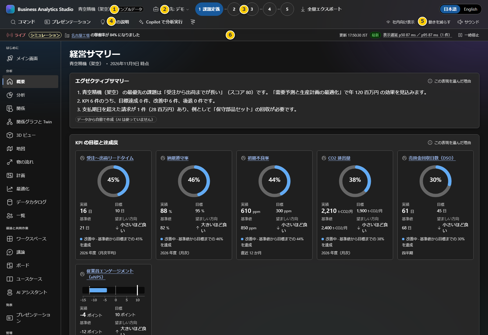
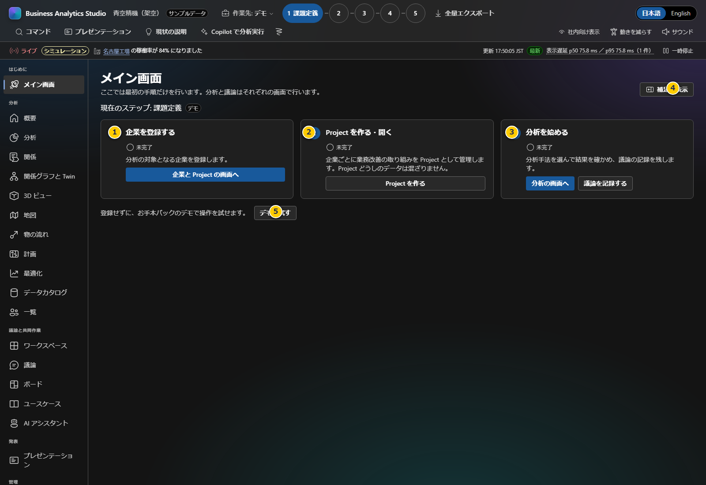

# 第2章 画面の見方と最初の操作

この章では、BAS全体の共通部分と、最初に開くホーム・概要画面を説明します。デモの表示値は架空のサンプルです。

**前:** [第1章 Windowsのセットアップと初回起動](01-setup.md)

**次:** [第3章 企業とProjectの管理](03-projects.md)

## 起動したときの流れ
. **スプラッシュ画面:** アプリ名だけを表示します（顧客名やProject名は出しません）。「スキップ」またはEscで閉じられます。動きを減らす設定では表示しません。. **企業とProjectの選択画面:** 作業する企業とProjectを選びます。「サンプルデータのある企業」（サンプル企業のデモProject）、登録済みの企業とProject、新しい企業とProjectの作成が並びます。顧客パックを取り込んだProjectには「顧客パック取込済み」と表示されます。. **Project画面:** 選んだProjectのメイン画面が開きます。
、再読み込みしても選択画面には戻りません。途中で選び直すときは、画面上部の「Business Analytics Studio」をクリックするか、作業先メニューの「企業と Project の選択画面へ…」を使います。アプリ名はTabキーで選び、EnterまたはSpaceキーでも操作できます。選択画面に戻ってもProjectの作業データは消えません。

## 共通画面の読み方

### 画面上部

| 項目 | 説明 |
|---|---|
| 1. アプリ名とサンプル表示 | 「Business Analytics Studio」をクリックすると、起動時の企業とProjectの選択画面に戻ります。画面がサンプル（架空）のデータを使っている間は「サンプルデータ」バッジが出ます。企業名は作業先に表示します。実データで運用する場合はバッジが出ていないことを毎回確認します |
| 2. 作業先 | デモかProjectかを選びます。「企業と Project の選択画面へ…」で起動時の選択画面に戻れます。Projectに顧客パックを取り込んでいれば、そのProjectを開くと画面がそのパックのデータに切り替わります |
| 3. 業務改善ステップ | 課題定義、現状分析、KPI測定、ユースケース作成、施策計画の位置を示します |
| 4. 共通操作 | コマンド、プレゼンテーション、現状の説明、Copilotで分析実行、インクなどの操作です。AI操作は送信前提やモック表示を確認してください |
| 5. 表示設定 | 社内/社外表示、動きを減らす設定、サウンドを切り替えます。社外表示はアクセス制御ではありません |
| 6. ライブフィード | 業務イベントは「シミュレーション」で、実際の業務システムの通知ではありません。その下の「ニュース」は選択企業について外部から取得した実記事で、出典・公開日時・リンクを表示します |
| 7. ステップの ToDo | ライブフィードの下に、現在のステップの成果物、進み具合、「次にやること」を表示します。広げると完了条件を一覧します。「自動判定」はデータから判定し、「人が確認」は確認した人がチェックします。「Copilotでドラフト作成」で成果物の下書きを作れます（未承認の間はモック表示） |

### 企業ニュース

- 企業のProjectを開くと、その登録企業名でGoogle News RSSを自動検索し、以後5分ごとに取得します。実企業のパックを使うデモではパックの企業名を使い、架空サンプルのデモでは検索しません。
- 外部へ送るのは企業名と言語のみで、Projectの内容や顧客パック本文は送りません。企業名は公開名称を使用してください。日本語／英語の切替に合わせて検索言語も切り替わります。
- 最新記事と出典・公開日時（JST）、取得確認時刻を表示します。「ニュース一覧」を開くと最大10件を確認できます。記事リンクは別タブで開きます。企業名の一致検索であり、同名企業の記事や古い記事を含むことがあります。原文と出典を必ず確認してください。「最新」は取得状態であり、記事が新しいことや内容の正しさを保証しません。
- 「ニュースを更新」で再取得できます（サーバーは5分以内の取得結果を再利用します）。「一時停止」はシミュレーションとニュース取得の両方を停止し、再開するとニュースも取得します。
- 取得失敗は明示し、同じ企業の前回記事があれば取得時刻を残して表示します。企業を切り替えた場合は旧企業の記事を消します。記事がない場合は「見つかりませんでした」と表示し、架空ニュースで補いません。
- インターネット接続とBASのローカルサーバーが必要です。オフライン時やHTMLファイルだけを配信する構成では取得できず、エラーを表示します。APIキーやAI接続設定は不要です。管理者が外部接続先を制限している場合は `news.google.com` の許可が必要です。

### 左側メニュー

| グループ | 主な画面 | 目的 |
|---|---|---|
| はじめに | メイン画面、成果物 | 会社登録、Project作成、分析への案内。各ステップの成果物・完了条件・追加する情報の記入 |
| 分析 | 概要、分析、関係、関係グラフ、3D、地図、物の流れ、計画、最適化、データカタログ、一覧 | パックの情報確認や分析 |
| 議論と共同作業 | ワークスペース、議論、ボード、ユースケース、AIアシスタント | 議論やアイデアの整理 |
| 発表 | プレゼンテーション | ストーリーの再生・説明 |
| 管理 | 企業とProject、データ管理、外部連携、ブランド、AI接続設定、設定 | データと表示、接続の管理。データ管理では顧客パックを確認・取り込みます（[第7章](07-real-data-pack.md)） |

## ホームのクイックスタート

1. **企業を登録する:** 分析対象となる会社を登録します。登録は企業名などの管理情報であり、顧客の実績データを読み込むものではありません。
2. **Projectを作る・開く:** 取り組みごとにProjectを分けます。Project間でKPI・分析・議論の状態は混ざりません。
3. **分析を始める:** 分析手法を選び、結果と議論を記録します。
4. **補足を表示:** 初めての人向けの使い方や顧客パックの説明を開きます。
5. **デモで試す:** 登録前に架空のサンプルを使って機能を確認します。デモの内容は自社データではありません。

ホームは業務を進める順序の案内で、データの自動取込や共同編集を意味しません。デモから実際の企業へ切り替える場合は[第3章](03-projects.md)へ進みます。

## ステップの成果物とToDo

画面上部のステップ（1. 課題定義〜5. 施策計画）ごとに、作る成果物と完了条件が決まっています。

| ステップ | 成果物 | 追加する情報（例） |
|---|---|---|
| 1. 課題定義 | 課題定義書 | 課題ステートメント、影響、対象範囲・対象外、スポンサー、原因の仮説、成功の定義 |
| 2. 現状分析 | 現状分析レポート | 現状の業務の流れ、事実とデータ、真因、データの不足、制約 |
| 3. KPI測定 | KPI定義書（測定計画） | KPIツリー、定義と計算式、データの出所、頻度、責任者 |
| 4. ユースケース作成 | ユースケース定義書 | 利用者、主な流れ、受け入れ条件、必要なデータ、リスク |
| 5. 施策計画 | 施策計画書 | ロードマップ、投資対効果、体制（RACI）、リスク、承認を求める事項 |

1. **ToDoを確認する:** ライブフィードの下の帯の1行目に「次にやること」として、まだ終わっていない最初の完了条件が出ます。帯を広げると完了条件の一覧が並び、未完了の項目が先頭に来ます。「次にやること」や「対応する」をクリックすると、該当の画面・タブを開き、対象コンポーネントまでスクロールしてフォーカスを移します。成果物の未記入・不備は、最初に直す必要のある入力欄へ移ります。
2. **ドラフトを作る:** 「Copilotでドラフト作成」で、顧客パックとProjectのデータから下書きを作ります。実接続が未承認の間は端末内のモックで作り、「モック」と表示します。ドラフトは専用の用途「成果物のドラフト作成」で送るため、ほかの用途を許可しても実接続にはなりません（AI の接続設定の基準表に、未承認の行として表示されます）。入力済みの項目は、指定しない限り置き換えません。
3. **成果物を仕上げる:** 「成果物を開く」で成果物の画面を開き、内容を確かめて直します。数値や期限が必要な項目は、足りないと注意が出ます。
4. **人が確認する:** スポンサーの合意・承認など、データで判定できない項目は確認した人がチェックします。チェックには日付と記入者名が残ります。

そのステップのすべてのタスク（自動判定と人の確認）が完了すると、上部のステップボタンが **GREEN（緑色）とチェック印** に変わります。選択中でないステップも完了状態を表示し、入力を消したり確認チェックを外して未完了に戻るとGREENも解除されます。別のステップを選ぶだけでは完了になりません。完了状態は作業先のProjectごとに判定します。

自動判定は記入の有無やデータのつながりを確かめるもので、内容の正しさを保証するものではありません。主な判定の基準は次のとおりです。

- **数値の照合（2. 現状分析）:** 課題の説明と議論の記録に書いた数値（KPI と同じ単位のもの）が、その KPI の基準値・現状値・目標値のどれかと一致するかを確かめます。合わないときは KPI（担当者・出典・期間がある値）を正として、文章の側を直してください。日付（「3 月 31 日」）や増減（「5 日短縮」）は対象外です。
- **投資回収（5. 施策計画）:** 施策の開始から、構築期間と「投資額 ÷ 年間効果」を足した年数で判定します。上限の既定値 3 年はアプリの仮定です。施策計画の成果物の画面の「判定の基準」で、組織の投資基準（0.5〜10 年）に合わせてください。設定した人と日付が残ります。

帯は「ToDoをたたむ」で1行に縮められます。自分でたたむ・開くを選ぶまでは、画面上部の固定の領域（開いた一覧を含む）が画面の高さの 35% 以内に収まるときだけ一覧を開きます（目安: 1920×1080 の 100% 表示では開き、1440×900 や 125% 表示ではたたんだ状態で始まります）。

## 概要画面を役員・本部長が見るとき

1. **会社名・基準日:** 表示内容の対象会社と日付を確認します。バッジがサンプルなら業務実績として扱わないでください。
2. **エグゼクティブサマリー:** サンプルパックから生成した要約です。事実の証跡ではないため、出典や計算の前提は元資料で確認します。
3. **KPIカード:** 現状値、基準値、目標値、進捗、単位、望ましい方向を読みます。達成率だけで結論を出さず、期間と定義を確認します。
4. **下部の優先順位や課題一覧:** 表示範囲の続きはスクロールして見ます。影響度・実現性等の評価尺度と入力者も確認します。

画面内の「この表現を選んだ理由」を開くと、表示方法の選択理由が確認できます。グラフ表示は分析の判断を代行するものではありません。詳しいKPIの登録は[第4章](04-analysis-kpi.md)、会議のエクスポートは[第8章](08-meetings-and-backup.md)を参照してください。
