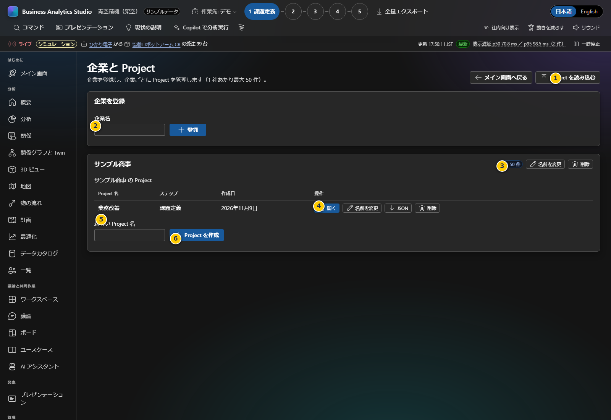

# 第3章 企業とProjectの管理

企業は対象組織、Projectはその企業で行う個別の改善・検討テーマです。Projectを分けることで、議論や分析の作業データが混ざらないようにします。

**前:** [第2章 画面の見方と最初の操作](02-orientation.md)

**次:** [第4章 分析・KPI・OKR](04-analysis-kpi.md)

## 企業とProjectを登録する

1. 左側の「企業とProject」を開きます。
2. 「企業名」欄へ会社名を入力し、「登録」を押します。企業の登録は 1 社につき 1 回だけです。
3. 登録した企業の枠にある「新しいProject名」へ、取り組み名（例:「納期改善」）を入力します。「目的（任意・複数行）」欄に、この Project で解決したいことを書いておくこともできます（あとから「編集」でも書けます）。
4. 「Projectを作成」を押します。企業ごとに最大50件まで作れます。
5. 一覧の「開く」を押すと、そのProjectを作業先として選べます。

### 画面の並び（企業ごとの枠）

企業ごとの枠は、上から次の順に並びます。

1. **企業情報**（業種・公式サイト・企業メモ）: その企業のすべての Project で共通に使います。
2. **Project の一覧**: 各 Project の入力情報（目的・重点・基準日・社内資料・情報源・調査メモ）と、顧客パックの有無を表示します。
3. **Project 同士の関係**: 関係の図と表、関係の登録、関係がありそうな Project の候補、**同じ業務課題かもしれない Project の警告と統合** を表示します。

### 画面項目

| 項目 | 説明 |
|---|---|
| 1. Projectを読み込む | BAS形式で以前に書き出したProject JSONを復元します。任意のExcelや表データは読み込めません |
| 2. 企業名と登録 | 企業を作成します。同名企業は重複登録できません |
| 3. Project数 | 企業に登録された件数と上限（50）を表示します |
| 4. 企業情報を編集 | 企業名・業種・公式サイト・企業メモを変更します。変更はその企業のすべての Project に使われます |
| 5. 企業情報 | 業種・公式サイト・企業メモを表示します。未入力の項目は「未入力」と表示します |
| 6. Project名・顧客パック | Project 名と、顧客パックが「作成済み（日付）」か「未作成」かを表示します |
| 7. 入力情報 | 目的（改行もそのまま表示）・重点・基準日・社内資料のファイル名・情報源（公開ニュース・Work IQ）・調査メモを表示します。目的が未入力なら「目的が未入力です」と表示します |
| 8. ステップ・作成日 | 作業の目安のステップと作成日です |
| 9. 開く・Copilot で作成（不足データを再取得）・編集・JSON・削除 | Projectの選択、顧客パックの作成、入力情報の変更、エクスポート、削除を行います。削除はProject内のローカル保存データも消すため、先にバックアップします |
| 10. 新しいProject名・目的・作成 | 企業の下に改善テーマを追加します。同じ企業内で同一名は登録できません |

## 企業情報は 1 社に 1 回だけ入力する

企業情報（業種・公式サイト・企業メモ）は、Project ごとではなく企業に 1 つだけ保存します。同じ顧客で 2 件目以降の Project を作るときに、もう一度入力する必要はありません。

1. 企業の枠の右上にある **企業情報を編集** を押します。
2. 企業名・業種・公式サイトの URL・企業メモ（組織の特徴や、どの Project にも共通する前提）を入力し、**保存** を押します。
3. 企業の枠のいちばん上の「企業情報」に表示されます。

顧客パックの作成画面でも、企業情報は最初の欄（「企業情報（企業ごとに 1 回）」）に表示されます。登録済みの企業なら、業種と公式サイトが自動で入ります。作成画面で業種や公式サイトを直すと、企業情報も更新され、その企業のすべての Project に使われます。

## Project の入力情報を変更する

1. Project の行の **編集** を押します。
2. Project 名・目的（複数行）・重点・基準日・公開Web調査メモを変更し、**保存** を押します。目的の欄では Enter キーで改行できます。
3. 一覧の「入力情報」の欄に、入力したとおりに（改行も含めて）表示されます。

ここで入力した値は、次に「Copilot で作成」または「不足データを再取得」を押したときに、作成画面へ読み込まれます。

## Project 同士の関係を登録する

顧客が「別の課題」と言っていても、実は同じ課題だったり、一方が他方に依存していたり、相関があったりすることがあります。企業の枠の下にある **Project 同士の関係** で記録します。関係は同じ企業の Project どうしだけです。

| 関係の種類 | 意味 | 図での表示 |
|---|---|---|
| 同じ課題 | 呼び方が違うだけで、同じ課題 | 赤の太線。つながった Project の丸は赤 |
| 依存 | 元の Project は、先の Project が進まないと進まない | 青の線と矢印（元 → 先） |
| 相関 | 一方が良くなると、もう一方も動く | 橙の破線 |

1. 「Project（元）」「種類」「Project（先）」を選びます。必要なら「根拠・メモ」に理由を書きます。
2. **関係を登録** を押します。図に線が追加され、下の表に「Beta は Alpha に依存する」のような文で表示されます。
3. 不要になった関係は、表の **削除** で消します。種類を変えるときは、削除してから登録し直します。

次の場合は登録できず、理由が表示されます。

- 同じ Project どうし、別の企業の Project どうし
- すでに関係がある 2 つの Project（1 組に関係は 1 つ）
- 依存が循環する場合（たどると元の Project に戻る）

「同じ課題」でつながった Project があると、「同じ課題としてまとまっている Project があります」と表示されます。1 つの Project にまとめるか、分けたままにするかを顧客と確認してください（アプリは自動でまとめません）。

**関係がありそうな Project（候補）:** 名前・目的・重点の文章が似ている組み合わせを、類似度（%）と共通の語とともに最大 5 件表示します（類似度 20% 以上。PARAM-150）。候補はアプリの機械的な計算で、生成 AI には送りません。内容を確かめてから「同じ課題として登録」「相関として登録」「→ の依存として登録」のどれかを押します。関係を登録した組み合わせは候補から消えます。

## 同じ業務課題かもしれない Project を統合する

顧客が別々の課題として話した Project が、言葉は違っても同じ業務課題のことがあります（例: 「既存顧客の解約を減らす」と「Reduce churn and protect renewal revenue」）。アプリはこうした組み合わせを見つけると、**同じ業務課題かもしれない Project** に警告と **根拠** を表示します。統合は、あなたが確かめて合意したときだけ行います。自動では統合しません。

### 何を根拠に警告するか

文章の見た目の重なりだけではなく、次の業務上の根拠を合計した「根拠の強さ」（0〜100%）が 50% 以上の組み合わせを警告します（PARAM-151）。

| 根拠 | 内容 | 1 件の点数（上限） |
|---|---|---|
| 「同じ課題」の関係 | あなたが「同じ課題」として登録した | 50%（50%） |
| 業務テーマが同じ | 名前・目的・重点から、売上・受注、顧客維持・解約、商談・案件管理など 17 の業務テーマを読み取ります。「解約」「離反」「churn」「retention」のように、言い方や言語が違っても同じテーマとして扱います | 25%（50%） |
| 顧客パックに同じ課題・原因 | 2 つの Project の顧客パックに、同じ課題・原因がある | 25%（50%） |
| 顧客パックに同じ KPI・OKR | 同じ KPI や OKR がある | 20%（40%） |
| 顧客パックに同じ施策 | 同じ施策・ソリューションがある | 15%（30%） |
| 顧客パックに同じデータ | データカタログに同じデータがある | 10%（20%） |
| 文章の重なり | 名前・目的・重点の文章の重なり（20% 以上のとき） | 重なりの割合（40%） |

点数と上限は PARAM-152 です。顧客パックの根拠は、**2 つとも顧客パックがあるときだけ** 使います。パックの項目名は、表記の違いを吸収して比べます（2 文字単位の重なりが 60% 以上なら同じ項目。PARAM-154）。Project が 3 つ以上あるとき、**すべての Project に共通する** テーマやパックの項目は、組み合わせの違いを示さないので根拠から外します。

判定はアプリの決まった計算で、生成 AI には送りません。外部への送信も費用もなく、同じ入力なら同じ結果になります。

### 警告を確かめて統合する

1. 警告の **根拠** を読み、2 つの Project が本当に同じ業務課題かを顧客と確認します。
2. 同じ課題なら **統合を検討…** を押します。統合の画面が開きます。
3. 画面上部の **比較の表** で、2 つの Project の目的・重点・基準日・調査メモ・資料・顧客パックの有無・作成日を並べて確かめます。
4. **残す Project** を選びます。最初は、顧客パックがある方（どちらも同じなら古い方）が選ばれています。もう一方は、残す Project にまとめられて削除されます。
5. **統合後の名前** を確かめます。統合される側の名前を使うこともできます。
6. **統合後の目的** を確かめます。残す Project の目的の下に、「【統合元: 名前】」という見出しを付けて、もう一方の目的が加えてあります。顧客と合意した 1 つの目的に書き直してください。重点・調査メモ・資料のファイル名・情報源の設定も、両方の内容をまとめます。
7. **統合で起きること** を読みます。関係の移動、移せない関係（2 つの間の関係・重複する関係・依存が循環する関係）の削除、統合される側の顧客パックと作業データの削除が書かれています。
8. 統合される側のデータが必要になりそうなら、**JSON で保存（統合前の控え）** を押して保存します。統合は、この JSON からしか元に戻せません。
9. **顧客と確認し、1 つの業務課題としてまとめることに合意した** にチェックを入れます。チェックを入れるまで、統合のボタンは押せません。
10. **（統合される側）を（残す側）に統合** を押します。完了のメッセージに、移した関係と削除した関係の件数が表示されます。
11. 残した Project の入力情報の **統合した Project** に、統合元の名前・日付・根拠の強さが残ります。名前を押すと、そのときの根拠と統合元の目的を見られます。
12. 統合後は、残した Project の顧客パックを、まとめた目的で作成するか、**不足データを再取得** で更新してください。

### 別の課題だった場合

顧客と確認して別の課題だったときは、**別の課題として確認済み** を押します。警告は消え、下の一覧に確認した組み合わせが残ります。

- その後、顧客パックを作成したなどで根拠の強さが 25% 以上増えると、もう一度警告します（PARAM-153）。
- 間違えて押したときは、一覧の **警告に戻す** を押します。
- 2 つの Project を「依存」または「相関」として関係を登録した組み合わせは、意図して別の Project にしているものとして警告しません。

## 顧客パックを Copilot で作る・AI 設定

起動時の「企業と Project を選ぶ」画面と「企業とProject」の管理画面から、設定済みの生成AI（Azure の Microsoft Foundry または GitHub Copilot）に顧客パックを作らせることができます。手順の詳細は [第7章 画面で作る（Copilot で自動作成）](07-real-data-pack.md#画面で作るcopilot-で自動作成) を参照してください。

- **顧客パックを Copilot で作成**（ロボットとキラキラのアイコン）: 「新しく始める」の欄では入力中の企業名・Project 名で、登録済みの各 Project の行ではその Project に作ります。新しい企業・Project は、検査に通ったパックを保存するときに作られます（失敗・中止したときは作られません）。「新しく始める」で登録済みの企業名を入れると、業種と公式サイトは企業情報から入ります。
- **顧客パックは Project に 1 つ:** 顧客パックがある Project では、ボタンが **不足データを再取得** に変わります。押すと前回の入力が読み込まれ、作成すると今の顧客パックを新しい内容で置き換えます（作成画面に「この Project にはすでに顧客パックがあります」と表示されます）。別の課題として分けたいときは、Project を新しく作ってください。
- **AI 設定**（歯車のアイコン、画面右上）: 接続先（Microsoft Foundry / GitHub Copilot）、Foundry のエンドポイント・デプロイ・API キー、Copilot のサインイン状態とモデル、単価、月の予算、実接続の切替を、アプリを開かずに設定できます。作成のダイアログの「AI 設定を開く」からも開けます。
- Foundry は API キーと単価を用意し、送信先・概算費用に同意して **接続をテストして保存** を押します。モデルの応答を確認できた設定だけが利用可能になります。旧保存値は自動で接続済みにはしません。URL の選び方とエラーの対処は [第7章の接続設定](07-real-data-pack.md#foundry-の接続を設定する) を参照してください。
## 名前の変更・削除

起動時の「企業と Project を選ぶ」画面では、登録済み企業と各Projectの「名前を変更」「削除」を使えます。「企業とProject」の管理画面では、企業名は「企業情報を編集」、Project 名は「編集」で変更します（入力の規則は同じです）。作業中は上部の「作業先」メニューから選択画面に戻るか、「企業と Project」の管理画面を開きます。サンプル企業・デモProjectは編集・削除の対象外です。

- **名前を変更:** 現在の名前が入ったダイアログで編集し、「保存」を押します。空白だけの名前、同名の企業、同じ企業内の同名Projectは保存できません。別の企業のProjectと同名にすることはできます。前後の空白は除去されます。
- **変更を中止:** 「キャンセル」またはEscapeキーで閉じると、元の名前やデータは変わりません。
- **削除:** 確認画面で対象名を確認してから「削除」を押します。企業の場合は、配下のProject数も表示され、すべてのProjectとそのローカル保存データが削除対象になります。「キャンセル」なら削除されません。

名前を変えてもProjectのID・分析・議論・取り込んだ顧客パックは維持されます（パック自体に含まれる会社名は変更されません）。開いているProjectを削除すると作業先はデモになり、最後に開いたProjectの参照も解除されます。最後のProjectを削除しても企業は残り、新たなProjectを追加できます。

## 作業先の切り替え

上部バーの「作業先」メニューで、デモまたは登録済みのProjectを選びます。Projectで入力したKPI・分析・議論はそのProjectだけに保存されます。Projectを切り替えたときに別Projectの記録が見えないのは正常です。

顧客パック（概要・地図・業務フロー・最適化などの起動時データ）とProjectの作業記録は別の仕組みです。Projectに会社名を登録しても、顧客パックの会社名・KPIやサンプルデータは置き換わりません。パックの実データ化は[第7章](07-real-data-pack.md)を参照してください。

## 保存・移行・削除

- 企業・Project、KPI・分析・議論・レイアウト・設定、顧客パック、手書きボードは、アプリの `.bas-local/device.sqlite` に保存されます。同じPC・同じBASフォルダーなら、ポートやブラウザーが変わっても利用できます。クラウド同期や共同編集はありません。
- 画面の「このPCに保存済み」を確認してから閉じます。別画面の変更は再読み込みで取得します。古い画面から同じ項目を上書きしようとした場合や保存失敗時は操作を停止し、復旧用コピーのダウンロードと再試行を案内します。
- Project一覧の「JSON」でProject全体をファイルへ書き出し、承認された安全な保管場所へ保存します。
- 復元は同じ画面の「Projectを読み込む」からBAS形式のファイルを選びます。既存Project IDとの重複や件数上限により拒否されることがあります。
- 削除は取り消せません。会社を削除すると、その会社のProjectとデータも削除されます。
- 旧版のブラウザー保存データは、元のブラウザー・プロファイル・URLで新版を一度開くと自動移行します。元データをバックアップし、端末の既存データと異なれば上書きせず停止します。旧データを残して端末データを使う選択もできます。移行後は元のポートに戻す必要はありません。
- 移行時のバックアップ（DB内の `legacy_backups`）、元のブラウザーデータ、外部に書き出したファイルは、通常のProject削除とは別管理です。復旧用JSONは技術的な復旧用であり、通常のProjectインポートには使えません。別のBASフォルダー・別PCへ移す場合はエクスポート、または全サーバー停止後の `.bas-local` 全体のバックアップを使います。

Projectを作成したら[第4章](04-analysis-kpi.md)で分析や指標を用意します。
