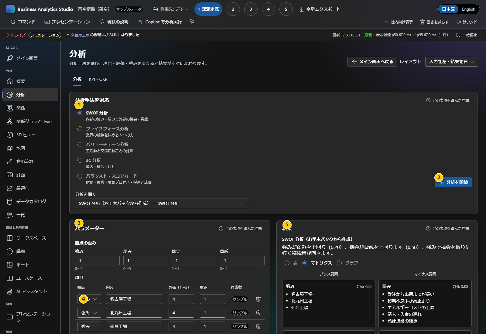
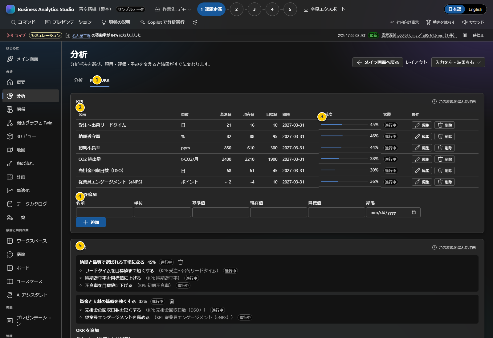

# 第4章 分析・KPI・OKR

この章では、Projectの分析、KPI、OKRを使って検討内容と進捗を記録します。デモの既存項目はサンプルです。実際の会社やProjectで使う場合は対象期間、単位、出典を人が確認し、未確定の仮説を実績として扱わないでください。

**前:** [第3章 企業とProjectの管理](03-projects.md)

**次:** [第5章 議論・決定・次のアクション](05-discussion.md)

## 分析を作る

1. 「分析手法を選ぶ」でSWOT、ファイブフォース、バリューチェーン、3C、バランスト・スコアカードから枠組みを選びます。
2. 「分析を開始」を押すと、その手法の分析が作成されます。既存分析は「分析を開く」から切り替えます。
3. **パラメーター**では観点ごとの重みを設定します。重みは結果への影響を表し、事実の確度ではありません。
4. **項目**では分類、内容、評価（1～5）、重み、作成者を記録します。内容欄に確認済み事実か仮説かを明記すると、会議での誤解を減らせます。
5. **結果**は表、マトリクス、グラフで切り替えます。数値が大きいことは、必ずしも優先的に実行すべきことを意味しません。影響・実現性・リスクを合わせて議論してください。
6. 「項目を追加」で新しい観点を記録します。「AIで下書き」はモックを含むことがあり、画面上の表示を確認し、提案を人が検証してください。

### 主な入力項目の意味

| 項目 | 入力・判断のポイント |
|---|---|
| 観点 | 選択した分析手法に対応する区分です（SWOTなら強み・弱み・機会・脅威） |
| 内容 | 一項目一論点を目安に、根拠や対象範囲を添えて簡潔に書きます |
| 評価 | 画面に示される範囲内で相対評価します。評価ルールをチーム内でそろえます |
| 重み | その項目の優先度を結果へ反映します。根拠の強さとは区別します |
| 作成者 | 人が入力した値か、サンプル・AI提案かを判別します |
| 結果表示 | 表/マトリクス/グラフの切替です。同一データの異なる見せ方なので、見た目だけで結論を変えないようにします |

## KPIとOKRを記録する

1. 上部の「KPI・OKR」タブを開きます。
2. KPI一覧を読み、基準値、現在値、目標値、期限、達成度、状態を確認します。
3. 下のKPI追加フォームへ名称、単位、基準値、現在値、目標値、期限を入力し「追加」を押します。既存行の「編集」から修正できます。
4. OKRフォームでObjective（達成したい目的）とKey Resultを入力し、各Key Resultを対応するKPIへ結び付けます。
5. 期限、単位、指標の望ましい方向（小さいほど良い/大きいほど良い）と、達成率の計算方法が業務上の定義に合うか確認します。

| KPI項目 | 説明 |
|---|---|
| 名称・単位 | 指標名と測定単位。人によって解釈が変わらない定義を使います |
| 基準値・現在値・目標値 | 比較する数値です。対象期間や母数が同じ条件かを確認します |
| 期限 | 目標の期日です |
| 達成度・状態 | 入力値から画面が算出する進捗表示です。実績値の正しさは入力元に照合します |
| Objective / Key Result | Objectiveは目的、Key Resultは成果を測る結果です。各Key ResultをKPIへ結び付けます |

画面のProject KPIはブラウザー内に保存され、顧客パックのKPIとは別です。CSVを用いた一括登録機能はありません。次は[第5章](05-discussion.md)で、結果に対する判断と担当アクションを記録します。
