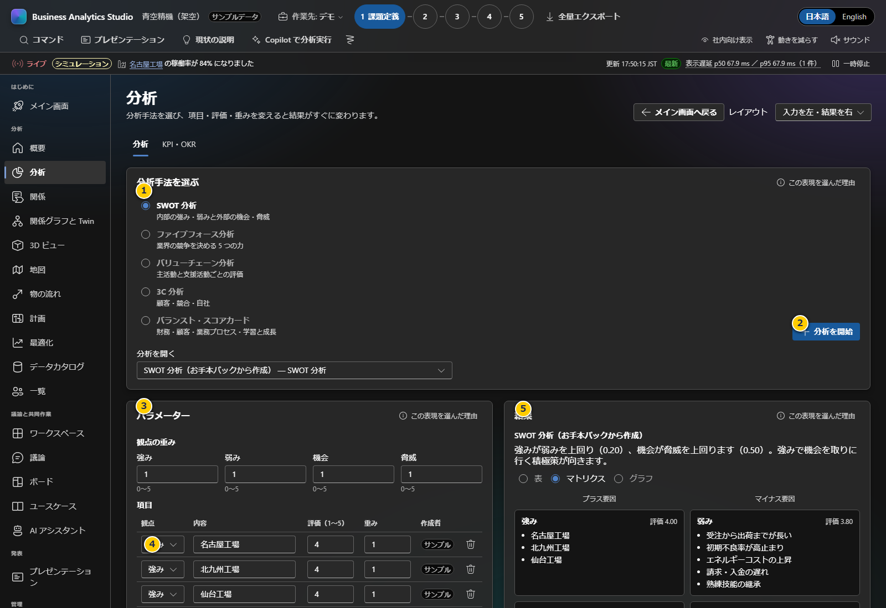
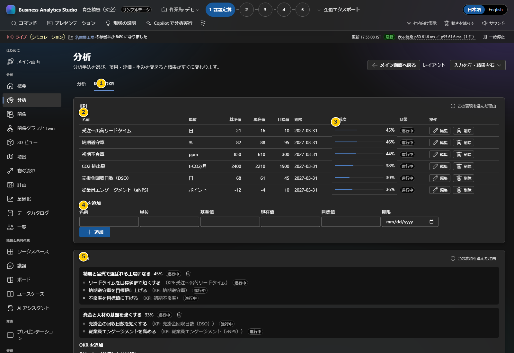

# 第4章 分析・KPI・OKR

この章では、Projectの分析、KPI、OKRを使って検討内容と進捗を記録します。デモの既存項目はサンプルです。実際の会社やProjectで使う場合は対象期間、単位、出典を人が確認し、未確定の仮説を実績として扱わないでください。

**前:** [第3章 企業とProjectの管理](03-projects.md)

**次:** [第5章 議論・決定・次のアクション](05-discussion.md)

## 分析を作る

1. 「分析手法を選ぶ」のアイコン付きボタン（SWOT、ファイブフォース、バリューチェーン、3C、バランスト・スコアカード）を押して、表示する手法を選びます。複数選べ、もう一度押すと外れます。選んだ手法はProjectに保存されます。
2. 選んだ手法はダッシュボードにタイルとして並びます。分析がまだない手法のタイルでは「分析を開始」を押します。タイルの「＋」で同じ手法の分析を新しく作り、同じ手法に複数の分析がある場合はタイル内で表示する分析を切り替えます。
3. タイルの「編集」を押すと、その分析が**パラメーター**に開きます（「編集する分析」でも切り替えられます）。**パラメーター**では観点ごとの重みを設定します。重みは結果への影響を表し、事実の確度ではありません。
4. **項目**では分類、内容、評価（1～5）、重み、作成者を記録します。内容欄に確認済み事実か仮説かを明記すると、会議での誤解を減らせます。
5. 各タイルの結果は、ドットプロット（既定）、マトリクス、表、グラフで切り替えます。ドットプロットでは、1 つの点が 1 つの項目を表し、横位置が評価、点の大きさが重み、縦線が観点の平均です。点にポインターを合わせると項目名と値が表示され、評価を編集すると同じ点が新しい位置へ移動します（視覚効果を減らす設定では即座に移動します）。数値が大きいことは、必ずしも優先的に実行すべきことを意味しません。影響・実現性・リスクを合わせて議論してください。
6. 「項目を追加」で新しい観点を記録します。「Copilot でドラフト作成」は、まず確認用のドラフトを保存します。「承認してアイテムに追加」を押すまで、項目・計算・グラフは変わりません。ドラフトは再読み込み後も残り、破棄できます。生成後に分析の内容や重みを変えた場合は、現在の入力から再生成してください。モックを含むことがあるため、表示と根拠を人が確認してください。
7. タイルの項目（ドットプロットの点、観点の見出し、表の行、グラフの棒）を押すと選択され、ほかのタイルの関連する項目が強調され、関連しない項目は薄く表示されます。BIダッシュボードのクロスハイライトと同じ操作です。グラフでは、関連項目だけの値が濃い棒で重なり、「値（全体 値）」の形で全体と比べられます。ドットプロットは矢印キーで点を移動し、Enterキーで選択できます。もう一度押す、グラフの空白を押す、Escキーまたは「選択を解除」のいずれかで元に戻ります。
   - **同じ対象**（リンクのアイコン）: 同じ顧客パックの要素（拠点、課題、施策、KPIなど）を名前で含む項目、または内容がまったく同じ項目です。
   - **関係でつながる**（フローのアイコン）: 顧客パックの関係で1段つながる要素を含む項目です（例: 課題とそれを測るKPI、課題を解決する施策）。
   - 関連は項目の文言に含まれる要素名から自動で判定します。表記が異なると関連づかないため、強調は議論のきっかけとして使い、因果関係の根拠にはしないでください。

### 主な入力項目の意味

| 項目 | 入力・判断のポイント |
|---|---|
| 観点 | 選択した分析手法に対応する区分です（SWOTなら強み・弱み・機会・脅威） |
| 内容 | 一項目一論点を目安に、根拠や対象範囲を添えて簡潔に書きます |
| 評価 | 画面に示される範囲内で相対評価します。評価ルールをチーム内でそろえます |
| 重み | その項目の優先度を結果へ反映します。根拠の強さとは区別します |
| 作成者 | 人が入力した値か、サンプル・AI提案かを判別します |
| 結果表示 | タイルごとのドットプロット/マトリクス/表/グラフの切替です。同一データの異なる見せ方なので、見た目だけで結論を変えないようにします |
| 関連の強調 | 選んだ項目と同じ対象、または顧客パックの関係でつながる項目を示します。文言からの自動判定なので、人が確認します |

## KPIとOKRを記録する

1. 上部の「KPI・OKR」タブを開きます。
2. KPI一覧を読み、基準値、現在値、目標値、期限、達成度、状態を確認します。
3. 下のKPI追加フォームへ名称、単位、基準値、現在値、目標値、期限を入力し「追加」を押します。既存行の「編集」から修正できます。
4. OKRフォームでObjective（達成したい目的）とKey Resultを入力し、各Key Resultを対応するKPIへ結び付けます。
5. 期限、単位、指標の望ましい方向（小さいほど良い/大きいほど良い）と、達成率の計算方法が業務上の定義に合うか確認します。

| KPI項目 | 説明 |
|---|---|
| 名称・単位 | 指標名と測定単位。人によって解釈が変わらない定義を使います |
| 基準値・現在値・目標値 | 比較する数値です。対象期間や母数が同じ条件かを確認します |
| 期限 | 目標の期日です |
| 達成度・状態 | 入力値から画面が算出する進捗表示です。実績値の正しさは入力元に照合します |
| Objective / Key Result | Objectiveは目的、Key Resultは成果を測る結果です。各Key ResultをKPIへ結び付けます |

### 社内の KPI / OKR から採用する

顧客パックに社内の KPI / OKR（Work IQ で取得）があると、タブの下に一覧が出ます。

1. 使いたい KPI・目標・主要な結果のチェックボックスを選び、「KPIに追加する」または「OKRに追加する」を押します。選んだ項目は「ドラフト」になります。追加済みの項目には「KPI ドラフト」「OKR 採用済み」などと表示され、二重には追加されません。
2. ドラフトの名称・単位・基準値・目標値・期限を確認して直し、「保存」を押します（「すべて保存」でまとめて保存できます）。保存するまで KPI 一覧・OKR・達成度には入りません。
3. 「Copilotでドラフト作成」を押すと、Project の目的に合う候補を Copilot が選び、KPI（最大 5 件）・OKR（最大 3 件）のドラフトを作ります。選んだ理由が各ドラフトに表示されます。実接続と AI 設定での `kpiOkrDraft` の許可が必要です。送るのは Project の目的・既存の KPI/OKR の名前と目標・まだ採用していない候補だけで、候補の件数と推定費用がボタンの下に出ます。

数値と単位は社内の記載から読み取り、Copilot には作らせません。Copilot の文に、社内データにも目的にもない数値があると注意が表示されます。「未計測」の現状や「FY27」のような年度は基準値・期限に入れず空欄にするため、保存前に業務上の定義を確認して入力してください。保存した KPI・OKR は出どころが「顧客の定義」になり、採用元の候補を記録します。

目標（OKR）を採用すると、主要な結果ごとに測る KPI がつながります。主要な結果が社内の KPI と同じ数値と同じ語（または「倍」「件」などの単位）を含むときは、その KPI につなぎ、同じ指標のドラフトを二重に作りません。「Agents at the core」のように数値のない主要な結果や、1 文に複数の指標（例: 5 件と 20%）を含む主要な結果は、その文から KPI のドラフトを作るので、測り方と目標値を入力してください。

Azure のコンテンツ フィルターが要求を拒否したときは、その旨が表示されます。社内の KPI / OKR の名前や定義に、AI への指示のように読める文がないか確認してください。その場合も、一覧から選んで手動で採用できます。

画面のProject KPIはブラウザー内に保存され、顧客パックのKPIとは別です。CSVを用いた一括登録機能はありません。次は[第5章](05-discussion.md)で、結果に対する判断と担当アクションを記録します。
