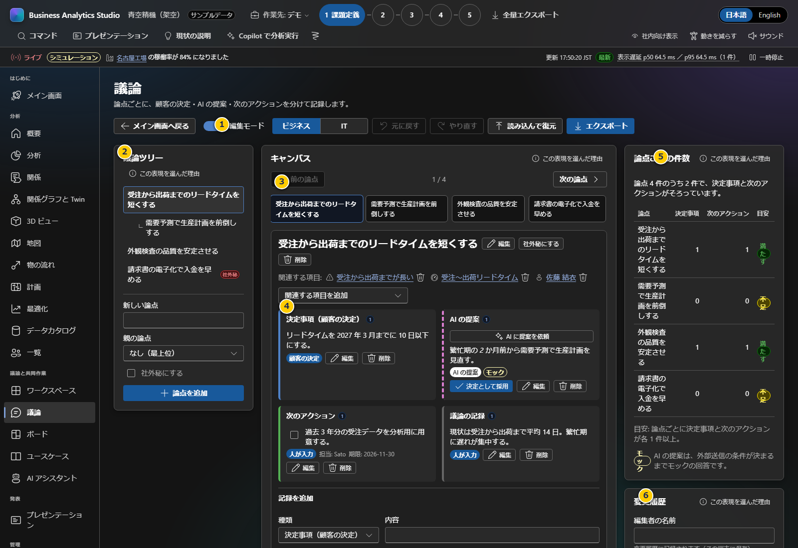

# 第5章 議論・決定・次のアクション

議論画面は、取り組みの論点ごとに人の決定、AI等の提案、次のアクション、メモを分けて残します。画面のデモ内容は架空のサンプルです。

**前:** [第4章 分析・KPI・OKR](04-analysis-kpi.md)

**次:** [第6章 データカタログの取り込みと突合](06-data-catalog.md)

## 画面の構成

| 番号 | 画面項目 | 説明 |
|---|---|---|
| 1 | 編集モード | 論点や記録の追加・変更を行います。表示だけで使う場合はオフにします |
| 2 | Business / IT レンズ | 用語集に沿って、業務向け・IT向けの用語表示を切り替えます |
| 3 | 元に戻す / やり直す | 議論の変更を戻す・再適用します。変更履歴も確認してください |
| 4 | 読み込んで復元 / エクスポート | BAS形式の議論データを読み込むか、出力ダイアログを開きます |
| 5 | 議論ツリー | 論点の親子関係と選択中の論点を示します。下に新しい論点を追加できます |
| 6 | キャンバスの論点タブ | 登録済み論点を選択し、前後の論点へ移動します |
| 7 | 選択中の論点カード | 関連項目、決定事項、提案、アクション、メモを記録します |
| 8 | 件数と変更履歴 | 論点ごとの決定・アクションの揃い具合、編集者名や直近の操作を確認します |
| 9 | 社外秘にする | 論点を社内向けに分類します。共有前に表示・出力から除外されているか確認してください |

## 論点を追加し、会議の内容を残す

1. 左側の「新しい論点」に論点名を入力します。
2. 必要なら「親の論点」で既存論点を選択し、論点ツリーを階層化します。循環する親子関係は登録できません。
3. 内部情報を含む場合は「社外秘にする」を選び、「論点を追加」を押します。
4. 論点を選び、キャンバスから「決定事項（顧客の決定）」「AIの提案」「次のアクション」「議論の記録」を追加します。
5. 次のアクションに担当者と期限を設定し、会議後に完了状態を更新します。
6. 「変更履歴」で誰が何を変更したかを確認します。名前は利用者が入力する記録情報であり、ログイン認証ではありません。

顧客が決めた事項と、AI・メンバーが提案した内容は種別を混同しないでください。AIの提案がモックとして示された場合、実際に外部モデルが回答したものではありません。人が確認・採用するまで決定事項にはなりません。

## 課題・施策・KPI などのデータを入力する

議論と共同作業のデータ（課題、KPI、施策、顧客、案件、成果物、請求、担当者など）は画面から追加・編集・削除できます。

- 議論画面: 編集モードをオンにし、論点のキャンバスで「新しい項目を作成して関連付け…」から種別を選びます。保存すると、その論点の関連項目に追加されます。関連項目の鉛筆ボタンで内容を編集できます。
- Workspace: 「エグゼクティブサマリー」「優先度マトリクス」「優先順位のランキング」「KPI」「業務の連鎖」の各コンポーネント上部のツールバーで「（種別）を追加」または「既存の項目を編集…」を使います。
- 必須項目や参照先（例: 案件には製品と担当者、施策には対象の課題）が足りない場合は保存できません。参照先はダイアログ内の「新しい（種別）を作成」からその場で作れます。他のデータから参照されている項目は削除できません。

保存先は対象の Project によって変わります。

- 顧客パックを取り込んだ Project: 取り込んだ顧客パックそのものに書き込みます。
- それ以外（サンプルデータを使う Project）: 共通のサンプルデータは変更せず、その Project の変更として保存します。Project の出力・バックアップに含まれ、他の Project には表示されません。

画面から入力したデータの作成者は「人」として記録されます。

## 入力・共有時の注意

- 人名、期限、金額などを含む場合は、利用目的と公開範囲を確認してから入力します。
- `internal` は社内向け、`shareable` は共有可能な分類です。外部向け表示はデータアクセスを制限しません。
- 入力内容はProjectごとのブラウザー保存です。会議後はProject全体または議論の出力を保管してください。
- 読み込むJSON/MarkdownはBASの出力形式に限られます。任意の議事録ファイルを自動解釈するものではありません。

会議記録の出力プレビューや共有チェックは[第8章](08-meetings-and-backup.md)、Projectのバックアップは[第3章](03-projects.md)を参照してください。
