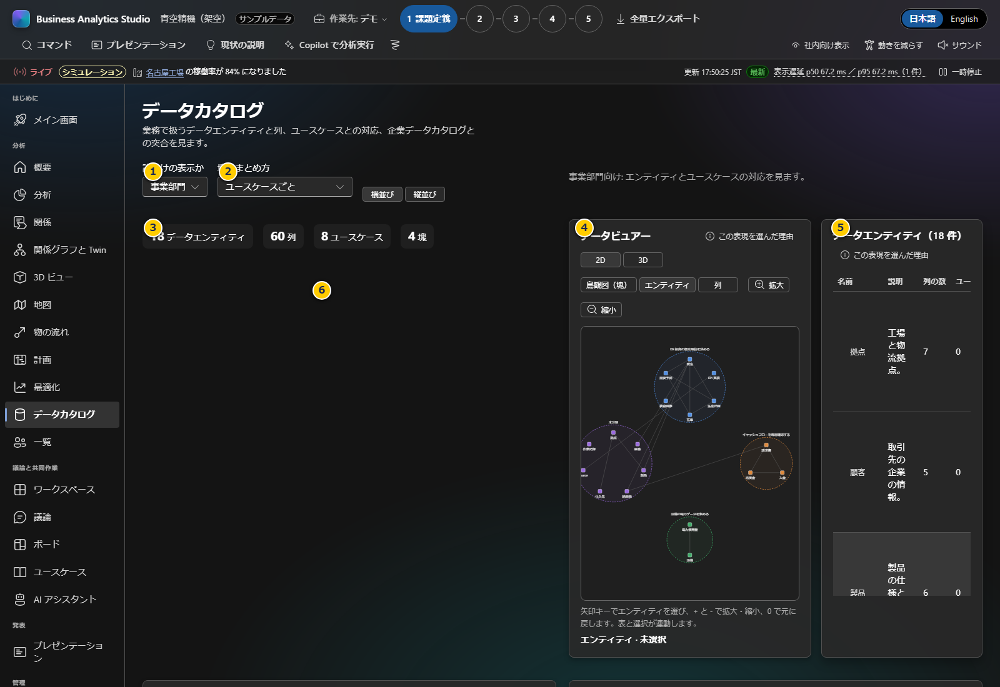
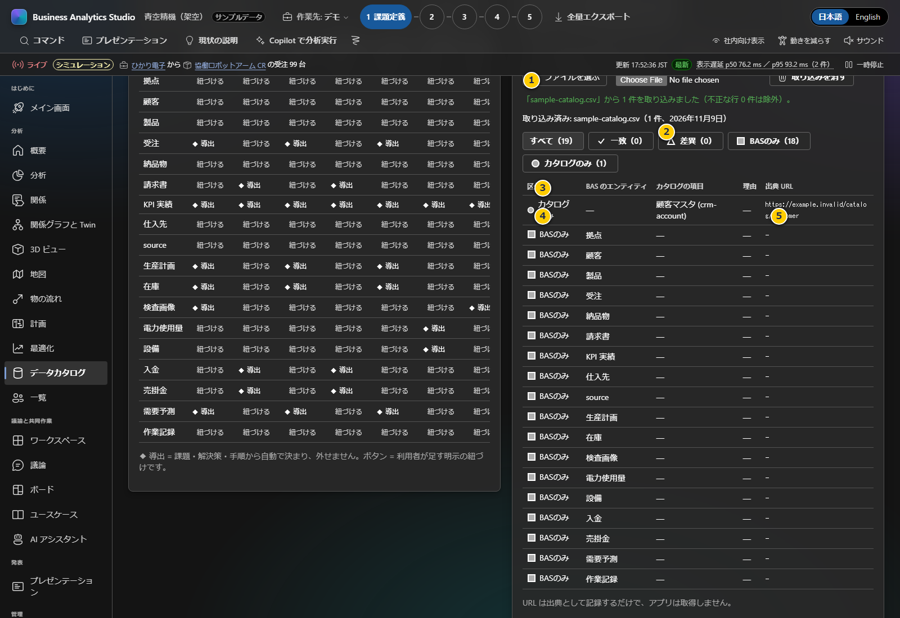

# 第6章 データカタログの取り込みと突合

この画面で読み込めるのは、企業の**データ項目一覧・データ辞書**です。売上明細、受注レコード、顧客名簿などの実績データを取り込む機能ではありません。BASの顧客パックやユースケースが参照するデータエンティティと、企業のカタログを見比べます。

**前:** [第5章 議論・決定・次のアクション](05-discussion.md)

**次:** [第7章 実データと顧客パック](07-real-data-pack.md)

## 画面の見方





取込結果画面の番号は次のとおりです。

| 番号 | 画面項目 | 説明 |
|---|---|---|
| 1 | ファイル選択 | 企業のデータ辞書CSV/JSONをローカルで読み込みます |
| 2 | 結果フィルター | 全件・一致・差異・BASのみ・カタログのみを件数付きで絞り込みます |
| 3 | 突合結果の列 | 区分、BAS側の項目、カタログ側の項目、理由、出典URLを表示します |
| 4 | カタログのみの行 | BAS側に対応する項目が見つからなかった取込項目です |
| 5 | 出典URL | 値は記録されますが、リンク先をBASが取得することはありません |

| 番号 | 画面項目 | 説明 |
|---|---|---|
| 1 | ペルソナ表示 | 経営者、事業部門、IT、現場など、利用者に合わせて図の詳細度を変えます |
| 2 | 塊のまとめ方 | 関連項目をユースケース別または業務領域別に整理します |
| 3 | 件数サマリー | エンティティ、列、ユースケース、グループの件数です。件数はカタログ品質や網羅性を保証しません |
| 4 | データビュアー | データ項目間の関係を2D/3Dで眺めます。拡大・縮小や選択で対象を確認します |
| 5 | エンティティ一覧 | 名称、説明、列数、ユースケースとの関係を表で確認します |
| 6 | エンティティ×ユースケース表 | 「導出」はパック内の関連から自動表示された対応、「紐づける」は利用者が追加した対応です |
| 7 | 企業データカタログの取り込みと突合 | 下へスクロールすると表示されるJSON/CSV取込欄です。利用できる形式と上限を確認してから選択します |
| 8 | 突合結果 | 一致、差異、BASのみ、カタログのみの件数・行を表示します。列や名称の差異を確認します |
| 9 | ToDo | カタログにないBAS側の項目に基づく作業項目を追加します |

## CSVまたはJSONの項目一覧を取り込む

### CSV形式

UTF-8のCSVを用意します。ヘッダーに `name` が必須です。利用できる列は以下です。

| 列 | 必須 | 内容 |
|---|---:|---|
| `name` | はい | データ項目名 |
| `id` | いいえ | BASや社内カタログで使う識別子 |
| `description` | いいえ | 説明 |
| `columns` | いいえ | 列名。複数列は `;` または `|` で区切る |
| `domain` | いいえ | 業務領域 |
| `url` | いいえ | 出典URL（記録のみ。BASはURL先を取得しません） |

```csv
id,name,description,columns,domain,url
crm-account,顧客マスタ,顧客の基本情報,顧客ID;会社名;地域,営業,https://example.invalid/catalog/customer
```

この例の内容・URLは架空です。共有が許可されている自社カタログの情報へ置き換えてください。

### JSON形式

JSONは配列、または `items` 配列を持つオブジェクトにします。

```json
{
  "items": [
    {
      "id": "crm-account",
      "name": "顧客マスタ",
      "description": "顧客の基本情報",
      "columns": ["顧客ID", "会社名", "地域"],
      "domain": "営業"
    }
  ]
}
```

1ファイルは5 MiB以下、項目は最大5,000件です。画面の「ファイルを選ぶ」でCSVまたはJSONを指定します。ファイル全体が読めない場合は既存の取込データを保持します。有効な行と不正な行が混在する場合、不正行は除外され、行番号とフィールドが表示されます。読み込んだデータは現在のProjectのローカル保存領域に入ります。

### 結果を読む

- **一致:** IDまたは正規化した名称が一致し、両方に列情報がある場合は列も一致した項目です。
- **差異:** 対応づいた項目ですが、名称や列に差があります。表の理由を確認します。
- **BASのみ:** BAS側にあり、取り込んだ企業カタログに対応項目がありません。
- **カタログのみ:** 企業カタログにあり、BASの項目に対応しません。

自動突合は候補づけです。同じ名称でも定義や粒度が異なる場合は人が確かめます。取引データそのものを分析するには、手入力または[第7章の顧客パック](07-real-data-pack.md)を利用します。
