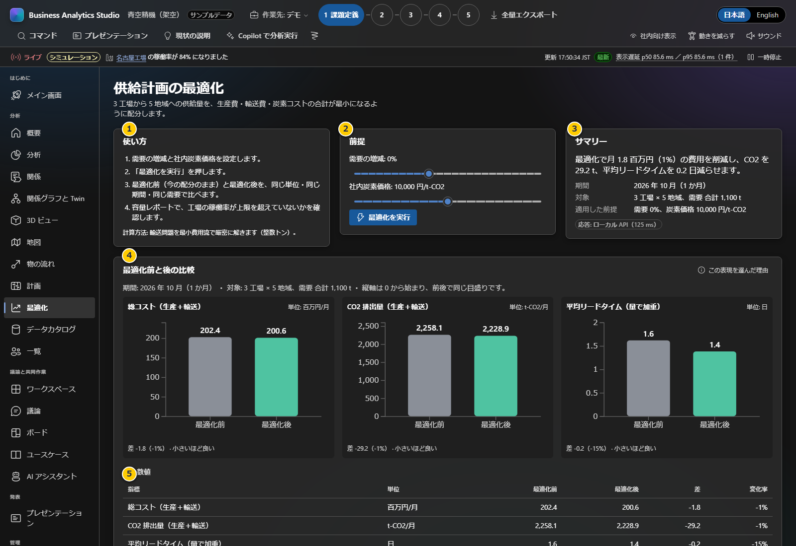

# 第7章 実データと顧客パック

顧客パックは、概要・関係・地図・業務フロー・最適化などの画面が起動時に読むJSONデータです。Excel/CSVを実績パックへ自動変換する機能はありません。作業は承認済みデータの加工と、スキーマの分かる担当者が行ってください。

**前:** [第6章 データカタログの取り込みと突合](06-data-catalog.md)

**次:** [第8章 会議での確認・出力・保管](08-meetings-and-backup.md)

## 実データ利用の承認と選択

実際のファイルを扱う前に、データ所有者、利用目的、個人情報・契約上の制限、出典、共有範囲を確認します。必要最小限の集計値を使い、未承認の顧客情報・個人情報をチャットやAI、外部サービスへ送らないでください。`internal` / `shareable` と社外表示はセキュリティアクセス制御ではありません。

利用目的別に方法を選びます。

| 目的 | 推奨経路 | 入力先 |
|---|---|---|
| 少数のKPI、会議論点、分析 | Projectへ手入力 | [第4章](04-analysis-kpi.md)、[第5章](05-discussion.md) |
| BASの項目と社内カタログを比較 | CSV/JSONのデータ辞書を取り込み | [第6章](06-data-catalog.md) |
| 概要・地図・関係・業務フロー・最適化へ反映 | 顧客パックをJSONとして整備 | この章 |

### `build` コマンドの重要な注意

```powershell
node scripts/bas.ts build "Contoso" --industry manufacturing --lang ja
```

このコマンドは作業フォルダーを作り、**架空サンプルをもとにした初期パック**を生成します。顧客名を指定しても、実データ取得・変換・AI生成は行われません。外部調査やLLMは現在ブロックされています。`build` を同じ顧客で再実行すると `work\<slug>\` が作り直され、その中の編集済みファイルが消えるので、先にバックアップしてください。

## パックの編集

1. [第1章](01-setup.md)のセットアップを済ませます。
2. 上記 `build` コマンドを一度実行して作業フォルダーを作ります。
3. `work\<slug>\data\pack.json` をJSONエディターで開きます。`<slug>` は実際の生成フォルダー名に置き換えます（Contosoの場合 `work\contoso\data\pack.json`）。
4. 架空サンプルの値・名称・出典・関係を、許可された実データへ置き換えます。Excel/CSVからの自動変換はないため、エンティティ間のID参照も合わせて作業します。
5. 内容が完全に実データで置き換わった後にのみ `isSample` を `false` にします。フラグだけを変えてサンプルを実データとして見せてはいけません。

パックの正式スキーマ: [`docs/pack.schema.json`](../docs/pack.schema.json)（生成元: [`src/data/schema.ts`](../src/data/schema.ts)）

### 主要なJSON項目

| 項目 | 作業の要点 |
|---|---|
| `packId` | パックを識別するID |
| `company.name` / `company.industry` | 画面に出る企業名と業種。表示文は `ja` と `en` の両方を設定 |
| `isSample` | サンプルパックかどうか。実データへの置換と確認が済むまで `true` のまま |
| `regions` | 地域IDと日英の表示名 |
| `entities` | 拠点、人物、顧客、製品、案件、KPI、課題、解決策、施策、出典などのレコード |
| `id` | 一意のID。英小文字から始める形式（例 `site-tokyo`） |
| `sourceIds` | 数値の根拠となる出典エンティティID。対象IDは `kind: "source"` でなければならない |
| `classification` | `internal` は社内向け、`shareable` は共有可能。共有可否は社内ルールで判断 |
| `author` | `human`、`sample`、`ai`。値の由来を事実どおり区別 |
| `flows` | 供給元・拠点・地域・顧客等の物量フロー。単位は月間トン |
| `optimization` | 工場能力・需要・生産/輸送コスト・CO2・リードタイム・現行配分の入力 |
| `extensions` | ブランドやデータカタログなど、各機能の拡張データ。使わないサンプル値を残さない |

数値には定義、単位、対象期間、出典を付けます。参照IDは実在し、必要な種類（たとえば `ownerId` が人物、`siteId` が拠点）を指す必要があります。表示テキストを持つレコードは日英両方を埋め、空文字を避けてください。特に `flows` と `optimization` は表の行列の順・単位・期間をそろえます。

## 検証して顧客パックを起動する

### 1. 検証

```powershell
node scripts/bas.ts verify ".\work\contoso\data\pack.json"
```

`PASS` を確認します。検査は構造、ID重複、参照、数値の出典、ブランド色、社内分類などを確認します。FAILの場合は原因と次の対処が出るのでJSONを修正して再実行します。PASSは、値が現実と一致すること、計算が正しいこと、利用権限があることを保証しません。データオーナーが元資料と照合してください。

### 2. 起動

```powershell
node scripts/bas.ts launch "Contoso" --port 4180
```

または:

```powershell
.\start.ps1 -Customer "Contoso" -Port 4180
```

ブラウザーで表示された `http://127.0.0.1:4180/` を開き、会社名と「サンプルデータ」バッジを確認します。`isSample: false` のパックならサンプルバッジは表示されません。誤った会社名、またはサンプルバッジが出る場合、パックの配置・JSON・起動対象を再確認してください。

顧客パックには読み取り専用のパック内容が適用されます。ここで入力したProjectのKPI/分析/議論は別途ブラウザー内に保存されます。Project単位の入力は[第3章](03-projects.md)を参照してください。

## データパックの読み方



この画面もキャプチャ時点では架空のサンプルです。

1. **使い方:** 需要の増減と社内炭素価格を設定し、「最適化を実行」を押します。
2. **前提:** スライダーが設定した条件を示します。現実に採用された計画や予測ではありません。
3. **サマリー:** モデル計算の結果を短く表示します。入力したデータ・制約の範囲で解釈してください。
4. **最適化前と後の比較:** 生産費・輸送費、CO2、平均リードタイムなどを同じ単位で比較します。差がどの前提に依存するか確認します。
5. **容量レポート・配分:** 工場能力、稼働率、地域別割当を確認します。能力超過や需要不足などの警告を見落とさないでください。

## 配布用パッケージ

`node scripts/bas.ts package "Contoso"` は `work\contoso-package\` にアプリとパックを含むオフライン配布物を作ります。起動時にnpmインストールは不要ですが、データファイルは暗号化・アクセス制御されません。内容が読み取り可能な状態で含まれるため、配布と保管に組織の承認を得てください。

顧客パック・ブランド・アセットは社内で承認された保護された経路でのみ移動し、不要な一時ファイルを削除します。会議での確認・出力方法は[第8章](08-meetings-and-backup.md)に進みます。
