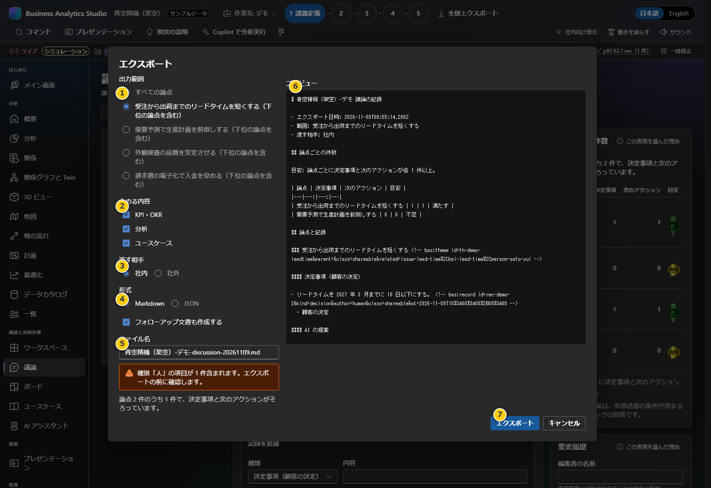

# 第8章 会議での確認・出力・保管

グラフや要約は、経営会議で前提と選択肢を揃えるための道具です。結論を自動決定する機能ではありません。会議で数値を使うときは、データの出典、期間、単位、仮定、担当者の確認状況を合わせて説明してください。

**前:** [第7章 実データと顧客パック](07-real-data-pack.md)

**次:** [ユーザーガイド目次](README.md)

## 経営層向けの確認手順

1. 画面上部の会社名、サンプルバッジ、作業先（デモ/Project）を確認します。
2. エグゼクティブサマリーの元となるKPI・課題・期間・出典を担当者と照合します。
3. 目標に対する進捗は、指標の単位・望ましい方向・母数・対象期間が正しいかを確認します。
4. 最適化は条件を変えたシミュレーションとして見ます。需要、炭素価格、生産能力、配分条件を読み上げ、変更の効果とトレードオフを確認します。
5. 議論画面で決定と提案を区別し、次のアクションに責任者と期限を記録します。
6. 共有用の画面やファイルを作る場合、社外秘情報・人物情報・未確認値を含まないか別の人にも確認してもらいます。

### 指標の読み方

- KPIの基準値・現状値・目標値は、同じ単位と定義で比較します。画面の達成率は入力値からの計算であり、データの真偽を判定しません。
- 「小さいほど良い」指標と「大きいほど良い」指標を取り違えないでください。
- 最適化結果はモデル制約内の解です。現場の例外、供給途絶、品質、契約、実行可能性を別途確認します。
- ライブフィードには「シミュレーション」と表示されます。実業務システムの通知ではありません。
- 表示方法の採用理由を確認するには、パネルの「この表現を選んだ理由」を開きます。

## 議論をエクスポートする

1. 議論画面で「エクスポート」を押します。
2. **出力範囲**で全論点か特定論点を選びます。
3. **含める内容**でKPI・OKR、分析、ユースケースを含めるか選択します。
4. **渡す相手**を社内/社外から選びます。外部向けなら除外件数を確認し、プレビューを最後まで読みます。
5. **形式**をMarkdownまたはJSONから選び、必要に応じてファイル名を修正します。
6. 「フォローアップ文書も作成する」を使う場合は、別ファイルが作られることを確認します。
7. 人物情報を含む場合、続ける前に表示される確認画面で対象者と共有先を見直します。
8. 内容に問題がなければ「エクスポート」を押し、承認された保管先を選びます。

### 生成AIのトークン使用量

エクスポート画面には、この Project で Microsoft Foundry / GitHub Copilot を使った分のトークン使用量が表示されます。行はステップ（顧客パックの作成の「基盤」「業務」「検査と修正」、「現状の説明」など）ごとで、送信回数・入力・出力・合計トークン・費用を示し、「書き出し（生成AIは使いません）」は 0、最後の行が総合計です。

- 数値は各サービスが応答で報告したトークン数です。モックの応答は 0 として数えません。中止・タイムアウトした送信はアプリの推定値で記録し、「（推定を含む）」と表示します。
- この機能より前の記録や、Project に結び付かない接続テストは含みません。
- Markdown で **社内** 向けに出力すると、同じ表を「生成AIのトークン使用量」として含めます。**社外** 向けと JSON には含めません。
- 請求額との照合: Foundry は Azure Portal の対象リソースの **メトリック**（Processed Prompt Tokens / Generated Completion Tokens、デプロイ名で分割）と **コスト分析**、GitHub Copilot は GitHub の **Billing and licensing → Usage**（プレミアム要求の利用状況レポート）で確認してください。Copilot のプレミアム要求はトークン数ではなく要求回数で課金されます。

| 項目 | 判断ポイント |
|---|---|
| 出力範囲 | 共有先に必要な論点だけか。親子論点の扱いもプレビューで確認 |
| 含める内容 | 会議に不要なKPI・分析・ユースケースを出力しない |
| 渡す相手 | 「社外」は出力時の分類フィルターです。認証やアクセス制限ではありません |
| 形式 | Markdownは人が読んで共有しやすく、JSONはBAS連携・復元に使います。個人情報はどちらにも含まれ得ます |
| プレビュー | ファイルへ保存される最終内容を確認します。人名・社内数値・AIモックなどを確認 |
| 人物情報の確認 | 人物が含まれることを知らせる確認です。承認を自動で代行するものではありません |

画面上で外部向け表示に切り替えただけでは、エクスポートファイルや他の画面のすべてから機密情報が消えるとは限りません。**出力設定とプレビューを必ず個別に確認**してください。

## バックアップと復元

- **Project全体:** 「企業とProject」画面で対象Projectの「JSON」を押します。生成ファイルにはProjectの作業データが入るため、承認された暗号化保管場所へ保存します。復元は同じ画面の「Projectを読み込む」です。
- **議論の記録:** 議論画面のエクスポートからMarkdownまたはJSONを保存します。これはProject全体のバックアップと同じではありません。
- **顧客パック:** `work\<slug>\data\pack.json` と参照するブランド・アセットを含めて、保護された場所にコピーします。`build` を再実行するとフォルダーが作り直されるため、その前にバックアップします。
- **削除:** Project/企業の削除は保存データも消去し、元に戻せません。エクスポートの存在を確認してから実行します。
- **別端末で使う:** ブラウザーローカルストレージは同期されません。ProjectのBAS形式エクスポート、またはパックを承認済みの手段で移します。

保管先や保持期間は社内規定に従います。オフライン配布物もデータを暗号化しません。実データの取り扱いと共有範囲は、[第7章](07-real-data-pack.md)の注意事項も確認してください。
