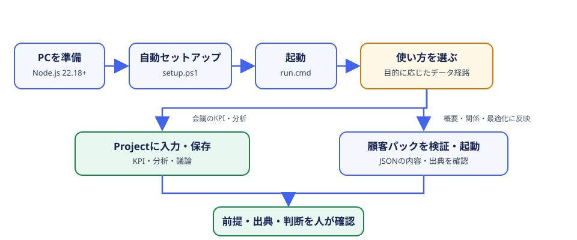
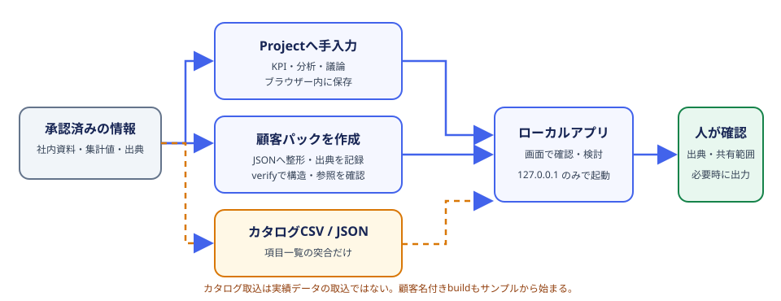

# Business Analytics Studio ユーザーガイド

経営企画・業務改善担当者、役員・本部長など、初めてBASを使う方向けの操作ガイドです。各章に実際のサンプル画面と、画面内の主な項目の説明を掲載しています。章は前から順に読めます。前後リンクをたどるか、目的に合う章からご覧ください。

> **重要:** スクリーンショットは組み込みの架空サンプルを使った画面です。掲載数値や社名・人物名は説明用であり、実績や推奨値ではありません。実データを扱う場合は[第7章](07-real-data-pack.md)を先に読み、社内の利用承認を得てください。

## 章の目次

| 順 | ドキュメント | こんなとき読む |
|---|---|---|
| 1 | [Windowsのセットアップと初回起動](01-setup.md) | BASをPCに初めて準備する |
| 2 | [画面の見方と最初の操作](02-orientation.md) | アプリ全体のメニューやホーム画面を把握する |
| 3 | [企業とProjectの管理](03-projects.md) | 実際の企業・取り組みを登録し、保存・復元する |
| 4 | [分析・KPI・OKR](04-analysis-kpi.md) | 分析を作り、KPIと目標を記録する |
| 5 | [議論・決定・次のアクション](05-discussion.md) | 会議の論点と合意事項を記録する |
| 6 | [データカタログの取り込みと突合](06-data-catalog.md) | CSV/JSONのデータ項目一覧を照合する |
| 7 | [実データと顧客パック](07-real-data-pack.md) | 概要・地図・業務フロー・最適化に実データを反映する |
| 8 | [会議での確認・出力・保管](08-meetings-and-backup.md) | 数値を読み、出力を確認し、バックアップする |

## 目的別の読み方

- **初回利用:** [セットアップ](01-setup.md) → [画面の見方](02-orientation.md) → [Project](03-projects.md) → [分析・KPI](04-analysis-kpi.md) → [議論](05-discussion.md)。
- **実データを使う:** [画面の見方](02-orientation.md) → [データ利用の違い](06-data-catalog.md) → [顧客パック](07-real-data-pack.md) → [会議・保管](08-meetings-and-backup.md)。
- **会議資料を作る:** [分析・KPI](04-analysis-kpi.md) → [議論](05-discussion.md) → [会議・保管](08-meetings-and-backup.md)。

## 画面図とスクリーンショット

実際の画面キャプチャは[スクリーンショット一覧](screenshots/README.md)に保存しています。撮影対象は画面ごとに対応する章にも掲載しています。キャプチャは 2026-11-09 に、Windows上の日本語UI、デスクトップ表示（1600×1100 CSS px）、組み込みサンプルデータで撮影しました。ライブフィードや時計は閲覧時と一致しない場合があります。

## 前後のドキュメント

**前:** [リポジトリREADME（全体の入口・このガイドの目次）](../README.md)

**次:** [第1章 Windowsのセットアップと初回起動](01-setup.md)

開発者向けの機能・テスト・CLI一覧は[リポジトリREADME](../README.md)を参照してください。実データ利用の承認、社内ネットワーク公開、AIへの送信可否などは、組織の情報管理責任者の判断が優先されます。
